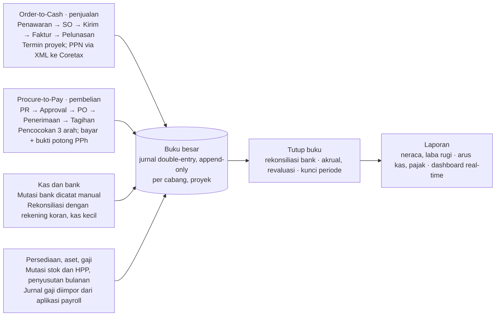
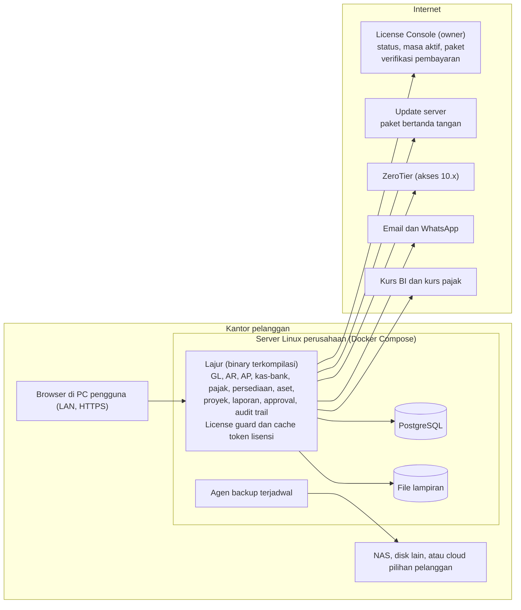
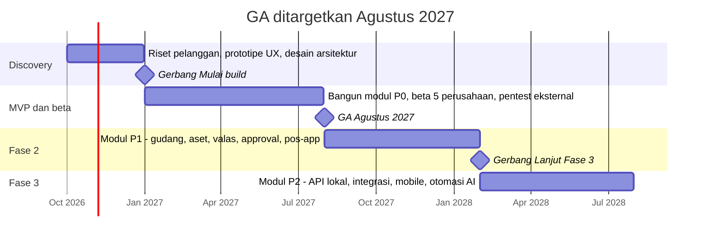

# PRD — Lajur: Aplikasi Keuangan & Akuntansi On-Premise untuk Perusahaan

12 Oktober 2026 · Salinan dari [dokumen PRD di Claude Docs](https://claude.ai/code/artifact/07e8b625-58b5-465c-a5c4-a0af4bfc143e)

## Ringkasan eksekutif

Lajur adalah aplikasi keuangan dan akuntansi untuk grup usaha dan perusahaan kecil-menengah di Indonesia yang dipasang di server Linux milik perusahaan (on-premise). Lisensinya berbasis masa aktif dan diverifikasi ke License Console milik kita, mengikuti model pos-app. Target rilis umum (GA) Agustus 2027.

**Masalah yang diselesaikan**

- Data keuangan tersebar di spreadsheet, aplikasi desktop, dan portal bank, sehingga tutup buku lambat dan rawan salah input.
- Kepatuhan pajak makin kompleks sejak Coretax DJP berlaku 2025: faktur pajak, bukti potong, dan tarif PPN baru harus tepat setiap masa.
- Aplikasi akuntansi sederhana tidak mendukung approval berjenjang, multi-cabang, dan audit trail yang dibutuhkan perusahaan yang sedang tumbuh.
- ERP besar terlalu mahal dan butuh implementasi berbulan-bulan bagi perusahaan menengah.
- Banyak perusahaan tidak mau data keuangannya disimpan di cloud pihak lain.

**Solusi**

Satu buku besar double-entry menjadi sumber kebenaran tunggal; setiap dokumen (faktur, tagihan, pembayaran, mutasi stok) otomatis memposting jurnal. Di atasnya dibangun rekonsiliasi bank yang cepat, data pajak siap impor ke Coretax, approval yang dapat dikonfigurasi, dan dashboard real-time. Data tetap di server pelanggan; yang keluar ke internet hanya pengecekan lisensi, pembaruan aplikasi, dan integrasi yang diaktifkan pelanggan.

**Nilai bagi pelanggan**

| Untuk | Nilai utama |
| --- | --- |
| Pemilik / direksi | Posisi kas, laba, dan piutang terkini per PT maupun konsolidasi grup, tanpa menunggu laporan akhir bulan |
| Tim keuangan | Tutup buku bulanan ≤ 3 hari kerja berkat jurnal otomatis dan rekonsiliasi |
| Tim pajak | Faktur pajak dan bukti potong siap impor ke Coretax, tarif mengikuti regulasi terbaru |
| Tim IT | Data tetap di server sendiri; dipasang langsung oleh tim kami, pembaruan cukup satu klik |
| Auditor | Jejak audit lengkap dari angka laporan sampai dokumen sumber |

## Tujuan, non-tujuan, dan metrik keberhasilan

Dalam 12 bulan setelah GA, produk menargetkan paling banyak 30 perusahaan dengan lisensi aktif, tingkat perpanjangan ≥ 90%, dan tutup buku pelanggan ≤ 3 hari kerja. Semua angka target di bawah adalah usulan awal dan perlu divalidasi saat discovery.

**Tujuan**

1. Bisnis: membangun pendapatan berulang dari perpanjangan lisensi di segmen grup usaha dan perusahaan menengah yang sudah PKP.
2. Produk: menjadikan buku besar selalu benar dan terkini, sehingga laporan tersedia kapan saja tanpa rekap manual.
3. Kepatuhan: setiap transaksi kena pajak menghasilkan data yang siap dilaporkan lewat Coretax tanpa input ulang.
4. Kontrol: setiap perubahan data keuangan tercatat, dapat ditelusuri, dan tunduk pada hak akses serta approval.
5. Lisensi: setiap instalasi hanya bisa bertransaksi dengan lisensi aktif dari License Console, tanpa menutup akses baca pelanggan ke datanya sendiri.

**Non-tujuan (di luar lingkup)**

- ERP manufaktur penuh (MRP, perencanaan produksi, shop floor).
- Menyimpan atau memindahkan dana pelanggan; produk bukan bank, dompet digital, atau penyedia pembayaran.
- HRIS dan payroll: gaji dihitung di aplikasi payroll milik pelanggan; Lajur hanya menerima jurnal gajinya.
- Integrasi langsung ke bank, payment gateway, atau Coretax: mutasi bank dicatat manual dan pajak dilaporkan dengan unggah XML manual.
- POS ritel; untuk retail cukup diintegrasikan dengan pos-app.
- Hosting data pelanggan di server kita; perangkat keras, jaringan, dan pelaksanaan backup menjadi tanggung jawab pelanggan.
- Jasa konsultasi pajak atau audit.

**Metrik keberhasilan (target 12 bulan pasca-GA)**

| Metrik | Definisi | Target |
| --- | --- | --- |
| Lisensi aktif | Instalasi berstatus ACTIVE atau WARNING | ≤ 30 |
| Pendapatan lisensi | Rata-rata pendapatan perpanjangan per bulan | Rp 25–30 juta |
| Aktivasi | Instalasi baru yang menerbitkan faktur pertama dalam 7 hari | ≥ 60% |
| Konversi trial | Lisensi trial 14 hari yang diperpanjang berbayar | ≥ 15% |
| Tingkat perpanjangan | Lisensi jatuh tempo yang diperpanjang ≤ 7 hari setelah expired | ≥ 90% |
| Waktu instalasi | Median waktu dari menjalankan skrip instal sampai setup wizard selesai | ≤ 1 jam |
| Waktu tutup buku | Median hari kerja dari akhir bulan sampai periode dikunci | ≤ 3 hari |
| Rekonsiliasi bank tepat waktu | Rekening bank yang selesai direkonsiliasi ≤ 5 hari kerja setelah akhir bulan | ≥ 90% |
| Adopsi versi terbaru | Instalasi aktif di versi terbaru ≤ 14 hari setelah rilis | ≥ 90% |
| Ketersediaan License Console | Uptime bulanan layanan verifikasi lisensi | ≥ 99,5% |
| NPS | Skor survei pengguna per kuartal | ≥ 40 |

## Target pasar dan persona

Segmen utama adalah perusahaan menengah berstatus PKP dengan 20–250 karyawan yang sudah melampaui aplikasi akuntansi sederhana; pelanggan saat ini bergerak di jasa, konstruksi, dan retail. Grup usaha (beberapa PT dalam satu kepemilikan) menjadi segmen prioritas nomor 1. Pesaing langsung di Indonesia antara lain Jurnal (Mekari), Accurate Online, Kledo, dan Zahir; diferensiasi kita ada pada kepatuhan Coretax, approval, multi-entitas, dan data yang tetap tersimpan di server perusahaan sendiri.

**Segmen pelanggan**

| Segmen | Ciri | Kebutuhan utama | Prioritas |
| --- | --- | --- | --- |
| Grup usaha | Beberapa PT dalam satu kepemilikan, bisa lintas jasa, konstruksi, dan retail | Banyak PT dalam satu instalasi, transaksi antar-perusahaan, laporan konsolidasi grup | Nomor 1 |
| Jasa | Konsultan, agensi, perawatan, dan jasa profesional lain; PKP | Faktur jasa dan kontrak berulang, PPh 23 dipotong pelanggan, laba per klien atau proyek | Utama |
| Konstruksi | Kontraktor dengan beberapa proyek berjalan | Biaya dan laba per proyek, termin progres, retensi, PPh final 4(2) jasa konstruksi | Utama |
| Retail | Toko atau jaringan toko, sebagian memakai pos-app | Persediaan dan HPP, rekap penjualan harian, PPN digunggung | Utama |

**Persona pengguna di sisi pelanggan**

| Persona | Hak akses | Yang dibutuhkan dari produk |
| --- | --- | --- |
| Pemilik | Semua modul dan laporan di semua PT | Dashboard kas dan laba per PT dan grup, approval dari ponsel |
| Manager | Semua akses, ditambah kontrol internal: approval, kunci dan buka periode, aturan approval, review audit trail | Checklist tutup buku per PT, laporan komparatif dan konsolidasi, antrean approval |
| Staf akuntansi | Melihat dan membuat transaksi di semua modul, termasuk menginput dan memposting jurnal penyesuaian; tidak bisa mengubah, menghapus, atau membatalkan (koreksi oleh Manager) | Entri cepat, rekonsiliasi bank cepat, drill-down ke dokumen |
| Auditor | Baca saja: memeriksa laporan dan transaksi | Audit trail, drill-down ke dokumen, ekspor data |
| Staf pajak | PPN, PPh, dan pelaporan bulanan | Ekspor XML Coretax, rekap SPT Masa, bukti potong |
| Admin pelanggan | Pengguna, peran, backup, dan persona kustom | Kelola pengguna dan persona kustom, backup terjadwal, status lisensi, pembaruan satu klik |

Di sisi kita hanya ada satu persona: owner aplikasi, yang memasang Lajur di lokasi pelanggan serta menerbitkan dan memperpanjang lisensi lewat License Console.

## Ruang lingkup dan prioritas modul

MVP (P0) berisi sebelas modul yang cukup bagi grup usaha dan perusahaan PKP di bidang jasa, konstruksi, dan retail untuk menjalankan siklus pembukuan bulanan dari faktur sampai laporan. Modul P1 menyusul setelah GA, P2 di fase berikutnya; prioritas tiap kebutuhan di bawah memakai skala yang sama.

| Modul | Cakupan inti | Prioritas |
| --- | --- | --- |
| Akuntansi inti (GL) | Bagan akun berkode 1–9, jurnal umum dan penyesuaian, neraca lajur, kunci periode | P0 · MVP |
| Penjualan & piutang | Faktur, termin proyek, pelunasan, nota kredit, umur piutang | P0 · MVP |
| Pembelian & utang | Tagihan, pembayaran, biaya langsung, umur utang | P0 · MVP |
| Kas & bank | Rekening, pencatatan mutasi manual, rekonsiliasi | P0 · MVP |
| Pajak | PPN, PPN digunggung, PPh potong-pungut, ekspor XML Coretax | P0 · MVP |
| Laporan & dashboard | Laporan keuangan utama, laba per proyek, dashboard kas | P0 · MVP |
| Proyek | Dimensi proyek, biaya dan laba per proyek, retensi | P0 · MVP |
| Persediaan dasar | Stok satu gudang, HPP rata-rata tertimbang, stock opname | P0 · MVP |
| Platform & instalasi | Paket instal Linux (Docker), setup wizard, peran, audit trail, backup, pembaruan | P0 · MVP |
| Lisensi & License Console | Masa aktif, verifikasi ke console, perpanjangan, pembayaran | P0 · MVP |
| Persediaan lanjutan | Multi-gudang atau multi-toko, FIFO, konversi satuan | P1 · Fase 2 |
| Integrasi pos-app | Penjualan harian toko masuk sebagai jurnal dan mutasi stok | P1 · Fase 2 |
| Aset tetap | Register aset, penyusutan komersial dan fiskal | P1 · Fase 2 |
| Approval berjenjang | Aturan approval per nominal dan jenis dokumen | P1 · Fase 2 |
| Multi-mata uang | Transaksi valas, kurs, revaluasi | P1 · Fase 2 |
| Anggaran | Anggaran vs realisasi per departemen dan proyek | P1 · Fase 2 |
| Reimbursement & impor gaji | Klaim biaya karyawan, kasbon, impor jurnal gaji | P1 · Fase 2 |
| Multi-entitas & konsolidasi | Banyak PT, intercompany, laporan grup | P0 · MVP |
| API lokal & integrasi | API, webhook, marketplace | P2 · Fase 3 |
| Aplikasi mobile | Approval, foto nota, dashboard (lewat ZeroTier) | P2 · Fase 3 |
| Otomasi AI | OCR nota, saran akun, asisten laporan | P2 · Fase 3 |

## Kebutuhan fungsional — Akuntansi inti

Buku besar double-entry adalah sumber kebenaran tunggal: setiap transaksi dari modul mana pun berakhir sebagai jurnal yang seimbang. Modul lain tidak boleh menyimpan saldo keuangan sendiri di luar buku besar.

| ID | Kebutuhan | Prioritas |
| --- | --- | --- |
| GL-01 | Bagan akun (CoA) bertingkat hingga 5 level dengan kode berkepala 1–9 (lihat tabel kelompok di bawah), ditambah template standar per industri (jasa, konstruksi, retail) | P0 · MVP |
| GL-02 | Jurnal umum manual multi-baris dengan memo, lampiran, dan validasi total debit = kredit | P0 · MVP |
| GL-03 | Jurnal otomatis dari setiap modul, tertaut ke dokumen sumbernya | P0 · MVP |
| GL-04 | Buku besar dan neraca saldo per periode, dengan drill-down sampai dokumen sumber | P0 · MVP |
| GL-05 | Tahun fiskal dan periode yang dapat dikonfigurasi; kunci periode per modul | P0 · MVP |
| GL-06 | Saldo awal dan impor migrasi dari Excel atau aplikasi akuntansi lain | P0 · MVP |
| GL-07 | Penomoran dokumen otomatis yang dapat dikustom per jenis dokumen dan cabang | P0 · MVP |
| GL-08 | Jurnal berulang dan jurnal pembalik otomatis untuk akrual | P0 · MVP |
| GL-09 | Dimensi analitik (cabang, departemen, proyek, pusat biaya) di setiap baris jurnal | P0 · MVP |
| GL-10 | Checklist tutup buku bulanan dan tutup tahun otomatis ke laba ditahan | P1 · Fase 2 |
| GL-11 | Jurnal penyesuaian: jenis jurnal tersendiri dengan nomor seri JP, bertanggal akhir periode, opsi balik otomatis di awal periode berikutnya, dan template penyesuaian berulang | P0 · MVP |
| GL-12 | Neraca lajur per periode: neraca saldo, penyesuaian, neraca saldo disesuaikan, laba rugi, dan neraca | P0 · MVP |

**Kelompok kode akun**

| Kepala | Kelompok | Saldo normal | Masuk ke |
| --- | --- | --- | --- |
| 1 | Aset (aktiva) | Debit | Neraca |
| 2 | Liabilitas (utang) | Kredit | Neraca |
| 3 | Ekuitas (modal) | Kredit | Neraca |
| 4 | Pendapatan usaha | Kredit | Laba rugi |
| 5 | Beban pokok (HPP, biaya proyek) | Debit | Laba rugi |
| 6 | Beban usaha | Debit | Laba rugi |
| 7 | Pendapatan lain-lain | Kredit | Laba rugi |
| 8 | Beban lain-lain | Debit | Laba rugi |
| 9 | Pajak penghasilan | Debit | Laba rugi |

Contoh struktur bertingkat: `1` Aset → `1-1000` Aset lancar → `1-1100` Kas dan bank → `1-1101` Kas kantor.

**Aturan bisnis**

- Jurnal yang sudah diposting tidak dapat dihapus. Jurnal manual (umum dan penyesuaian) boleh diubah oleh Staf akuntansi, Manager, dan Pemilik selama periodenya belum dikunci; nomor tetap, dan versi sebelumnya tersimpan di riwayat perubahan dan audit trail (revisi klien 16 Oktober 2026). Jurnal dari dokumen dan jurnal di periode terkunci tetap dikoreksi lewat void atau jurnal pembalik.
- Transaksi bertanggal di periode terkunci ditolak, kecuali oleh peran berizin “buka periode” dengan alasan tertulis.
- Nominal disimpan sebagai desimal presisi tetap (bukan floating point), dalam mata uang transaksi dan mata uang dasar.
- Struktur laporan mengikuti SAK Indonesia; template SAK EP untuk entitas privat tersedia sejak MVP.
- Angka kepala kode akun menentukan kelompok, saldo normal, dan letaknya di laporan; kode yang tidak cocok dengan kelompoknya ditolak. Akun berkepala 4–9 ditutup ke laba ditahan di akhir tahun.
- Semua PT dalam grup memakai struktur kode yang sama, sehingga pemetaan untuk konsolidasi hampir otomatis.
- Jurnal penyesuaian diinput dan diposting oleh Staf akuntansi; void tetap hanya oleh Manager atau Pemilik.
- Tutup buku dua tahap: setelah periode ditutup untuk transaksi, hanya jurnal penyesuaian yang boleh masuk sampai Manager mengunci periode secara final.

**Contoh kriteria penerimaan**

- Jurnal dengan selisih debit-kredit Rp 1 ditolak, dan pesan galat menyebut besar selisihnya.
- Void atas faktur yang sudah diposting membuat jurnal pembalik bertanggal void; saldo buku besar kembali seperti sebelum faktur.

## Kebutuhan fungsional — Penjualan dan piutang (AR)

Modul AR harus memungkinkan staf menerbitkan faktur ber-PPN dalam kurang dari 1 menit dan melacak setiap rupiah piutang sampai lunas. Setiap faktur memposting jurnal: debit piutang usaha, kredit pendapatan dan PPN keluaran.

| ID | Kebutuhan | Prioritas |
| --- | --- | --- |
| AR-01 | Data pelanggan: NPWP 16 digit atau NIK, NITKU, alamat, termin, limit kredit, kontak penagihan | P0 · MVP |
| AR-02 | Faktur penjualan dengan diskon per baris dan total, PPN, uang muka, termin, dan catatan | P0 · MVP |
| AR-03 | Kirim faktur via email dengan PDF bertemplate logo dan rekening perusahaan | P0 · MVP |
| AR-04 | Penerimaan pembayaran: parsial, satu pembayaran untuk banyak faktur, uang muka, serta PPh 23 atau PPh final 4(2) yang dipotong pelanggan | P0 · MVP |
| AR-05 | Nota kredit dan retur penjualan, dengan alokasi ke faktur asal | P0 · MVP |
| AR-06 | Laporan umur piutang dan kartu piutang per pelanggan | P0 · MVP |
| AR-07 | Alur penawaran → sales order → pengiriman (surat jalan) → faktur, dengan konversi satu klik | P1 · Fase 2 |
| AR-08 | Faktur termin berdasarkan persentase progres proyek, dengan potongan uang muka dan retensi (konstruksi) | P0 · MVP |
| AR-09 | Pengingat jatuh tempo otomatis via email dan WhatsApp | P1 · Fase 2 |
| AR-10 | Faktur berulang untuk kontrak dan langganan pelanggan | P1 · Fase 2 |
| AR-11 | Limit kredit dengan peringatan atau blokir transaksi baru | P1 · Fase 2 |
| AR-12 | Portal pelanggan untuk melihat riwayat dan membayar faktur | P2 · Fase 3 |

**Aturan bisnis**

- Faktur yang faktur pajaknya sudah disetujui Coretax tidak dapat diubah; perubahan lewat faktur pajak pengganti atau retur.
- Pelunasan dengan PPh 23 dipotong pelanggan menutup piutang penuh; potongannya dicatat sebagai PPh 23 dibayar di muka sampai bukti potong diterima.
- Uang muka pelanggan dicatat sebagai liabilitas sampai dialokasikan ke faktur.
- PPh final 4(2) jasa konstruksi yang dipotong pelanggan dicatat sebagai beban PPh final, bukan kredit pajak.
- Retensi dicatat sebagai piutang retensi terpisah dan baru ditagih setelah masa pemeliharaan selesai.

## Kebutuhan fungsional — Pembelian, biaya, dan utang (AP)

Modul AP mengendalikan pengeluaran sejak permintaan sampai pembayaran, sehingga tidak ada tagihan dibayar tanpa dasar yang sah. Setiap tagihan memposting jurnal: debit persediaan atau beban dan PPN masukan, kredit utang usaha dan PPh yang dipotong.

| ID | Kebutuhan | Prioritas |
| --- | --- | --- |
| AP-01 | Data pemasok: NPWP, status PKP, rekening bank, termin, kontak | P0 · MVP |
| AP-02 | Tagihan pemasok (bill) dengan PPN masukan, PPh 23 atau 4(2) yang dipotong, uang muka, dan lampiran | P0 · MVP |
| AP-03 | Pembayaran pemasok: parsial, banyak tagihan sekaligus, dan jadwal pembayaran | P0 · MVP |
| AP-04 | Pencatatan biaya langsung tanpa PO, dengan foto atau PDF nota | P0 · MVP |
| AP-05 | Nota debit dan retur pembelian | P0 · MVP |
| AP-06 | Laporan umur utang dan proyeksi kebutuhan kas untuk pembayaran | P0 · MVP |
| AP-07 | Alur permintaan pembelian (PR) → pesanan pembelian (PO) → penerimaan barang → tagihan | P1 · Fase 2 |
| AP-08 | Pencocokan tiga arah PO–penerimaan–tagihan dengan toleransi selisih yang dapat diatur | P1 · Fase 2 |
| AP-09 | Ekspor file transfer massal (bulk payment) sesuai format bank utama | P1 · Fase 2 |
| AP-10 | Approval PO dan pembayaran berdasarkan nominal dan departemen | P1 · Fase 2 |
| AP-11 | OCR tagihan dan nota: unggah PDF atau foto, sistem menyusun draf tagihan | P2 · Fase 3 |

**Aturan bisnis**

- Tagihan dengan PPh dipotong otomatis membuat draf bukti potong di modul pajak.
- Tagihan dengan pemasok dan nomor faktur pemasok yang sama ditandai sebagai kemungkinan duplikat sebelum disimpan.
- Pembayaran di atas batas nominal yang ditetapkan tidak dapat diproses sebelum disetujui.

## Kebutuhan fungsional — Kas, bank, dan rekonsiliasi

Semua transaksi bank dicatat manual; Lajur tidak terhubung ke bank maupun payment gateway. Fokusnya membuat rekonsiliasi dengan rekening koran cepat, dan selisih langsung terlihat sebelum periode dikunci.

| ID | Kebutuhan | Prioritas |
| --- | --- | --- |
| CB-01 | Akun kas dan bank multi-rekening, termasuk kas kecil (petty cash) per cabang atau proyek | P0 · MVP |
| CB-02 | Penerimaan, pengeluaran, dan transfer antar rekening | P0 · MVP |
| CB-03 | Pencatatan mutasi bank manual: biaya admin, bunga, pajak bunga, setoran, penarikan | P0 · MVP |
| CB-04 | Rekonsiliasi manual: centang transaksi sesuai rekening koran, isi saldo akhir, sistem menampilkan selisih | P0 · MVP |
| CB-05 | Laporan rekonsiliasi bank dan daftar transaksi yang belum tercocokkan | P0 · MVP |
| CB-06 | Impor mutasi dari file CSV atau Excel unduhan internet banking, dengan saran pencocokan (tanpa koneksi ke bank) | P1 · Fase 2 |
| CB-07 | Proyeksi arus kas 13 minggu dari piutang, utang, dan transaksi berulang | P1 · Fase 2 |
| CB-08 | Pengelolaan giro dan cek mundur beserta tanggal jatuh temponya | P2 · Fase 3 |

**Aturan bisnis**

- Mutasi yang sudah direkonsiliasi terkunci; membatalkan rekonsiliasi butuh izin khusus dan tercatat di audit trail.
- Rekonsiliasi suatu bulan hanya bisa ditutup bila saldo akhir di Lajur sama dengan saldo rekening koran.
- Impor file mutasi (CB-06) menolak baris duplikat berdasarkan rekening, tanggal, nominal, dan referensi bank.

## Kebutuhan fungsional — Persediaan dan aset tetap

MVP menyediakan persediaan dasar untuk pelanggan retail: stok satu gudang, HPP rata-rata tertimbang, dan stock opname. Multi-gudang dan aset tetap masuk Fase 2. Keduanya memposting jurnal otomatis, sehingga nilai persediaan dan aset di neraca selalu sama dengan subledger-nya.

**Persediaan**

| ID | Kebutuhan | Prioritas |
| --- | --- | --- |
| INV-01 | Master produk dan jasa: kode, nama, satuan, harga jual, akun pendapatan dan beban | P0 · MVP |
| INV-02 | Pelacakan stok multi-gudang dengan transfer antar gudang | P1 · Fase 2 |
| INV-03 | Penilaian persediaan rata-rata tertimbang dengan HPP otomatis saat penjualan (FIFO di Fase 2) | P0 · MVP |
| INV-04 | Penyesuaian stok dan stock opname, selisihnya dijurnal otomatis | P0 · MVP |
| INV-05 | Konversi satuan (misalnya dus ke pcs) dan harga jual bertingkat | P1 · Fase 2 |
| INV-06 | Stok minimum, titik pesan ulang, dan notifikasi; laporan kartu stok dan nilai persediaan | P1 · Fase 2 |
| INV-07 | Nomor seri, batch, dan tanggal kedaluwarsa | P2 · Fase 3 |
| INV-08 | Perakitan sederhana (bill of materials satu tingkat) | P2 · Fase 3 |

**Aset tetap**

| ID | Kebutuhan | Prioritas |
| --- | --- | --- |
| FA-01 | Register aset: kategori, tanggal perolehan, nilai, lokasi, penanggung jawab, lampiran | P1 · Fase 2 |
| FA-02 | Penyusutan bulanan otomatis (garis lurus, saldo menurun) dengan dua buku: komersial dan fiskal per kelompok harta PPh | P1 · Fase 2 |
| FA-03 | Penjualan, pelepasan, dan penghapusan aset dengan jurnal laba atau rugi | P1 · Fase 2 |
| FA-04 | Laporan selisih penyusutan komersial vs fiskal sebagai dasar koreksi fiskal | P2 · Fase 3 |

LIFO tidak disediakan karena tidak diperkenankan oleh SAK Indonesia maupun ketentuan pajak.

## Kebutuhan fungsional — Perpajakan Indonesia

Setiap transaksi kena pajak harus menghasilkan data yang siap diunggah ke Coretax DJP tanpa input ulang. Staf pajak mengunggah file XML secara manual; tidak ada integrasi langsung ke Coretax. Tarif dan aturan disimpan sebagai konfigurasi bertanggal berlaku, bukan ditanam di kode, karena regulasi berubah lebih cepat dari siklus rilis.

Acuan saat ini: PPN 12% dengan DPP nilai lain 11/12 untuk barang dan jasa non-mewah, sehingga efektif 11%; barang mewah memakai DPP penuh ([PMK 131/2024, penjelasan DJP](https://investortrust.id/macro/51960/djp-jelaskan-hitung-hitungan-barang-dan-jasa-nonmewah-terkena-ppn-11)). Impor massal ke Coretax memakai format XML; converter faktur keluaran terbaru v1.6 bertanggal 23 Januari 2026 ([template XML Coretax](https://www.pajak.go.id/reformdjp/coretax/template-xml-dan-converter-excel-ke-xml)).

| ID | Kebutuhan | Prioritas |
| --- | --- | --- |
| TAX-01 | Master kode pajak bertanggal berlaku: PPN (DPP nilai lain atau DPP penuh), PPnBM, PPh 22, 23, 4(2), 15, dan 26 | P0 · MVP |
| TAX-02 | Perhitungan PPN per faktur sesuai skema DPP; DPP, DPP nilai lain, dan PPN ditampilkan terpisah | P0 · MVP |
| TAX-03 | Ekspor faktur pajak keluaran ke XML untuk diunggah manual ke Coretax; nomor faktur yang terbit dicatat kembali lewat impor file unduhan Coretax atau input manual | P0 · MVP |
| TAX-04 | Kode transaksi faktur sesuai ketentuan Coretax, faktur pengganti, dan pembatalan | P0 · MVP |
| TAX-05 | Validasi NPWP 16 digit atau NIK, serta NITKU per cabang, untuk perusahaan, pelanggan, dan pemasok | P0 · MVP |
| TAX-06 | Rekap PPN keluaran vs masukan per masa: kurang bayar, lebih bayar, kompensasi | P0 · MVP |
| TAX-07 | Faktur pajak masukan: rekam, tandai dikreditkan atau tidak, cocokkan dengan data masukan di Coretax | P1 · Fase 2 |
| TAX-08 | Bukti potong PPh 23, 4(2), dan 26 (BPPU, BPNR) dari tagihan pemasok, diekspor ke XML Coretax | P1 · Fase 2 |
| TAX-09 | Data pendukung SPT Masa PPN dan SPT Masa PPh Unifikasi | P1 · Fase 2 |
| TAX-10 | Kurs pajak (KMK mingguan) untuk transaksi valas yang terutang PPN | P1 · Fase 2 |
| TAX-11 | Data pendukung SPT Tahunan Badan: koreksi fiskal, daftar penyusutan, biaya promosi dan entertainment | P2 · Fase 3 |
| TAX-12 | Rekap penjualan eceran untuk PPN digunggung (retail), diekspor ke format converter Coretax | P0 · MVP |

**Aturan bisnis**

- Perubahan tarif atau DPP cukup dengan menambah konfigurasi bertanggal berlaku; transaksi lama tetap memakai aturan pada tanggal transaksinya.
- Perusahaan non-PKP tidak dapat menerbitkan faktur pajak; fakturnya tanpa PPN.
- Faktur pajak yang sudah disetujui Coretax terkunci; koreksi hanya lewat penggantian atau pembatalan.
- Eksportir XML diberi versi dan diuji ulang setiap DJP merilis template atau converter baru.
- Tarif PPh final 4(2) jasa konstruksi berbeda menurut jenis pekerjaan dan sertifikat usaha ([PP 9/2022, DJP](https://pajak.go.id/id/artikel/penurunan-pajak-pada-usaha-jasa-konstruksi)), jadi tarif dipilih per kontrak proyek, bukan per pelanggan.

## Kebutuhan fungsional — Reimbursement dan impor gaji

Payroll tidak dibangun di Lajur karena pelanggan sudah memakai aplikasi payroll sendiri; Lajur cukup menerima jurnal gajinya. Reimbursement tetap ada karena langsung mengurangi entri manual di AP.

| ID | Kebutuhan | Prioritas |
| --- | --- | --- |
| EXP-01 | Karyawan mengajukan klaim biaya dengan foto nota, lengkap dengan kategori dan proyek | P1 · Fase 2 |
| EXP-02 | Approval atasan dan finance, lalu klaim dibayar lewat AP | P1 · Fase 2 |
| EXP-03 | Uang muka (kasbon) karyawan dan pertanggungjawabannya, dengan selisih dikembalikan atau dibayarkan | P1 · Fase 2 |
| EXP-04 | Impor jurnal gaji bulanan dari aplikasi payroll pelanggan (template Excel atau CSV), dirinci per departemen atau proyek | P1 · Fase 2 |

Sampai EXP-04 rilis, jurnal gaji dicatat lewat jurnal umum (GL-02).

## Kebutuhan fungsional — Anggaran, multi-mata uang, dan multi-entitas

Fitur ini membedakan produk dari aplikasi akuntansi untuk usaha kecil: perusahaan menengah perlu mengendalikan anggaran per departemen, bertransaksi dalam valas, dan mengelola banyak cabang atau PT. Model data mendukung semuanya sejak MVP, meskipun antarmukanya dirilis bertahap. Karena grup usaha menjadi segmen nomor 1, multi-entitas, transaksi antar-perusahaan, dan konsolidasi masuk MVP.

| ID | Kebutuhan | Prioritas |
| --- | --- | --- |
| BUD-01 | Anggaran tahunan per akun × departemen atau proyek, dengan versi (awal, revisi) dan rincian bulanan | P1 · Fase 2 |
| BUD-02 | Laporan anggaran vs realisasi dengan varians, plus peringatan saat realisasi mendekati batas | P1 · Fase 2 |
| BUD-03 | Profitabilitas proyek: pendapatan, biaya, dan margin per proyek | P0 · MVP |
| BUD-04 | Kontrol anggaran pada PR, PO, dan biaya: peringatan atau blokir bila melebihi sisa anggaran | P2 · Fase 3 |
| FX-01 | Transaksi valas dengan kurs harian (kurs tengah BI) atau kurs manual | P1 · Fase 2 |
| FX-02 | Selisih kurs terealisasi saat pelunasan dan revaluasi saldo valas akhir periode | P1 · Fase 2 |
| FX-03 | Rekening bank, pelanggan, dan pemasok dalam valas | P1 · Fase 2 |
| ME-01 | Multi-cabang dalam satu entitas: laporan, penomoran, dan hak akses per cabang | P1 · Fase 2 |
| ME-02 | Banyak PT dalam satu instalasi dan satu lisensi; berpindah entitas tanpa login ulang | P0 · MVP |
| ME-03 | Transaksi antar-perusahaan dengan jurnal cerminan otomatis di entitas lawan | P0 · MVP |
| ME-04 | Konsolidasi: pemetaan CoA antar entitas, eliminasi intercompany, laporan grup (translasi valas menyusul bersama modul valas di Fase 2) | P0 · MVP |

Kurs pajak (KMK) untuk PPN dikelola terpisah dari kurs akuntansi, lihat TAX-10.

## Kebutuhan fungsional — Laporan keuangan, dashboard, dan analitik

Semua laporan dihitung langsung dari buku besar, jadi angka yang sama muncul di setiap laporan dan bisa ditelusuri sampai dokumen sumber. Setiap laporan dapat difilter per periode, cabang, dan dimensi, lalu diekspor ke PDF, Excel, dan CSV.

| ID | Laporan atau fitur | Prioritas |
| --- | --- | --- |
| RPT-01 | Laporan posisi keuangan (neraca) dan laba rugi, komparatif antar bulan dan tahun, per entitas maupun konsolidasi grup | P0 · MVP |
| RPT-02 | Laporan arus kas (metode tidak langsung) | P0 · MVP |
| RPT-03 | Neraca saldo, neraca lajur, buku besar, dan daftar jurnal | P0 · MVP |
| RPT-04 | Umur piutang, umur utang, dan kartu pelanggan atau pemasok | P0 · MVP |
| RPT-05 | Penjualan per pelanggan dan produk; pembelian per pemasok | P0 · MVP |
| RPT-06 | Rekap pajak: PPN keluaran dan masukan, PPh dipotong dan dipungut | P0 · MVP |
| RPT-07 | Dashboard: saldo kas dan bank, piutang dan utang jatuh tempo, laba bulan berjalan vs bulan lalu | P0 · MVP |
| RPT-08 | Laporan perubahan ekuitas dan arus kas metode langsung | P1 · Fase 2 |
| RPT-09 | Rasio keuangan (rasio lancar, DSO, DPO, margin kotor) dan laporan anggaran vs realisasi | P1 · Fase 2 |
| RPT-10 | Laporan dwibahasa (Indonesia dan Inggris) dan pengiriman laporan terjadwal via email | P1 · Fase 2 |
| RPT-11 | Pembuat laporan kustom (pilih akun, kolom, dimensi) | P2 · Fase 3 |
| RPT-12 | Draf Catatan atas Laporan Keuangan (CaLK) dari template | P2 · Fase 3 |

Target performa: laporan standar tampil ≤ 5 detik untuk entitas dengan 1 juta baris jurnal (lihat kebutuhan non-fungsional).

## Kebutuhan per industri

Pelanggan saat ini bergerak di jasa, konstruksi, dan retail, jadi MVP harus melayani ketiganya sejak GA. Tabel ini memuat kebutuhan yang khas per industri; sisanya sudah tercakup di modul umum.

| Industri | ID | Kebutuhan | Prioritas |
| --- | --- | --- | --- |
| Konstruksi | IND-01 | Data proyek: nilai kontrak, RAB per pos biaya, pemberi kerja, tarif PPh final 4(2), status | P0 · MVP |
| Konstruksi | IND-02 | Biaya per proyek (material, upah, subkontraktor, alat) dari tagihan, pengeluaran kas, dan jurnal | P0 · MVP |
| Konstruksi | IND-03 | Laporan laba rugi per proyek dan biaya aktual vs RAB | P0 · MVP |
| Konstruksi | IND-04 | Pengakuan pendapatan sesuai persentase penyelesaian untuk proyek lintas periode | P1 · Fase 2 |
| Jasa | IND-05 | Laba per klien atau proyek dari faktur jasa dan biaya terkait | P0 · MVP |
| Jasa | IND-06 | Kontrak retainer dengan faktur bulanan otomatis (memakai AR-10) | P1 · Fase 2 |
| Retail | IND-07 | Impor rekap penjualan harian per toko (Excel atau CSV) menjadi satu jurnal dan mutasi stok | P0 · MVP |
| Retail | IND-08 | Integrasi pos-app: penjualan, retur, dan stok harian terkirim otomatis ke Lajur | P1 · Fase 2 |

Kebutuhan industri lain sudah ada di modulnya: termin dan retensi konstruksi di AR-08, PPh final 4(2) di TAX-01, PPN digunggung retail di TAX-12, dan persediaan dasar di INV-01, INV-03, serta INV-04.

## Platform, instalasi, dan pembaruan

Satu instalasi melayani satu perusahaan pelanggan dan berjalan di server Linux miliknya. Owner memasangnya sendiri di lokasi pelanggan dalam ≤ 1 jam sampai setup wizard selesai; pembaruan berikutnya cukup satu klik oleh admin pelanggan, tanpa kunjungan ulang.

| ID | Kebutuhan | Prioritas |
| --- | --- | --- |
| PLT-01 | Paket Docker Compose (aplikasi + PostgreSQL) untuk server Linux (Ubuntu 22.04+ atau Debian 12+), dipasang dengan satu perintah skrip instal; satu instalasi dapat berisi banyak entitas | P0 · MVP |
| PLT-02 | Setup wizard: Client ID, license key, URL License Console, tes koneksi, profil perusahaan, template CoA, admin pertama | P0 · MVP |
| PLT-03 | Akses lewat browser dari PC lain di jaringan kantor (LAN) dengan HTTPS dan sertifikat lokal | P0 · MVP |
| PLT-04 | Akun pengguna internal dengan kata sandi ter-hash dan 2FA (TOTP) | P0 · MVP |
| PLT-05 | Enam peran bawaan sesuai persona (Pemilik, Manager, Staf akuntansi, Staf pajak, Auditor, Admin pelanggan) dengan izin per modul, per PT, dan per aksi (lihat, buat, ubah, hapus, approve) | P0 · MVP |
| PLT-06 | Audit trail tak dapat diubah: siapa, kapan, aksi, nilai sebelum dan sesudah, alamat IP; disimpan ≥ 10 tahun | P0 · MVP |
| PLT-07 | Impor dan ekspor massal (Excel, CSV) untuk master data dan transaksi, dengan validasi per baris | P0 · MVP |
| PLT-08 | Lampiran dokumen (PDF, gambar) di setiap transaksi; notifikasi email lewat SMTP pelanggan | P0 · MVP |
| PLT-09 | Backup terjadwal ke disk lain, NAS, atau cloud pilihan pelanggan, dengan alat restore dan peringatan bila backup gagal | P0 · MVP |
| PLT-10 | Pembaruan satu klik dari update server: paket bertanda tangan, backup otomatis sebelum migrasi, rollback bila gagal | P0 · MVP |
| PLT-11 | Workflow approval berjenjang yang dapat dikonfigurasi per jenis dokumen, nominal, dan departemen | P1 · Fase 2 |
| PLT-12 | Persona kustom buatan Admin pelanggan, termasuk pembatasan akses per PT atau cabang | P0 · MVP |
| PLT-13 | Akses jarak jauh lewat ZeroTier (alamat 10.x): owner untuk dukungan dan pembaruan, pengguna pelanggan dari luar kantor; tanpa membuka port server ke internet | P1 · Fase 2 |
| PLT-14 | Notifikasi in-app dan WhatsApp untuk approval dan jatuh tempo | P1 · Fase 2 |
| PLT-15 | API lokal REST dan webhook dengan kunci API, rate limit, dan dokumentasi OpenAPI | P2 · Fase 3 |
| PLT-16 | Integrasi marketplace, e-commerce, HRIS atau payroll, dan alat BI | P2 · Fase 3 |
| PLT-17 | Login lewat Active Directory/LDAP; aplikasi mobile untuk approval dan foto nota | P2 · Fase 3 |
| PLT-18 | Asisten AI opsional: data hanya dikirim ke layanan AI bila pelanggan mengaktifkannya | P2 · Fase 3 |

Detail ZeroTier, yaitu paket berlangganan dan cara memisahkan jaringan antar pelanggan, dibahas terpisah setelah aplikasi deploy. Prinsip yang tetap dipegang: server pelanggan yang satu tidak boleh bisa menjangkau server pelanggan lain.

Retensi 10 tahun mengikuti kewajiban menyimpan buku dan dokumen dasar pembukuan dalam UU KUP. Karena data ada di server pelanggan, produk wajib menyediakan backup dan arsip, dan ekspor data tetap terbuka walau lisensi expired.

## Sistem lisensi dan License Console

Lisensi mengikuti model pos-app: setiap instalasi punya masa aktif yang diterbitkan dan diperpanjang dari License Console milik kita. Status dihitung oleh License Console, bukan oleh komputer pelanggan, sehingga tanggal expired tidak bisa diubah dari sisi pelanggan.

| ID | Kebutuhan | Prioritas |
| --- | --- | --- |
| LIC-01 | Data lisensi di License Console: clientId, produk, hash license key (SHA-256), status, expiresAt, timezone, durasi paket, installationId, versi terakhir, waktu check-in terakhir | P0 · MVP |
| LIC-02 | Aktivasi mengikat license key ke installationId (ID instalasi + machine-id host Linux); pindah server butuh reset dari console | P0 · MVP |
| LIC-03 | Server pelanggan check-in ke console tiap 1 jam lewat HTTPS; jawabannya token bertanda tangan (RSA-SHA256) yang diverifikasi aplikasi dengan kunci publik | P0 · MVP |
| LIC-04 | Status efektif ACTIVE, WARNING, EXPIRED, SUSPENDED, ditambah UNVERIFIED dan INVALID_KEY di sisi pelanggan | P0 · MVP |
| LIC-05 | License guard di setiap endpoint (mode write atau read); tes otomatis memastikan tidak ada endpoint mutasi tanpa guard | P0 · MVP |
| LIC-06 | Owner License Console: daftar client, filter (expired, ≤ 30 hari, suspended, tidak check-in ≥ 7 hari), perpanjang +1/3/6/12 bulan dengan preview, atur tanggal, suspend, reset key, audit log | P0 · MVP |
| LIC-07 | Pembayaran perpanjangan: admin pelanggan pilih paket, bayar (Lynk.id atau transfer), unggah bukti; owner menyetujui atau menolak | P0 · MVP |
| LIC-08 | Pengingat: email harian ke owner (H-14, H-7, H-3, H-1, expired, tidak check-in) dan banner di aplikasi | P0 · MVP |
| LIC-09 | Satu paket fitur untuk semua pelanggan; console hanya mengatur durasi (1, 3, 6, 12 bulan) dan harganya | P0 · MVP |
| LIC-10 | Versi minimum dari console (mis. setelah perubahan Coretax); versi di bawahnya masuk read-only sampai diperbarui | P1 · Fase 2 |
| LIC-11 | Memperluas License Console pos-app untuk aplikasi ini: kolom produk, paket per produk, dan penanda tangan token (RSA-SHA256), tanpa mengganggu client pos-app yang sudah berjalan | P0 · MVP |
| LIC-12 | Perpanjangan otomatis lewat payment gateway (VA, QRIS) dengan webhook, tanpa verifikasi bukti bayar manual | P2 · Fase 3 |

**Perilaku aplikasi per kondisi lisensi**

| Kondisi | Yang terjadi di aplikasi pelanggan |
| --- | --- |
| ACTIVE | Semua fitur |
| WARNING (sisa ≤ 7 hari) | Banner untuk admin; pengguna lain baru melihatnya mulai H-3 |
| EXPIRED | Transaksi dan perubahan data dikunci; admin tetap bisa melihat laporan, laporan pajak, dan mengekspor data |
| SUSPENDED atau INVALID_KEY | Semua menu dikunci, kecuali halaman status lisensi dan ekspor data oleh admin |
| License Console tidak terjangkau | Memakai token terakhir yang valid hingga 3 hari (72 jam), tidak pernah melewati expiresAt; setelah itu UNVERIFIED (read-only) |
| Jam server dimundurkan | Terdeteksi dari waktu server di token dan waktu transaksi terakhir; diperlakukan sebagai UNVERIFIED |

**Aturan**

- Perpanjangan dihitung dari max(hari ini, expiresAt) lalu ditambah durasi paket, sama seperti pos-app.
- Backend didistribusikan sebagai binary terkompilasi; pelanggan tidak menerima kode sumber.
- Kunci privat penanda tangan token tidak pernah keluar dari License Console; license key di server pelanggan disimpan terenkripsi.
- Ekspor data tidak pernah dikunci oleh lisensi, karena data milik pelanggan dan wajib disimpan 10 tahun.
- Karena server berada di tangan pelanggan, proteksi bersifat menyulitkan, bukan mustahil ditembus; perjanjian lisensi (EULA) melarang modifikasi aplikasi.

## Alur bisnis dan alur pengguna utama



Empat siklus transaksi memposting jurnal ke satu buku besar; laporan resmi baru terbit setelah tutup buku mengunci periode. Kontrol di semua alur: hak akses per peran, approval berjenjang, dan audit trail.

**Alur instalasi dan onboarding (target ≤ 1 jam sampai faktur pertama)**

1. Owner membuat client baru di License Console; license key ditampilkan sekali dan dibawa saat instalasi.
2. Owner datang ke lokasi pelanggan dan menjalankan skrip instal di server Linux kantor (Docker Compose).
3. Setup wizard: isi Client ID, license key, dan URL License Console, lalu jalankan tes koneksi.
4. Isi profil perusahaan (nama, NPWP, status PKP, NITKU, tahun fiskal) dan pilih template bagan akun.
5. Masukkan saldo awal atau impor dari Excel dan aplikasi lama (boleh dilewati), lalu atur jadwal backup.
6. Buat akun pengguna dan bagikan alamat aplikasi di jaringan kantor.
7. Buat pelanggan dan faktur pertama, lalu kirim via email.

## Kebutuhan non-fungsional

Karena aplikasi berjalan di server pelanggan, kita bertanggung jawab atas mutu perangkat lunak, keamanan, dan alat backup; perangkat keras, jaringan, dan pelaksanaan backup menjadi tanggung jawab pelanggan. Pembagian ini wajib tertulis di perjanjian lisensi.

| Kategori | Kebutuhan | Target |
| --- | --- | --- |
| Spesifikasi server | Minimum untuk ≤ 20 pengguna bersamaan | CPU 4 core, RAM 8 GB, SSD 100 GB; Ubuntu 22.04+ atau Debian 12+ dengan Docker |
| Ketersediaan | License Console dan update server milik kita | ≥ 99,5% per bulan |
| Toleransi offline | Aplikasi tetap berjalan saat License Console tidak terjangkau | 3 hari (72 jam), tidak pernah melewati expiresAt |
| Performa | Waktu respons API di jaringan kantor | p95 < 300 ms |
| Performa | Laporan standar untuk entitas dengan 1 juta baris jurnal, pada spesifikasi minimum | ≤ 5 detik |
| Skalabilitas | Kapasitas per instalasi | 50 pengguna bersamaan, 10 entitas |
| Keamanan | HTTPS di LAN dan ZeroTier dengan sertifikat lokal, kata sandi Argon2 atau bcrypt, kolom sensitif (rekening, NIK) dienkripsi | TLS 1.2+ |
| Keamanan | Standar pengembangan dan pengujian | OWASP ASVS level 2, pentest eksternal sebelum GA lalu tiap tahun |
| Integritas distribusi | Image container dan paket pembaruan ditandatangani dan diverifikasi sebelum dipasang | 100% paket bertanda tangan |
| Privasi | UU PDP No. 27/2022: data keuangan tetap di server pelanggan; License Console hanya menyimpan data lisensi dan kontak | Notifikasi insiden atas data yang kita kelola ≤ 3 × 24 jam |
| Backup | Backup otomatis terjadwal dan uji restore | Harian secara default, 30 salinan; peringatan bila gagal atau > 48 jam tidak berjalan |
| Pembaruan | Pembaruan regulasi (mis. Coretax) tersedia cepat; migrasi basis data otomatis dengan rollback | Rilis ≤ 5 hari kerja setelah perubahan, 0 kehilangan data |
| Retensi | Data transaksi, dokumen, dan audit trail, termasuk arsip tahun lama | ≥ 10 tahun |
| Integritas | Transaksi ACID, jurnal seimbang dijaga di basis data, idempotency key untuk pembayaran dan API | 0 jurnal tidak seimbang |
| Kegunaan | Responsif di desktop dan tablet, pintasan keyboard untuk entri cepat | WCAG 2.1 AA |
| Kompatibilitas | Peramban yang didukung | Dua versi terakhir Chrome, Edge, Safari, Firefox |

## Arsitektur teknis dan model data



Semua data keuangan tinggal di server pelanggan. Yang keluar ke internet hanya check-in lisensi tiap jam, unduhan pembaruan, dan integrasi yang diaktifkan pelanggan; port server tidak perlu dibuka ke internet karena akses jarak jauh lewat ZeroTier. Coretax dan bank tidak terhubung: file XML pajak dan mutasi bank diisi manual oleh staf.

**Usulan teknologi**

| Lapisan | Usulan | Alasan |
| --- | --- | --- |
| Frontend web | Next.js (React, TypeScript), di-build statis dan dilayani oleh backend | Server pelanggan tidak perlu Node.js |
| Backend | Go, satu binary terkompilasi | Ringan di server kecil, mudah dipasang, kode sumber tidak ikut terdistribusi |
| Basis data | PostgreSQL 16+ sebagai container dalam paket Docker Compose yang sama | ACID, tipe desimal presisi |
| Job latar | Worker di dalam binary yang sama, tanpa Redis | Lebih sedikit komponen yang harus dirawat pelanggan |
| Distribusi | Docker Compose untuk Ubuntu 22.04+ dan Debian 12+, dengan skrip instal satu perintah | Cara pasang dan update yang sama di semua pelanggan |
| Pembaruan | Image bertanda tangan dari update server, dipasang oleh komponen updater; migrasi basis data otomatis | Perubahan regulasi cepat sampai ke semua pelanggan |
| License Console | Owner License Service pos-app (Apps Script + Sheets), ditambah kolom produk dan token bertanda tangan RSA-SHA256 | Satu console untuk semua produk; kuota Apps Script perlu diuji sebelum GA |
| Mobile (Fase 3) | React Native atau Flutter, terhubung lewat ZeroTier | Satu kode untuk iOS dan Android |

**Prinsip model data**

- Satu instalasi untuk satu pelanggan; tabel bisnis memakai `company_id` untuk memisahkan entitas di dalamnya.
- Nominal disimpan sebagai `NUMERIC(19,4)`, tidak pernah floating point.
- Jurnal bersifat append-only: baris yang sudah diposting tidak pernah di-UPDATE. Satu-satunya pengecualian adalah revisi jurnal manual di periode terbuka, yang mengganti barisnya setelah menyimpan versi lama secara utuh; selain itu koreksi selalu berupa entri baru.
- Setiap jurnal menyimpan `source_type` dan `source_id` dokumen asalnya untuk drill-down.
- Tarif pajak dan kurs disimpan bertanggal berlaku (`valid_from`, `valid_to`).
- Sisi pelanggan hanya menyimpan token lisensi bertanda tangan terakhir; sumber kebenaran status lisensi ada di License Console.

Entitas inti: perusahaan, cabang, pengguna, peran, akun, jurnal, baris jurnal, kontak, produk, gudang, mutasi stok, faktur penjualan, tagihan pembelian, pembayaran, transaksi bank, kode pajak, faktur pajak, aset tetap, anggaran, log audit, token lisensi, dan riwayat backup.

```sql
CREATE TABLE journal_entries (
  id           UUID PRIMARY KEY,
  company_id   UUID NOT NULL,
  entry_date   DATE NOT NULL,
  source_type  TEXT NOT NULL,          -- invoice, bill, payment, manual, ...
  source_id    UUID,
  status       TEXT NOT NULL,          -- draft, posted, reversed
  reversal_of  UUID REFERENCES journal_entries(id),
  created_by   UUID NOT NULL,
  created_at   TIMESTAMPTZ NOT NULL DEFAULT now()
);

CREATE TABLE journal_lines (
  id            UUID PRIMARY KEY,
  entry_id      UUID NOT NULL REFERENCES journal_entries(id),
  account_id    UUID NOT NULL,
  debit         NUMERIC(19,4) NOT NULL DEFAULT 0,
  credit        NUMERIC(19,4) NOT NULL DEFAULT 0,
  currency      CHAR(3) NOT NULL,
  fx_rate       NUMERIC(19,8) NOT NULL DEFAULT 1,
  branch_id     UUID,
  department_id UUID,
  project_id    UUID,
  CHECK (debit >= 0 AND credit >= 0 AND (debit = 0 OR credit = 0))
);
-- Keseimbangan SUM(debit) = SUM(credit) per entry dijaga dengan constraint trigger DEFERRABLE.
```

## Model bisnis dan harga lisensi

Hanya ada satu paket: setiap pelanggan mendapat semua fitur dan semua modul yang sudah dirilis, yang berbeda hanya durasi lisensinya. Harga di bawah adalah usulan awal yang perlu diuji ke calon pelanggan saat discovery.

| Durasi lisensi | Harga | Setara per bulan | Hemat |
| --- | --- | --- | --- |
| 1 bulan | Rp 1.000.000 | Rp 1.000.000 | 0% |
| 3 bulan | Rp 2.850.000 | Rp 950.000 | 5% |
| 6 bulan | Rp 5.400.000 | Rp 900.000 | 10% |
| 12 bulan | Rp 10.000.000 | Rp 833.333 | ± 17% |

**Kebijakan**

- Biaya implementasi sekali bayar mulai Rp 2.500.000: instalasi oleh owner di lokasi pelanggan, migrasi saldo awal, dan pelatihan.
- Satu lisensi untuk satu instalasi, termasuk semua PT dalam grup; jumlah pengguna dan entitas tidak dibatasi selain batas teknis (50 pengguna bersamaan, 10 entitas).
- Pembaruan aplikasi dan dukungan termasuk selama lisensi aktif; saat expired, pembaruan berhenti dan transaksi terkunci, tetapi data tetap bisa dibaca dan diekspor.
- Modul P1 dan P2 masuk lewat pembaruan tanpa biaya tambahan.
- Trial 14 hari: lisensi trial diterbitkan dari License Console tanpa pembayaran.

## Roadmap rilis



| Gerbang | Kriteria |
| --- | --- |
| Mulai build | Desain divalidasi oleh 10 calon pelanggan |
| GA · Agustus 2027 | 0 bug kritis terbuka; tutup buku beta sukses |
| Lanjut Fase 3 | 15 lisensi berbayar; perpanjangan ≥ 90% |

Isi tiap fase mengikuti kolom Prioritas di tabel kebutuhan (P0 = MVP, P1 = Fase 2, P2 = Fase 3). Fase berikutnya baru dimulai setelah kriteria gerbangnya terpenuhi dan disetujui tim produk serta pimpinan.

**Tim pengembang (5–7 orang)**

| Peran | Jumlah | Fokus |
| --- | --- | --- |
| Owner / product owner | 1 | Prioritas, License Console, instalasi di lokasi pelanggan |
| Backend (Go) | 2 | Buku besar, modul transaksi, pajak, lisensi |
| Frontend | 1–2 | Antarmuka web dan laporan |
| QA berlatar akuntansi | 1 | Uji skenario akuntansi dan pajak per industri |
| DevOps / tech lead | 0–1 | Paket Docker, updater, CI; bisa dirangkap backend senior |

Owner merangkap pemasang, jadi jadwal instalasi pelanggan beta (Juni–Juli 2027) perlu dikunci sejak awal.

## Risiko, asumsi, dan pertanyaan terbuka

Risiko terbesar tetap kesalahan angka akuntansi atau pajak, karena satu kesalahan merusak kepercayaan lebih cepat daripada fitur yang kurang. Model on-premise menambah dua risiko baru: lisensi dibobol di server pelanggan, dan data hilang karena backup pelanggan tidak berjalan.

| Risiko | Dampak | Mitigasi |
| --- | --- | --- |
| Kesalahan perhitungan jurnal, HPP, atau pajak | Laporan salah, pelanggan kena sanksi pajak | Uji skenario akuntansi otomatis, invariant debit = kredit di basis data, review oleh akuntan bersertifikat |
| Perubahan regulasi atau template Coretax | Pelanggan yang belum update salah lapor | Konfigurasi pajak bertanggal berlaku, rilis ≤ 5 hari kerja, versi minimum dari License Console (LIC-10) |
| Lisensi dibobol di server pelanggan (kode diubah, jam dimundurkan, koneksi diblokir) | Kehilangan pendapatan | Binary terkompilasi, token bertanda tangan, deteksi jam mundur, batas offline 3 hari, EULA |
| Server pelanggan rusak tanpa backup | Data keuangan hilang, reputasi produk ikut rusak | Backup terjadwal aktif sejak setup, peringatan backup gagal, panduan dan uji restore |
| Ragam spesifikasi server dan distribusi Linux pelanggan | Biaya dukungan tinggi | Spesifikasi minimum, dukungan resmi hanya Ubuntu dan Debian dengan Docker, alat diagnosis bawaan |
| Jaringan ZeroTier salah konfigurasi sehingga server antar pelanggan saling terlihat | Kebocoran data antar pelanggan | Satu jaringan per pelanggan atau flow rules; hanya perangkat owner yang menjangkau semua server; audit anggota jaringan berkala |
| Semua instalasi dilakukan sendiri oleh owner | Waktu owner tersita; ≤ 30 instalasi per tahun (± 2–3 per bulan) masih terkelola | Skrip instal teruji; dukungan dan pembaruan lewat ZeroTier tanpa kunjungan ulang |
| Lingkup MVP bertambah (multi-entitas dan konsolidasi, proyek, persediaan, termin konstruksi) dengan tim 5–7 orang | GA Agustus 2027 terlambat | Gerbang lingkup; kandidat pertama yang digeser ke P1 adalah biaya vs RAB (IND-03) dan stock opname (INV-04) |
| Pendapatan ≤ 30 lisensi (± Rp 300–360 juta per tahun) belum tentu menutup biaya tim 5–7 orang | Produk belum mandiri secara finansial di tahun pertama | Hitung titik impas sebelum build; pertimbangkan harga atau biaya implementasi lebih tinggi, atau tim inti lebih kecil setelah MVP |
| Kuota Apps Script untuk License Console | Rendah pada ≤ 30 client (± 720 check-in per hari); naik bila pelanggan bertambah | Uji beban sebelum GA; pindahkan license service ke server sendiri bila perlu |
| Verifikasi bukti bayar manual | Masih ringan pada ≤ 30 client; menjadi beban bila pelanggan bertambah | Perpanjangan otomatis lewat payment gateway (LIC-12) |
| Persaingan dengan pemain lokal yang mapan | Biaya akuisisi tinggi | Fokus pada perusahaan PKP di jasa, konstruksi, dan retail yang ingin data di server sendiri |

**Asumsi**

- Pelanggan utama sudah PKP, bergerak di jasa, konstruksi, atau retail, dan melaporkan pajak melalui Coretax.
- Pelanggan punya server Linux yang menyala selama jam kerja, plus koneksi internet untuk lisensi dan pembaruan.
- Entri data dilakukan di peramban desktop dalam jaringan kantor; akses dari luar kantor lewat ZeroTier.
- Owner License Service pos-app dapat diperluas untuk produk ini tanpa mengganggu client pos-app yang sudah berjalan.
- Tim 5–7 orang cukup untuk membangun MVP dalam lima bulan (Januari–Mei 2027).

**Keputusan**

| Tanggal | Keputusan |
| --- | --- |
| 12 Okt 2026 | Kode akun berkepala 1–9: aset, liabilitas, ekuitas, pendapatan usaha, beban pokok, beban usaha, pendapatan lain-lain, beban lain-lain, pajak penghasilan |
| 12 Okt 2026 | Jurnal penyesuaian diinput dan diposting oleh Staf akuntansi |
| 12 Okt 2026 | Persona di sisi pelanggan: Pemilik, Manager, Staf akuntansi, Auditor, Staf pajak, Admin pelanggan |
| 12 Okt 2026 | Satu lisensi berlaku untuk seluruh PT dalam grup, karena memakai satu aplikasi |
| 12 Okt 2026 | Grup usaha menjadi segmen prioritas nomor 1; multi-entitas, transaksi antar-perusahaan, dan konsolidasi masuk MVP |
| 12 Okt 2026 | Akses jarak jauh ke server pelanggan lewat ZeroTier (alamat 10.x); detail dibahas terpisah setelah aplikasi deploy |
| 12 Okt 2026 | Target saat ini paling banyak 30 lisensi dalam 12 bulan setelah GA |
| 12 Okt 2026 | Nama produk: Lajur (nama kerja; merek dan domain belum dicek) |
| 12 Okt 2026 | Payroll tidak dibangun; jurnal gaji diimpor dari aplikasi payroll pelanggan |
| 12 Okt 2026 | Pajak dilaporkan dengan unggah XML manual ke Coretax, tanpa integrasi host-to-host |
| 12 Okt 2026 | Transaksi bank dicatat manual, tanpa integrasi bank atau payment gateway |
| 12 Okt 2026 | Satu paket harga untuk semua fitur; yang berbeda hanya durasi lisensi |
| 12 Okt 2026 | Industri sasaran awal: jasa, konstruksi, dan retail |
| 12 Okt 2026 | Tim pengembang 5–7 orang |
| 12 Okt 2026 | Instalasi di lokasi pelanggan dilakukan sendiri oleh owner |
| 12 Okt 2026 | Model on-premise dengan lisensi berjangka; status lisensi diverifikasi ke License Console |
| 12 Okt 2026 | Server pelanggan memakai Linux (Ubuntu atau Debian dengan Docker) |
| 12 Okt 2026 | Aplikasi boleh berjalan tanpa terhubung ke License Console paling lama 3 hari |
| 12 Okt 2026 | License Console pos-app diperluas, bukan dibuat baru |

**Pertanyaan terbuka**

- [ ] Apakah nama “Lajur” bebas dipakai (cek merek di PDKI dan ketersediaan domain)?
- [ ] Berapa titik impas Lajur dengan ≤ 30 lisensi, dan perlukah harga atau biaya implementasi dinaikkan?
- [ ] Untuk pelanggan retail yang belum memakai pos-app, cukupkah impor rekap penjualan harian (IND-07)?
- [ ] Lingkup MVP sebelas modul: mundurkan GA, atau pindahkan persediaan dasar dan biaya vs RAB ke Fase 2?

## Sumber

- [Penjelasan DJP atas PMK 131/2024 (PPN 12%, DPP nilai lain 11/12)](https://investortrust.id/macro/51960/djp-jelaskan-hitung-hitungan-barang-dan-jasa-nonmewah-terkena-ppn-11) — Investortrust, 2 Januari 2025
- [Template XML dan converter Excel ke XML Coretax](https://www.pajak.go.id/reformdjp/coretax/template-xml-dan-converter-excel-ke-xml) — DJP
- [Penurunan Pajak pada Usaha Jasa Konstruksi (PP 9/2022)](https://pajak.go.id/id/artikel/penurunan-pajak-pada-usaha-jasa-konstruksi) — DJP
