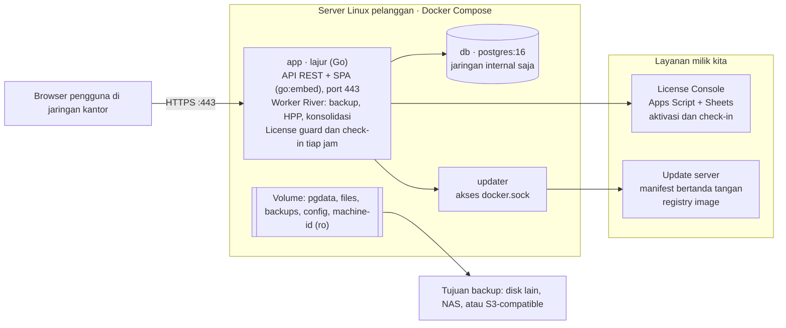
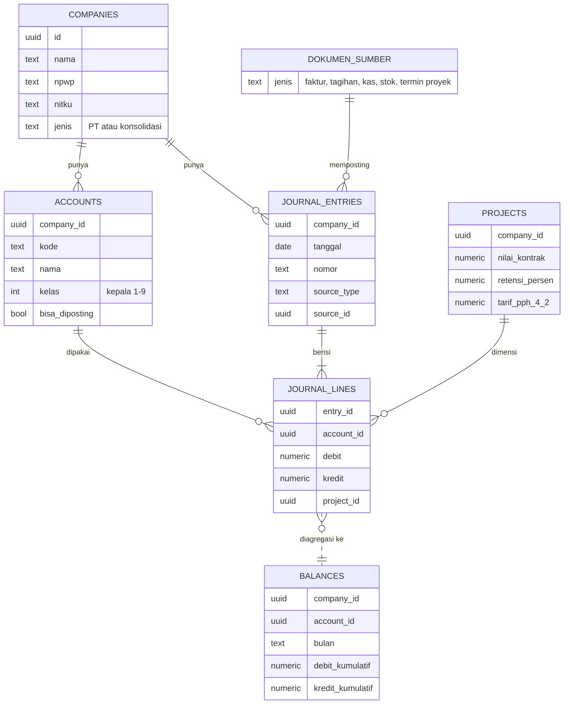
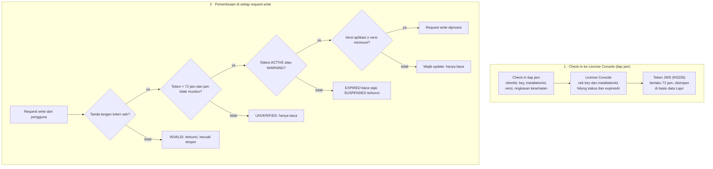
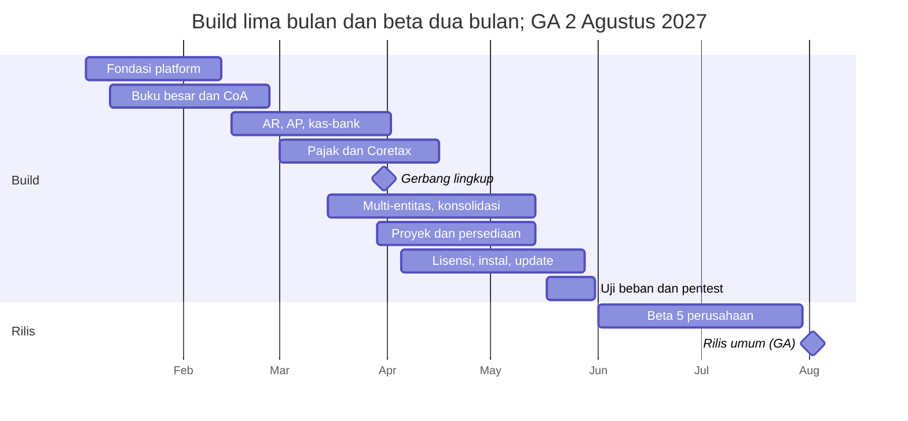

# TDD — Lajur: Desain Teknis Aplikasi Keuangan On-Premise

12 Oktober 2026 · Salinan dari [dokumen TDD di Claude Docs](https://claude.ai/code/artifact/7c231845-b8e7-479f-8f3d-1722cf7da513) · Kebutuhan produk: [PRD.md](PRD.md)

Lajur dibangun sebagai satu binary Go dengan PostgreSQL, dikemas Docker Compose untuk server Linux pelanggan. Desain ini mencakup seluruh kebutuhan P0 di PRD.

## Ringkasan

TDD ini menetapkan cara membangun MVP Lajur, yaitu semua kebutuhan P0 di PRD, oleh tim 5–7 orang dalam lima bulan (Januari–Mei 2027). ID kebutuhan PRD (GL-xx, AR-xx, LIC-xx, dan seterusnya) dirujuk langsung di bagian yang relevan.

**Lingkup teknis MVP**

- Satu instalasi Lajur per grup usaha: banyak PT dalam satu aplikasi, satu basis data, dan satu lisensi.
- Modul: akuntansi inti, penjualan, pembelian, kas-bank manual, pajak dengan ekspor XML Coretax, laporan, proyek, persediaan dasar, multi-entitas dan konsolidasi, platform, serta lisensi.
- Komponen di luar server pelanggan: perluasan License Console pos-app dan update server.

**Di luar lingkup dokumen ini**

- Rincian modul P1 dan P2; desain hanya memastikan modul itu bisa ditambahkan tanpa membongkar yang sudah ada.
- Konfigurasi ZeroTier, yang dibahas setelah aplikasi deploy.
- Desain UI per layar, yang dibuat sebagai prototipe di fase Discovery.

## Keputusan teknis utama

Semua pilihan di bawah mengejar dua hal: satu artefak yang mudah dipasang di server pelanggan, dan angka akuntansi yang tidak mungkin salah karena teknologi. Satu keputusan menyimpang dari PRD: frontend memakai Vite, bukan Next.js, karena aplikasi tidak butuh server-side rendering.

| Area | Keputusan | Alasan |
| --- | --- | --- |
| Backend | Go 1.23+, satu binary | Ringan, mudah didistribusikan, kode sumber tidak ikut terkirim |
| Arsitektur | Modular monolith; antar modul lewat interface Go, bukan HTTP | Tim kecil; faktur, jurnal, dan stok cukup diproses dalam satu transaksi basis data |
| Router HTTP | chi | Ringan dan kompatibel dengan net/http standar |
| Akses data | sqlc + pgx: SQL ditulis eksplisit, kode Go dihasilkan otomatis | Query akuntansi yang rumit lebih jelas sebagai SQL, tetap aman tipe |
| Migrasi | goose, file SQL berversi, dijalankan saat aplikasi start | Updater bisa memigrasi tanpa campur tangan manusia |
| Antrean job | River, antrean job di atas PostgreSQL | Tanpa Redis; job dibuat dalam transaksi yang sama dengan datanya |
| Angka uang | `NUMERIC(19,4)` di basis data, `shopspring/decimal` di Go | Tidak ada floating point di mana pun |
| ID | UUIDv7 yang dibuat di Go | Urut waktu, aman digabung antar PT, tidak membocorkan jumlah data |
| Frontend | React + TypeScript + Vite (SPA), disisipkan ke binary lewat `go:embed` | Satu artefak; server pelanggan tidak perlu Node.js |
| Komponen UI | shadcn/ui, TanStack Query dan Table, react-hook-form + zod, Motion untuk animasi | Tabel dan formulir akuntansi yang padat; animasi halus yang mudah dimatikan |
| Kontrak API | OpenAPI 3.1 sebagai sumber; klien TypeScript dihasilkan otomatis | Frontend dan backend tidak pernah berselisih bentuk data |
| Ekspor | XLSX dengan excelize, PDF dengan maroto | Pustaka Go murni, tanpa Chromium di server |
| Distribusi | Docker Compose berisi app, postgres:16, dan updater | Satu cara pasang di Ubuntu dan Debian |
| Lisensi | Token JWS (RS256) yang ditandatangani License Console | Bisa diverifikasi offline dengan kunci publik; Apps Script mendukung tanda tangan RSA-SHA256 |

## Arsitektur deployment



Container `app` memuat seluruh aplikasi: API, frontend, worker job, dan license guard. `db` hanya bisa dijangkau dari dalam jaringan Docker, sedangkan `updater` terpisah karena butuh hak atas Docker.

Koneksi keluar dari server pelanggan hanya ada empat: check-in lisensi tiap jam, unduhan pembaruan saat admin menekan tombol, email lewat SMTP pelanggan, dan tujuan backup. Coretax dan bank tidak terhubung, sesuai PRD.

## Struktur kode

Semua kode ada di satu monorepo, dan setiap modul bisnis memiliki skema PostgreSQL sendiri. Batas modul dijaga oleh compiler Go dan linter di CI, bukan sekadar kesepakatan tim.

```text
lajur/
├── cmd/lajur/            # perintah: serve, migrate, backup, restore, diag
├── internal/
│   ├── platform/         # db, http, auth, rbac, audit, jobs, license, config, tls
│   ├── ledger/           # mesin buku besar: posting, saldo, periode, penomoran
│   └── modules/
│       ├── core/         # perusahaan, cabang, pengguna, kontak
│       ├── sales/        # AR: faktur, termin, pelunasan, nota kredit
│       ├── purchase/     # AP: tagihan, pembayaran, biaya
│       ├── cash/         # kas, bank, rekonsiliasi
│       ├── inventory/    # produk dan jasa, stok, HPP rata-rata, stock opname
│       ├── project/      # proyek, RAB, laba per proyek, termin dan retensi
│       ├── tax/          # kode pajak, PPN, PPh, ekspor Coretax
│       ├── consol/       # intercompany dan konsolidasi
│       └── report/       # laporan keuangan, arus kas, ringkasan, dashboard, ekspor
├── migrations/           # file SQL goose, dikelompokkan per modul
├── api/openapi.yaml      # kontrak API
├── web/                  # React + Vite
├── deploy/               # docker-compose.yml, install.sh, updater
└── test/                 # skenario akuntansi, E2E Playwright
```

**Aturan antar modul**

1. Setiap modul hanya mengekspos satu interface `Service`; isi lainnya ada di folder `internal/` milik modul itu, sehingga modul lain tidak bisa mengimpornya.
2. Hanya paket `ledger` yang boleh menulis ke tabel jurnal; modul lain memanggil `ledger.Post` di dalam transaksi yang sedang berjalan.
3. Modul tidak membaca tabel modul lain secara langsung. Pengecualian: modul `report` membaca tabel `ledger` dalam mode baca saja.
4. Arah dependensi selalu modul → `ledger` → `platform`, tidak pernah sebaliknya; dicek otomatis dengan go-arch-lint di CI.
5. Satu request HTTP = satu transaksi basis data. Transaksi dibuka di handler dan diteruskan lewat `context` ke semua service yang terlibat.

## Model data



Baris jurnal adalah satu-satunya sumber angka; saldo hanya agregat darinya. Tabel `consol.ic_links` (tidak digambar) menghubungkan dua dokumen cerminan antar-PT (faktur ↔ tagihan).

**Konvensi skema**

- Satu skema PostgreSQL per modul: `core`, `ledger`, `sales`, `purchase`, `cash`, `inventory`, `project`, `tax`, `consol`, `platform`.
- Setiap tabel bisnis punya `id` (UUIDv7), `company_id`, `created_at`, `created_by`, dan `version` untuk optimistic locking; dokumen juga punya `status` dan `posted_at`.
- Nominal `NUMERIC(19,4)`, kuantitas `NUMERIC(19,6)`, kurs `NUMERIC(19,8)`.
- Tanggal transaksi bertipe `DATE`; waktu sistem bertipe `TIMESTAMPTZ`.
- Foreign key komposit `(company_id, id)` mencegah data satu PT mengacu ke data PT lain.
- Data bisnis tidak pernah dihapus fisik; data master dinonaktifkan dengan `active = false`.

## Mesin buku besar

Semua angka di Lajur lewat satu fungsi, `ledger.Post`. Fungsi ini memvalidasi, memberi nomor, menulis jurnal, dan memperbarui saldo dalam satu transaksi, sehingga jurnal yang tidak seimbang tidak mungkin tersimpan (GL-02, GL-03).

**Alur posting**

1. Modul menyusun `EntryDraft`: PT, tanggal, dokumen sumber, serta baris debit dan kredit lengkap dengan dimensi (cabang, departemen, proyek).
2. `ledger.Post` memeriksa total debit = kredit, akun aktif dan bukan akun induk, periode masih terbuka untuk modul itu, dan dimensi wajib terisi (mis. proyek untuk akun biaya proyek).
3. Nomor dokumen diambil dari `ledger.sequences` dengan `SELECT … FOR UPDATE`, sehingga nomor tanpa celah per PT, jenis dokumen, cabang, dan tahun (GL-07).
4. `journal_entries` dan `journal_lines` disimpan; constraint trigger `DEFERRABLE` memastikan Σ debit = Σ kredit saat commit.
5. `ledger.balances` (saldo per PT × akun × bulan × jenis jurnal) diperbarui oleh trigger pada `journal_lines`, sehingga tidak mungkin terlupa. Baris berproyek juga mengisi `ledger.project_balances` (PT × proyek × akun × bulan) lewat trigger yang sama. Dimensi cabang ditambahkan bersama modul yang memakainya.
6. Audit log dan job lanjutan (River) ditulis di transaksi yang sama.

**Invariant yang dijaga basis data, bukan hanya aplikasi**

- Σ debit = Σ kredit per jurnal, dicek trigger saat commit.
- Baris jurnal tidak bisa diubah atau dihapus: trigger `guard_line` menolak `UPDATE` dan `DELETE`, kecuali `DELETE` untuk jurnal yang sedang direvisi (lihat Revisi jurnal manual).
- Setiap baris jurnal ber-`company_id` sama dengan jurnalnya, dijaga foreign key komposit.
- Saldo di `balances` selalu sama dengan jumlah baris jurnal; job harian mencocokkannya dan memberi alert bila berbeda.

**Koreksi dan kunci periode**

- Dokumen yang sudah diposting tidak pernah diedit. Koreksi = void (jurnal pembalik bertanggal void, kolom `reversal_of`) lalu dokumen baru; hanya Manager dan Pemilik yang boleh void. Pengecualian: jurnal manual di periode yang belum dikunci boleh direvisi (lihat Revisi jurnal manual).
- `ledger.periods` menyimpan status buka/tutup per PT dan bulan (GL-05); kunci per modul ditambahkan bersama modul penjualan, pembelian, dan persediaan. Posting ke periode tertutup ditolak, kecuali Manager membukanya dengan alasan yang tercatat di audit log. Baris periode dikunci `FOR SHARE` saat posting, sehingga periode tidak bisa ditutup di tengah posting yang sedang berjalan.

**Kode akun dan jurnal penyesuaian (GL-01, GL-08, GL-11, GL-12)**

- Kode akun divalidasi saat dibuat: angka kepala 1–9 menentukan `class`, dan dari kelas itu diturunkan saldo normal, letak di laporan, serta apakah akun ditutup ke laba ditahan di akhir tahun.
- Kode akun bisa dikoreksi (salah ketik) selama angka kepalanya sama, sehingga kelas dan letaknya di laporan tetap; baris jurnal menunjuk akun lewat id, jadi riwayatnya ikut memakai kode baru. Akun kelompok tidak bisa diganti kodenya. Akun sistem (peran di `roles.go`) dicari lewat kode bawaannya sampai kodenya diganti: saat itu perannya dikunci ke akunnya di `ledger.role_accounts` (migrasi 00025), sehingga PT dengan skema kode sendiri tetap memposting otomatis ke akun yang sama, dan akun baru yang kebetulan memakai kode bawaan tidak mengambil alih perannya. PT yang menyusun bagan akun sendiri (template kosong, tanpa kode bawaan) memilih akun tiap peran di halaman Bagan akun → Akun sistem (`/api/v1/ledger/system-accounts`): akunnya harus akun detail aktif dari kelas yang sesuai (neraca sekelas dengan kode bawaan; pendapatan 4/7; beban 5/6/8/9), dan akun lama yang masih bersaldo tidak bisa ditinggalkan supaya dokumen yang masih terbuka tetap dilunasi di akun yang sama. PPN keluaran bisa dipisah per jenis faktur pajak: peran PPN keluaran dipungut pemungut (02/03), DPP nilai lain (04), dan digunggung memakai akun PPN keluaran sampai dipilih sendiri (fallback). Pelanggan pemungut PPN (WAPU) ditandai di kontak (`vat_collector`, migrasi 00026); faktur menyimpan status pemungut dan akun PPN-nya saat diposting, pelunasan mencatat PPN dipungut (debit akun PPN faktur itu, kredit piutang, tanpa uang masuk), dan rekap PPN mengeluarkan PPN faktur berkode 02/03 dari kurang bayar (kode yang diubah staf pajak di modul pajak ikut dihitung). Trigger `ledger.guard_account` (migrasi 00023/00024/00027) tetap mengunci kelas dan jenis akun. Akun yang salah dibuat dan belum pernah dipakai boleh dihapus (revisi klien 21 Oktober 2026): trigger menolak akun kelompok dan akun berbaris jurnal, foreign key menolak akun yang dipakai data lain (rekening kas, produk, aset, draf dokumen, jurnal berulang, akun sistem), dan service menolak akun sistem serta akun yang masih punya anak dengan pesan yang menyebut pemakainya.
- Akun bisa dipindah ke induk lain di kelas yang sama (koreksi pengelompokan): induk harus header aktif, bukan akun itu sendiri atau turunannya, dan pohon paling dalam 5 tingkat; turunan akun header ikut digeser levelnya dari atas ke bawah. Trigger `ledger.guard_account` (migrasi 00024) memeriksa hal yang sama di basis data. Laporan menyusun pohon dari `parent_id`, jadi pengelompokan baru langsung berlaku untuk semua periode. Halaman Bagan akun menampilkan akun dalam urutan pohon.
- Saldo awal bisa diketik per akun di halaman Saldo awal (`GET/PUT /api/v1/imports/opening`), dengan satu jurnal sumber `opening` seri SA dan selisihnya ke peran `OpeningEquity`. Persediaan tetap diisi per barang lewat impor (kartu stok dan HPP). Piutang usaha dan utang usaha boleh diketik langsung (revisi klien 23 Oktober 2026, `ControlledAccount.Manual`): saldonya tanpa rincian faktur, jadi tidak muncul di umur piutang/utang dan pelunasannya dicatat lewat Kas dan bank; impor per faktur/tagihan tetap tersedia dan menambah saldo itu. Impor neraca saldo awal tetap menolak ketiganya. Koreksi di bulan yang sama memakai `ledger.ReviseOpening` (riwayat versi seperti revisi jurnal manual); pindah bulan mem-void jurnal lama lalu memposting yang baru. Formulir jurnal biasa tetap menolak mengubah jurnal saldo awal.
- Nama dan nama singkat PT bisa dikoreksi admin (`PUT /api/v1/admin/companies/{id}`, izin kelola sistem), unik di grup dan tercatat di audit trail.
- Kolom `journal_entries.kind` membedakan jurnal `umum`, `penyesuaian`, `pembalik`, dan `penutup`. Jurnal penyesuaian punya seri nomor sendiri, `JP/{tahun}/{bulan}/{nomor}`.
- Jurnal penyesuaian bertanda `auto_reverse` langsung membuat jurnal pembalik (seri JB) bertanggal hari pertama bulan berikutnya, di transaksi yang sama dan tertaut lewat `reversal_of`. Void jurnal penyesuaian ikut membatalkan pembaliknya, pada tanggal yang tidak lebih awal dari tanggal pembalik itu.
- Template penyesuaian berulang (mis. penyusutan, amortisasi sewa dibayar di muka) disimpan di `ledger.adjustment_templates`.
- Status periode di `ledger.periods`: `open` → `adjusting` (hanya jurnal penyesuaian yang boleh masuk) → `locked` (dikunci Manager).
- `ledger.balances` dipisah per `kind`, sehingga neraca lajur (`GET /ledger/worksheet`) langsung punya kolom sebelum penyesuaian, penyesuaian, dan sesudahnya tanpa menghitung ulang baris jurnal.
- Staf akuntansi memegang izin `ledger.adjustment.create` dan `ledger.adjustment.post`; void tetap hanya untuk Manager dan Pemilik.

**Contoh aturan posting**

| Dokumen | Debit | Kredit |
| --- | --- | --- |
| Faktur penjualan | Piutang usaha | Pendapatan; PPN keluaran |
| Faktur termin konstruksi (AR-08) | Piutang usaha; uang muka pelanggan (potongan DP); piutang retensi | Pendapatan proyek; PPN keluaran |
| Pelunasan dengan PPh 23 dipotong | Kas/bank; PPh 23 dibayar di muka | Piutang usaha |
| Pelunasan dengan PPh final 4(2) | Kas/bank; beban PPh final | Piutang usaha |
| Tagihan pemasok | Persediaan atau beban; PPN masukan | Utang usaha; utang PPh 23 atau 4(2) |
| Faktur uang muka proyek | Piutang usaha | Uang muka proyek; PPN keluaran |
| Pelepasan retensi | Piutang usaha | Piutang retensi |
| Penjualan barang persediaan | HPP | Persediaan |
| Pemakaian barang dan selisih stock opname | Biaya pemakaian atau selisih persediaan | Persediaan |
| Rekap penjualan harian retail (IND-07) | Kas/bank | Penjualan; PPN keluaran digunggung |

Aturan posting disimpan sebagai kode Go per jenis dokumen, dengan pemetaan akun yang dapat diatur per PT (akun default dari template CoA industri). Saat ini akun sistem (piutang usaha, PPN keluaran/masukan, PPh 23 dibayar di muka, utang PPh, beban PPh final, piutang retensi 1-1202, uang muka proyek 2-1402 dengan cadangan 2-1401, uang muka pelanggan 2-1401, uang muka pembelian 1-1503) dicari dari kode defaultnya di template; layar pemetaan per PT menyusul. Jurnal dari dokumen modul memakai nomor dokumennya sendiri (mis. FJ/2026/10/0001), sehingga buku besar dan dokumen sumber mudah dicocokkan.

## Desain modul bisnis

Setiap dokumen bisnis mengikuti siklus status yang sama: draft → posted → (lunas sebagian atau lunas) → void. Jurnal hanya dibuat saat posted, lewat `ledger.Post`.

**Penjualan (AR)**

- `sales.invoices` dan `sales.invoice_lines`; pelunasan di `sales.receipts`, dialokasikan ke banyak faktur lewat `receipt_allocations`. Potongan PPh 23 atau PPh final 4(2) dicatat per alokasi (AR-04). Faktur dikunci `FOR UPDATE` saat dialokasikan, sehingga dua pelunasan bersamaan tidak bisa melebihi sisa faktur.
- PPN dihitung per baris: PPN = DPP × rasio DPP × tarif, dibulatkan ke bawah ke rupiah; qty × harga dan diskon dibulatkan ke rupiah terdekat. Perhitungan yang sama dipakai di server (Go) dan di formulir (TypeScript, BigInt).
- Faktur termin (AR-08) dihitung modul proyek: nilai termin = % progres × nilai kontrak − termin sebelumnya; potongan uang muka proporsional (termin 100% memotong sisa uang muka, supaya habis persis); retensi = % retensi × nilai termin. Modul proyek membuat draf faktur lewat service penjualan dengan jenis `uang_muka`, `termin`, atau `retensi`; endpoint HTTP penjualan hanya membuat faktur `biasa`, dan draf dari proyek tidak bisa diubah di sana.
- Potongan uang muka disimpan sebagai diskon baris bernominal tetap (`discount_fixed`), sehingga PPN dihitung dari nilai termin setelah potongan. Jurnal termin: debit piutang usaha (total − retensi), piutang retensi, dan uang muka proyek; kredit pendapatan sebesar nilai progres (sebelum potongan) dan PPN keluaran. Faktur pelepasan retensi tanpa PPN: debit piutang usaha, kredit piutang retensi. Kolom `receivable` (total − retensi, kolom generated) menjadi dasar sisa tagihan, pelunasan, dan umur piutang.
- Urutan void dijaga: uang muka yang sudah dipotong termin, atau termin yang retensinya sudah dilepas, tidak bisa di-void lebih dulu.
- Umur piutang dihitung dari faktur yang belum lunas per tanggal laporan, bukan dari kolom saldo yang disimpan.

**Pembelian (AP)**

- Strukturnya mencerminkan AR: `purchase.bills`, `purchase.payments`, `payment_allocations`.
- PPh yang dipotong dicatat sebagai utang PPh saat tagihan diposting, sehingga yang dibayar ke pemasok adalah total dikurangi PPh; bukti potongnya disusun modul pajak (TAX-08, lihat bagian pajak). PPh 26 hanya untuk pemasok luar negeri (kontak dengan negara selain IDN) dan dicatat ke 2-1206 Utang PPh 26; pemasok luar negeri tidak boleh dipotong PPh 23/4(2). Tagihan dengan pemasok dan nomor faktur pemasok yang sama memunculkan peringatan, bukan ditolak.
- PT non-PKP tetap membayar PPN ke pemasok PKP, tetapi PPN itu tidak bisa dikreditkan: saat posting, PPN dibebankan ke akun baris tagihan, bukan ke PPN masukan.

**Nota kredit, nota debit, dan retur (AR-05, AP-05, tahap 9C)**

- `sales.credit_notes` (seri NK) dan `purchase.debit_notes` (seri ND), dengan barisnya. Setiap baris nota merujuk baris faktur atau tagihan asalnya. Nota langsung diposting saat disimpan dan dikoreksi lewat void.
- Pengguna memilih baris, kuantitas, dan harga (paling tinggi harga asal). Diskon, akun, produk, proyek, dan kode pajak diambil dari baris asal. PPN dihitung dengan tarif pada tanggal dokumen asal. Batas per baris: total DPP semua nota ≤ DPP baris asal, dan barang yang diretur ≤ kuantitas baris.
- Nota hanya untuk faktur biasa dan tagihan yang diposting. Faktur uang muka, termin, dan retensi proyek dikoreksi lewat void.
- Penjualan: debit pendapatan per akun dan PPN keluaran. Kreditnya ke piutang usaha sebesar sisa faktur (`applied`), dan kelebihannya ke uang muka pelanggan 2-1401 bila faktur sudah lunas.
- Barang yang dicentang "kembali ke stok" masuk lagi dengan biaya saat barang itu keluar. Pergerakannya memakai penilaian baru `ratio` (nilai pergerakan `cost_of` × qty / qty-nya), sehingga tetap ikut terhitung ulang bila HPP asalnya berubah. Jurnal HPP returnya bersumber `inventory.return`.
- Pembelian: kredit akun baris (ditambah PPN bila PT non-PKP) dan PPN masukan. Debitnya ke utang usaha sebesar sisa tagihan, dan kelebihannya ke uang muka pembelian 1-1503 (akun sistem baru). PPh yang dipotong di tagihan ikut berkurang sebanding DPP nota (debit utang PPh).
- Barang persediaan di tagihan selalu keluar dari stok dengan harga di tagihan, karena akun persediaan hanya boleh berubah lewat kartu stok.
- Sisa faktur dan tagihan = total − pelunasan − nota (`PaidByInvoice`/`PaidByBill`). Rumus ini dipakai juga oleh umur piutang/utang, kartu kontak, rekap PPN per masa (nota mengurangi PPN di masa notanya), rekap PPh potong, ringkasan penjualan dan pembelian, serta eliminasi konsolidasi.
- Faktur atau tagihan yang punya nota aktif tidak bisa di-void sebelum notanya di-void.
- Antar-PT (ME-03): nota atas dokumen sumber otomatis membuat nota pasangan atas dokumen cerminannya, dengan DPP dan PPN yang sama. Baris cerminan selalu satu per baris sumber (qty 1, harga = DPP). Nota atas dokumen cerminan ditolak; retur dicatat dari dokumen aslinya. Void satu sisi ikut mem-void pasangannya.
- Coretax: retur atas faktur pajak keluaran ke pembeli PKP dibuat pembeli di Coretax. Lajur mencatat dampak akuntansinya dan mengurangi rekap PPN masanya.

**Kas dan bank (input manual)**

- Penerimaan, pengeluaran, dan transfer disimpan di `cash.transactions`.
- Draf: staf boleh mencatat mutasi tanpa akun lawan (`status = 'draft'`, baris dengan `account_id` kosong). Draf belum punya nomor BKM/BKK/TRF dan jurnal, jadi saldo rekening di buku besar belum berubah. Akuntan melengkapi akun lalu memposting; nomor dan jurnal dibuat saat itu. Semua jalur posting lewat urutan yang sama: draf, tulis baris, lalu tandai diposting. Trigger DB menjaga baris hanya bisa diubah selama transaksinya draf, dan menolak posting bila masih ada baris tanpa akun. Draf diubah dengan cek `version`, dan dihapus oleh pembuatnya atau pemegang izin void kas. Jumlah draf tampil di halaman Kas dan di dashboard.
- Rekonsiliasi bank (CB-04, CB-05, tahap 9D):
  - `cash.reconciliations` menyimpan tanggal dan saldo rekening koran per rekening. `cash.recon_items` menandai baris buku besar (`journal_lines`) yang sudah dicentang; satu baris hanya bisa dicentang sekali.
  - Saldo awal koran diambil dari saldo koran rekonsiliasi tertutup sebelumnya. Hanya rekonsiliasi pertama rekening itu yang saldo awalnya diisi pengguna.
  - Kandidat centang: baris rekening itu sampai tanggal koran yang belum dicentang di rekonsiliasi lain. Pasangan jurnal void dan pembaliknya disembunyikan.
  - Selisih = saldo koran − (saldo awal + mutasi dicentang). Rekonsiliasi hanya bisa ditutup bila selisihnya nol.
  - Baris yang tidak dicentang terbawa ke rekonsiliasi berikutnya. Rekapnya: saldo buku − setoran dalam perjalanan + penarikan belum dicairkan = saldo koran. Rekap bisa diekspor ke XLSX/CSV.
  - Satu rekening hanya boleh punya satu rekonsiliasi terbuka (indeks unik). Trigger DB menolak perubahan centang pada rekonsiliasi tertutup.
  - Buka kembali hanya untuk rekonsiliasi tertutup terakhir, dengan izin void kas. Hapus hanya untuk yang masih terbuka. Tutup dan buka kembali tercatat di audit trail.

**Persediaan dasar (HPP rata-rata tertimbang)**

Master produk dan jasa ada di modul persediaan (`inventory.products`), karena barang membawa akun persediaan dan akun HPP-nya sendiri. Setiap penerimaan barang menghitung ulang biaya rata-rata per PT dan produk; setiap pengeluaran membukukan HPP dengan biaya rata-rata saat itu.

```latex
\bar{c}_{baru} = \frac{q_{lama}\,\bar{c}_{lama} + q_{masuk}\,c_{masuk}}{q_{lama} + q_{masuk}}
```

- Kartu stok (`inventory.movements`) berurutan (tanggal, urutan input). Setiap pergerakan punya cara penilaian: `fixed` (nilai dari dokumen: pembelian, penyesuaian masuk), `average` (keluar dengan biaya rata-rata: penjualan, pemakaian, penyesuaian keluar), atau `mirror` (kebalikan persis pergerakan lain, untuk void).
- Pergerakan baru menghitung ulang produk itu sejak tanggal pergerakannya, di transaksi yang sama (belum lewat job; cukup untuk volume pelanggan MVP). Stok tidak boleh negatif di titik mana pun. Pergerakan yang nilainya dijurnal modul persediaan sendiri (HPP penjualan, penyesuaian, pemakaian) menyimpan `posted_value`; bila hitung ulang menghasilkan nilai lain, selisihnya dijurnal sebagai koreksi HPP bertanggal pergerakan itu. Tanggal di periode yang ditutup ditolak oleh kunci periode buku besar.
- Pembelian barang dijurnal oleh tagihannya (debit akun persediaan produk); HPP penjualan dijurnal terpisah (seri HPP, sumber `inventory.cost`). Void dokumen = pergerakan `mirror` pada tanggal void, sehingga barang kembali dengan nilai yang sama persis.
- Akun persediaan hanya boleh bertambah lewat produk: baris tagihan dan kas ke akun persediaan tanpa produk barang ditolak. Laporan stok mencocokkan nilai kartu stok dengan saldo akun persediaan per tanggal.
- Saldo stok per produk (`inventory.stock`) sekaligus menjadi kunci baris: perubahan stok mengunci produk-produknya urut id, sehingga dua posting bersamaan tidak menghitung rata-rata yang sama.
- Stock opname menyimpan stok sistem dan hitungan fisik; selisihnya dinilai dengan biaya rata-rata (atau HPP satuan yang diisi untuk barang masuk) dan dijurnal ke akun selisih persediaan (INV-04). Dokumen pemakaian mengeluarkan barang ke akun biaya dan boleh membawa proyek, mis. material ke proyek konstruksi.

**Proyek**

- `project.projects` menyimpan pemberi kerja, nilai kontrak, persen uang muka, persen retensi, tarif PPh final 4(2), dan status (IND-01).
- `project.budget_lines` menyimpan RAB per pos biaya; satu pos = satu akun biaya. Biaya aktual = baris jurnal ber-`project_id` pada akun biaya, sehingga laba per proyek dan biaya vs RAB (IND-03) dibaca dari `ledger.project_balances`.
- Proyek diisi di kepala faktur penjualan, per baris tagihan, per baris kas, per baris jurnal manual, dan di dokumen pemakaian. Pelunasan ikut menandai piutang dan PPh yang dipotong (termasuk beban PPh final 4(2)) dengan proyek fakturnya.
- `ledger.journal_lines.project_id` memakai foreign key komposit ke `project.projects`. Pemeriksaan proyek (harus ada di PT ini dan tidak berstatus batal) dipasang ke `ledger.Post` sebagai fungsi saat perangkaian, supaya buku besar tidak bergantung pada modul proyek. Jurnal pembalik (void) tidak diperiksa, sehingga transaksi proyek yang dibatalkan tetap bisa di-void.

**Laporan keuangan dan dashboard**

- Modul `report` membaca tabel `ledger` dalam mode baca saja. Mutasi per akun untuk rentang tanggal mana pun = bulan penuh dari `ledger.balances` + hari sisanya di bulan awal dan akhir dari `journal_lines`, sehingga laporan per tanggal tetap membaca saldo agregat, bukan jutaan baris.
- Neraca dan laba rugi disusun mengikuti pohon bagan akun: akun header menjadi kelompok dengan subtotal, header yang hanya punya satu anak berisi angka langsung digantikan anaknya, dan akun bersaldo nol di semua kolom disembunyikan. Laba yang belum ditutup ke laba ditahan tampil sebagai dua baris ekuitas: tahun-tahun lalu dan tahun berjalan. Laba rugi dan arus kas tidak memakai jurnal penutup.
- Arus kas metode tidak langsung: laba bersih, lalu setiap perubahan akun neraca selain rekening kas/bank yang terdaftar dibalik. Akun di bawah kelompok X-1000 (lancar) masuk operasi, akun akumulasi penyusutan ditambahkan kembali sebagai pos nonkas, aset tidak lancar ke investasi, liabilitas jangka panjang dan ekuitas ke pendanaan. Karena setiap jurnal seimbang, kas awal + kenaikan bersih selalu sama dengan kas akhir; laporan menandai bila tidak.
- Ringkasan penjualan, pembelian, dan kartu kontak dibaca lewat service penjualan dan pembelian; dokumen yang di-void tidak ikut. Kartu piutang memakai nilai yang ditagih (total − retensi).
- Ekspor: setiap laporan punya bentuk tabel yang ditulis ke CSV (UTF-8 ber-BOM) atau XLSX oleh `platform/export` tanpa dependensi luar; angka ditulis sebagai angka. Route ekspor memakai mode lisensi Export dan izin `data.export` ditambah `report.view`. PDF lewat cetak browser dengan stylesheet cetak.

**Pajak dan ekspor Coretax**

- `tax.tax_codes` bertanggal berlaku: tarif, rasio DPP (mis. 11/12), dan akun. Perhitungan ada di fungsi murni `tax.Calculate(lines, tanggal)` sehingga mudah diuji.
- Eksportir XML Coretax disimpan per versi template (saat ini `coretax-faktur-keluaran/v1`, struktur `TaxInvoiceBulk`) dengan struct `encoding/xml` dan tes golden. Versi v1 disusun dari struktur impor massal yang dipakai luas, belum dari TaxInvoice.xsd resmi; sebelum dipakai pelanggan, uji dengan file contoh resmi DJP dan satu unggahan percobaan di Coretax.
- Status faktur pajak keluaran disimpan modul pajak (`tax.output_invoices`): siap → diekspor → terbit (nomor faktur tercatat) → dibatalkan atau diganti. Data fakturnya dibaca lewat service penjualan. Kode transaksi default 04 bila DPP nilai lain dipakai, selain itu 01. Faktur penjualan yang faktur pajaknya terbit tidak bisa di-void sampai faktur pajaknya ditandai dibatalkan (pengunci dipasang lewat hook di service penjualan, tanpa dependensi melingkar).
- Rekap PPN per masa dihitung dari faktur dan tagihan yang diposting; lebih bayar otomatis dikompensasikan ke masa berikutnya. Rekap ini juga memuat nota kredit/debit (mengurangi PPN di masa notanya) dan PPN digunggung dari rekap penjualan harian. PPN masukan dihitung per masa pengkreditannya (TAX-07, di bawah). Restitusi belum dibangun.
- Nomor faktur yang terbit dicatat kembali dengan mengimpor file unduhan Coretax, dicocokkan lewat nomor referensi faktur Lajur (TAX-03).
- Rekap PPN digunggung untuk retail (TAX-12) dihasilkan per masa dari rekap penjualan harian, dengan ekspor XLSX/CSV (format v1; cocokkan dengan converter Coretax yang berlaku sebelum dipakai pelanggan).

**Faktur pajak masukan (TAX-07)**

- Status pajak masukan disimpan per tagihan di `tax.input_invoices` (migrasi 00022): nomor faktur pajak pemasok (13–20 digit, unik per PT), tanggalnya, dikreditkan atau tidak, masa pengkreditan, jurnal reklasifikasi, dan PPN menurut Coretax. Tagihan tanpa baris status dianggap dikreditkan pada masa tagihannya, sehingga rekap PPN lama tidak berubah.
- Masa pengkreditan boleh digeser dari masa tagihan (atau masa faktur bila lebih akhir) sampai tiga masa sesudah masa faktur (UU PPN Pasal 9 ayat 9). Rekap PPN memakai masa pengkreditan; nota debit mengurangi PPN masukan pada masa notanya atau masa pengkreditan tagihannya bila lebih akhir.
- Tidak dikreditkan (PT PKP saja, wajib alasan): jurnal umum sumber `tax.input_vat` (id sumber = tagihan) mendebit akun biaya tiap baris tagihan sebesar PPN bersihnya (baris akun persediaan ke peran `NonCreditableVAT`, 6-4003) dan mengkredit PPN masukan; proyek, cabang, dan departemen ikut. Dikreditkan lagi mem-void jurnal itu. Tagihan dengan jurnal reklasifikasi tidak bisa di-void dan tidak bisa diberi atau dicabut nota debitnya (hook `VoidGuard` dan `NoteGuard` di service pembelian) sampai dikreditkan lagi, karena jurnalnya memakai PPN bersih saat dibuat.
- Pencocokan Coretax: berkas daftar pajak masukan (Excel/CSV) dibaca dari judul kolomnya (NPWP penjual, nama, nomor faktur, tanggal, PPN). Baris dicocokkan lewat nomor yang sudah dicatat, lalu NPWP pemasok + PPN bersih (selisih ≤ Rp1, tanggal terdekat). Nomor dan tanggal faktur yang cocok dicatat otomatis; PPN Coretax disimpan untuk penanda selisih. Hasilnya: cocok, selisih, ada di Coretax tanpa tagihan, dan tagihan tanpa faktur di Coretax.

**Bukti potong PPh 23, 4(2), dan 26 (TAX-08)**

- Satu tagihan diposting yang memotong PPh = satu bukti potong (`tax.withholding_slips`), nilainya bersih sesudah nota debit. Pemasok dalam negeri → BPPU (`coretax-bppu/v1`), pemasok luar negeri (PPh 26) → BPNR (`coretax-bpnr/v1`). Struktur dan urutan elemen mengikuti template XML resmi DJP (bppu.xml dan bpnr.xml, 7 November 2024); salinannya ada di `testdata` dan tes membandingkan elemen per elemen.
- Referensi kode objek pajak (KOP) beserta tarifnya, fasilitas, jenis dokumen, dan kode negara diambil dari sheet REF converter Excel resmi DJP dan ditanam di `coretax/refdata/bupot.json` (GET `/api/v1/tax/bupot-ref`, izin lihat PT). Perbarui berkas itu bila DJP merilis converter baru.
- KOP bawaan per kode PPh disimpan di `tax.settings.withholding_objects`; kode PPh 4(2) bawaan Lajur sudah punya pasangan pasti, PPh 23 dan 26 dipilih per jenis jasa. Masalah yang menahan ekspor: KOP kosong atau tidak ada di referensi, tarif KOP ≠ tarif PPh tagihan (tanpa fasilitas), NPWP/NIK pemasok tidak 16 digit, TIN atau alamat pemasok luar negeri kosong, nomor SKD kosong untuk fasilitas SKD, dan PPh yang sudah habis dibatalkan nota debit.
- Status: siap → diekspor (nilai yang diekspor disimpan) → terbit (nomor bukti potong unik per PT) → dibatalkan. Bukti potong yang diekspor bisa dikembalikan ke siap; nilai yang berubah sesudah diekspor (nota debit) ditandai. Satu ekspor bisa menghasilkan dua berkas (BPPU dan BPNR) yang disimpan di `tax.export_batches` dengan `kind`. Nomor yang terbit dicatat manual atau dari berkas daftar bukti potong Coretax, dicocokkan lewat nomor dokumen referensi.
- Tagihan yang bukti potongnya terbit tidak bisa di-void sampai bukti potongnya ditandai dibatalkan.
- Kontak menyimpan `country_code` (ISO alfa-3, bawaan IDN) dan `foreign_tin`; kontak luar negeri tidak boleh PKP dan tidak memakai NPWP/NIK/NITKU. PT lama perlu membuat akun 2-1206 Utang PPh 26 sebelum memakai PPh 26.

## Multi-entitas, transaksi antar-perusahaan, dan konsolidasi

Semua PT dalam grup berbagi satu basis data, tetapi setiap baris data bisnis terikat pada satu `company_id`. Konsolidasi MVP dibatasi untuk PT berkepemilikan 100% dengan mata uang rupiah; kepemilikan sebagian dan translasi valas menyusul.

**Multi-entitas (ME-02)**

- Hak akses disimpan per PT di `core.user_company_roles`, jadi seseorang bisa menjadi Manager di PT A dan Staf akuntansi di PT B.
- Sesi menyimpan PT aktif; berpindah PT tidak perlu login ulang. Setiap query wajib menyaring `company_id`, dan row-level security PostgreSQL menjadi lapisan pengaman kedua.
- Setiap PT punya bagan akun sendiri, dipetakan ke bagan akun grup lewat `consol.account_map`.

**Transaksi antar-perusahaan (ME-03)**

- Kontak yang mewakili PT lain dalam grup ditandai `linked_company_id` (satu kontak per PT grup), beserta akun default dokumen cerminan di PT itu: akun beban/aset untuk tagihan cerminan dan akun pendapatan untuk faktur cerminan.
- Saat faktur ke kontak itu diposting, modul `consol` membuat dan memposting tagihan di PT lawan dalam transaksi yang sama (lewat hook `AfterPost` di modul penjualan), dan sebaliknya untuk tagihan. Baris cerminan bernilai DPP baris asal dengan kode pajak yang sama, sehingga DPP, PPN, dan total kedua dokumen sama persis. Pasangan disimpan di `consol.ic_links`.
- Void di satu sisi otomatis mem-void sisi lainnya pada tanggal yang sama (hook `AfterVoid`); bila pasangannya tidak bisa di-void (mis. sudah dibayar), seluruh void dibatalkan, sehingga saldo antar-PT tidak pernah timpang. Penanda di `context` mencegah dokumen cerminan memicu cerminan lagi.
- Pelunasan dan pembayaran antar-PT dicatat masing-masing PT; faktur uang muka, termin, dan retensi ke PT grup belum didukung.

**Konsolidasi (ME-04)**

1. Pengguna memilih PT (hanya PT tempat ia punya izin `consol.view`), tanggal neraca, dan periode laba rugi.
2. Bagan akun grup = akun di `consol.group_accounts` ditambah kode akun PT yang belum tersimpan, dibaca langsung dari bagan akun PT. Akun PT masuk ke akun grup berkode sama, kecuali dipetakan lain di `consol.account_map`. Kode yang sama tetapi berisi lain antar-PT (mis. 4-1001 pendapatan jasa vs penjualan barang) ditandai, dan bisa dipisah dengan akun grup baru. Pemetaan harus ke akun grup detail berkelas sama; bila belum lengkap, laporan tidak disusun dan daftar masalahnya ditampilkan.
3. Saldo tiap PT dibaca lewat modul `report` (saldo agregat + baris jurnal untuk hari sisa) lalu dipetakan ke akun grup.
4. Eliminasi per pasangan PT yang saling bertaut: piutang penjual dengan utang pembeli per tanggal neraca (dari umur piutang/utang kontak tertaut), dan pendapatan penjual dengan beban pembeli dalam periode (dari baris faktur dan tagihan). Bagian yang berpasangan dieliminasi; selisihnya ditampilkan sebagai daftar yang harus dibereskan, mis. PPh yang dipotong pembeli tetapi belum dilunasi, atau pembelian yang dicatat sebagai aset (laba antar-PT di persediaan belum dieliminasi).
5. Eliminasi tidak disimpan di buku besar PT mana pun; laporan konsolidasi dihitung saat dibuka, sehingga selalu sama dengan buku setiap PT.
6. Laporan konsolidasi = satu kolom per PT + kolom eliminasi + kolom konsolidasi, memakai penyusun neraca dan laba rugi yang sama dengan laporan per PT, dan bisa diekspor ke Excel atau CSV.

## API

Frontend hanya bicara dengan backend lewat REST JSON di `/api/v1`, dengan kontrak di `api/openapi.yaml`. Klien TypeScript dihasilkan dari kontrak itu, jadi perubahan API yang merusak frontend langsung gagal di CI.

**Konvensi**

- PT aktif dikirim lewat header `X-Company-Id` dan selalu dicek terhadap hak akses sesi.
- Angka uang dikirim sebagai string desimal (`"1250000.0000"`), tidak pernah sebagai angka JSON.
- Error memakai format problem+json (RFC 9457) dengan kode bisnis yang stabil, mis. `ledger.unbalanced`, `period.closed`, `license.expired`.
- POST untuk dokumen keuangan wajib membawa `Idempotency-Key`; kunci disimpan 24 jam, jadi klik ganda tidak membuat dua faktur.
- Draf yang diubah memakai `If-Match` berisi versi dokumen, sehingga dua orang yang mengedit bersamaan tidak saling menimpa.
- Daftar memakai pagination kursor (`cursor`, `limit`).

**Endpoint utama**

| Kelompok | Contoh endpoint |
| --- | --- |
| Autentikasi | `POST /auth/login`, `POST /auth/totp`, `POST /auth/logout`, `POST /auth/totp/setup`, `POST /auth/totp/enable`, `POST /auth/password` |
| Setup dan admin | `GET/POST /setup`, `GET/POST /admin/users`, `PUT /admin/users/{id}/access`, `GET/POST/PUT/DELETE /admin/roles`, `POST /admin/companies` |
| PT dan sesi | `GET /companies`, `POST /session/company` |
| Buku besar | `POST /journals`, `POST /adjustments`, `POST /journals/{id}/void`, `GET /ledger/worksheet`, `GET /ledger/accounts/{id}/ledger`, `POST /ledger/periods/{bulan}/status` |
| Penjualan | `POST /sales/invoices`, `POST /sales/invoices/{id}/post`, `POST /sales/receipts` |
| Pembelian | `POST /purchase/bills`, `POST /purchase/payments` |
| Kas dan bank | `POST /cash/transactions`, `POST /cash/drafts`, `PUT /cash/drafts/{id}`, `POST /cash/drafts/{id}/post`, `PUT /cash/reconciliations/{id}` |
| Persediaan | `GET /inventory/products`, `GET /inventory/stock`, `GET /inventory/products/{id}/card`, `POST /inventory/adjustments` (penyesuaian, pemakaian, opname) |
| Proyek | `POST /projects`, `PUT /projects/{id}/budget`, `GET /projects/{id}/report`, `POST /projects/{id}/billings` |
| Pajak | `GET /tax/coretax/faktur-keluaran?period=2027-08`, `POST /tax/coretax/import-nomor` |
| Konsolidasi | `GET /consol/report?companies=…&date=…&from=…&to=…`, `GET /consol/accounts`, `PUT /consol/accounts`, `PUT /consol/map`, `GET /consol/links/{jenis}/{id}` |
| Laporan | `GET /reports/balance-sheet`, `GET /reports/profit-loss`, `GET /reports/cash-flow`, `GET /reports/trial-balance`, `GET /reports/summary`, `GET /reports/contact-card`, `GET /reports/dashboard`, `GET /reports/{nama}/export?format=xlsx\|csv` |
| Sistem | `GET /system/license`, `GET /system/license/detail`, `POST /system/license/recheck`, `PUT /system/license`, `GET/POST /system/license/payment`, `POST /system/updates/apply`, `GET /system/backups` |

## Autentikasi dan otorisasi

Izin dinyatakan sebagai `modul.objek.aksi` (mis. `sales.invoice.create`), dikelompokkan menjadi peran, lalu diberikan per PT. Setiap route wajib mendeklarasikan izin dan mode lisensinya; tes otomatis gagal bila ada route tanpa keduanya, seperti di pos-app.

**Autentikasi**

- Kata sandi di-hash dengan Argon2id. 2FA (TOTP) wajib untuk Pemilik, Manager, dan Admin pelanggan; opsional untuk peran lain.
- Sesi disimpan di server (`platform.sessions`), dengan cookie HttpOnly, Secure, dan SameSite=Strict. Sesi berakhir setelah 30 menit tidak aktif atau 12 jam sejak login.
- Lima kali salah kata sandi mengunci akun selama 15 menit. Menonaktifkan pengguna langsung mematikan semua sesinya.
- 2FA mengikuti RFC 6238 (HMAC-SHA1, 6 digit, 30 detik, toleransi satu langkah). Rahasia disimpan terenkripsi AES-256-GCM dengan kunci aplikasi, dan langkah waktu terakhir yang dipakai disimpan supaya satu kode tidak bisa dipakai dua kali. Login pengguna ber-2FA terdiri dari dua tahap: kata sandi yang benar menghasilkan challenge (5 menit, maksimal 5 kode salah), lalu kode yang benar membuka sesi. Pengguna yang memegang izin kelola pengguna atau sistem di PT mana pun wajib 2FA. Sebelum memasangnya, sesinya hanya boleh dipakai untuk memasang 2FA. QR untuk aplikasi autentikator dibuat sendiri di browser (byte mode, level M, versi 1–10), tanpa layanan luar.
- Pengelola pengguna hanya bisa memberi akses di PT tempat ia sendiri memegang izin kelola pengguna. Ia tidak bisa mengubah akses atau menonaktifkan akunnya sendiri, dan perubahan apa pun yang membuat instalasi tanpa pengelola pengguna aktif ditolak. Bila satu-satunya Pemilik kehilangan ponsel atau kata sandi, admin server menjalankan `lajur reset-2fa <email>` atau `lajur reset-password <email>`.
- Lupa kata sandi dari halaman masuk (revisi klien 26 Oktober 2026, migrasi 00028): `POST /api/v1/auth/password-reset/request` selalu menjawab sama untuk email terdaftar atau tidak (hanya menyebut apakah email server sudah diatur), menandai `platform.users.reset_requested_at` supaya Admin melihatnya di Pengguna dan akses, dan bila email server aktif mengantrekan kode 6 digit. Yang dikirim kode, bukan tautan, karena server pelanggan diakses lewat beberapa alamat (LAN, VPN) dan tautan bisa dibelokkan lewat header Host. Kode disimpan sebagai SHA-256(id, kode), berlaku 15 menit, sekali pakai, paling banyak 5 kali salah, dan paling banyak 3 kode per pengguna per 15 menit. `.../confirm` mengganti kata sandi, membuka kunci akun, menghapus semua sesi, dan menyelesaikan permintaan; 2FA tetap berlaku. Reset oleh Admin juga menyelesaikan permintaan. Semua input kata sandi (`Field type="password"`) punya tombol mata untuk menampilkan isinya.
- Setup wizard (PLT-02) hanya terbuka selama belum ada pengguna, dan diserialkan dengan advisory lock. Wizard mengaktifkan lisensi (mode remote), membuat PT pertama beserta bagan akun dari template industrinya, membuat akun Pemilik, lalu langsung meminta pemasangan 2FA.

**Matriks izin enam persona bawaan**

| Aksi | Pemilik | Manager | Staf akuntansi | Staf pajak | Auditor | Admin pelanggan |
| --- | --- | --- | --- | --- | --- | --- |
| Lihat transaksi dan laporan | Ya | Ya | Ya | Pajak saja | Ya | — |
| Buat transaksi | Ya | Ya | Ya | Dokumen pajak | — | — |
| Input dan posting jurnal penyesuaian | Ya | Ya | Ya | — | — | — |
| Ubah jurnal manual sebelum periode dikunci | Ya | Ya | Ya | — | — | — |
| Ubah, hapus, atau void transaksi | Ya | Ya | — | — | — | — |
| Approval dan aturan approval | Ya | Ya | — | — | — | — |
| Kunci dan buka periode | Ya | Ya | — | — | — | — |
| Ekspor XML Coretax dan rekap SPT | Ya | Ya | — | Ya | — | — |
| Lihat audit trail | Ya | Ya | — | — | Ya | — |
| Ekspor data | Ya | Ya | Ya | Ya | Ya | — |
| Kelola pengguna dan persona kustom | Ya | Ya | — | — | — | Ya |
| Backup, pembaruan, status lisensi | Ya | Ya | — | — | — | Ya |

Persona kustom (PLT-12) dibuat Admin pelanggan dengan memilih izin dari katalog yang sama. Mengubah jurnal yang sudah diposting hanya mungkin lewat izin `ledger.journal.edit`, dan hanya untuk jurnal manual di periode yang belum dikunci; jurnal dokumen dan periode terkunci tidak bisa diubah oleh siapa pun.

## Desain antarmuka dan animasi

Lajur harus terasa ringan dan hidup, tapi tetap serius untuk urusan uang. Caranya: animasi pendek yang menjelaskan perubahan, bukan hiasan. Animasi interaksi ≤ 250 ms, animasi dashboard ≤ 1 detik dan hanya saat halaman dibuka, dan tidak satu pun memperlambat entri data.

**Arah visual**

- Bersih dan lapang: latar netral, satu warna aksen merek, sudut membulat 8–12 px, bayangan halus hanya untuk elemen yang mengambang (dialog, menu, drawer).
- Tipografi Plus Jakarta Sans (karya foundry Indonesia, Tokotype) dengan angka tabular (`tabular-nums`), sehingga kolom nominal selalu rata kanan dengan rapi.
- Mode terang dan gelap sejak MVP.
- Tabel transaksi padat (baris 36–40 px) dengan opsi tampilan lega; formulir diberi ruang lebih.
- Warna status konsisten di seluruh aplikasi: hijau untuk lunas atau seimbang, kuning untuk mendekati jatuh tempo, merah untuk lewat jatuh tempo atau selisih.
- Ikon Lucide, ilustrasi halaman kosong yang sederhana, tanpa maskot.
- Penyegaran tampilan (revisi 22 Oktober 2026, supaya lebih menjual): sidebar dan panel merek navy gelap (`night`), kartu sudut 16 px dengan bayangan halus (`shadow-card`, naik ke `shadow-lift` saat hover), halaman masuk terbelah dengan panel merek berisi ilustrasi produk (kartu laba rugi, faktur lunas, ekspor Coretax) yang tumbuh dan mengambang pelan, dan Beranda dengan banner sapaan, kartu KPI berikon, grafik pendapatan-beban dengan garis laba dan tooltip, serta pintasan berikon. Semua ilustrasi berupa SVG/HTML di kode, tanpa file gambar dari luar.
- Font, ikon, dan ilustrasi dibundel di dalam binary; tidak ada yang dimuat dari CDN, karena server pelanggan bisa saja offline.

**Di mana animasi dipakai**

| Momen | Animasi | Durasi |
| --- | --- | --- |
| Pindah halaman | Fade dan geser 8 px | 200 ms |
| Buka dialog atau drawer detail | Skala 0,98 → 1 dengan fade; drawer meluncur dari kanan | 200–250 ms |
| Data sedang dimuat | Skeleton dengan kilau halus, bukan spinner | Sampai data tiba |
| Angka KPI di dashboard | Hitung naik dari nol, angka akhir selalu nilai persisnya | 800 ms |
| Grafik di dashboard | Batang tumbuh dari sumbu, lalu garis laba tergambar | 600 ms + 800 ms |
| Ilustrasi masuk dan banner Beranda | Muncul bertahap lalu mengambang pelan; berhenti bila gerak dikurangi | 500 ms, ayunan 6–8 detik |
| Simpan atau posting berhasil | Toast meluncur dengan ikon centang; baris baru disorot lalu memudar | 200 ms, sorotan 1,5 detik |
| Jurnal menjadi seimbang | Indikator selisih berubah ke hijau dengan transisi warna | 150 ms |
| Validasi gagal | Field bergetar halus dan pesan muncul di bawahnya | 200 ms |
| Hover dan fokus | Transisi warna dan sedikit elevasi | 120 ms |
| Berpindah PT aktif | Nama PT di header berganti dengan crossfade | 200 ms |

**Aturan animasi**

- Animasi tidak pernah menghalangi input: pengguna tetap bisa mengetik dan mengklik selama transisi, dan entri cepat dengan keyboard tidak menunggu animasi selesai.
- Angka di tabel dan laporan tidak pernah dianimasikan; hanya KPI dashboard yang boleh.
- Hanya `transform` dan `opacity` yang dianimasikan, supaya tetap mulus di PC kantor yang sudah tua.
- Kurva gerak: `cubic-bezier(0.2, 0, 0, 1)` untuk elemen masuk; elemen keluar dibuat lebih cepat.
- Sistem menghormati `prefers-reduced-motion`, dan setiap pengguna bisa memilih “Kurangi animasi” di profilnya.
- Pustaka: Motion untuk transisi komponen, transisi CSS untuk hover dan fokus, dan Recharts untuk grafik.

## Sistem lisensi



Request baca tetap dilayani dalam kondisi EXPIRED dan UNVERIFIED, dan ekspor data tidak pernah dikunci, sesuai aturan PRD.

**Protokol dengan License Console**

- `POST /activate` sekali saat setup wizard: console mencocokkan SHA-256 dari license key lalu mengikat `installationId` (LIC-02).
- `POST /checkin` tiap jam lewat job River; tombol “Cek Ulang Lisensi” memaksa check-in, maksimal sekali per 30 detik. Perpanjangan atau suspend di console berlaku paling lambat 1 jam.
- `installationId` = SHA-256 dari UUID instalasi dan `/etc/machine-id` host.
- Isi token: `clientId`, `product`, `status`, `expiresAt`, `timezone`, `minVersion`, `installationId`, `iat` (waktu server console), dan `exp` = `iat` + 72 jam.
- Kunci privat RSA disimpan di Script Properties console. Binary Lajur memuat dua kunci publik (aktif dan berikutnya), sehingga kunci bisa dirotasi tanpa memutus pelanggan.

**Deteksi jam mundur**

Lajur menyimpan waktu tertinggi yang pernah dilihat, dari `iat` token maupun waktu transaksi terakhir. Bila jam server lebih dari 10 menit di belakang nilai itu, status menjadi UNVERIFIED sampai check-in berikutnya berhasil.

**Perluasan License Console pos-app (LIC-11)**

- Kolom baru di sheet lisensi: `product`, `installationId`, `minVersion`, ringkasan kesehatan terakhir.
- Endpoint baru `activate` dan `checkin` untuk produk `lajur`; endpoint lama pos-app tidak diubah, sehingga client pos-app yang sudah berjalan tidak terdampak.
- Fungsi penanda tangan JWS memakai `Utilities.computeRsaSha256Signature` di Apps Script.

**Implementasi (tahap 8B)**

- Console (`pos-app/owner/Lajur.js`): aksi `lajur.activate` dan `lajur.checkin` di `doPost`. Kolom baru di sheet Licenses: `product`, `installationId`, `minVersion`, dan `health`. License key POS dan Lajur tidak bisa dipakai lintas produk. Aksi console baru: `resetInstallation` (pindah server) dan `setMinVersion`. Kunci privat ada di Script Property `LAJUR_SIGNING_KEY` (PEM PKCS#8; baris baru yang hilang dipulihkan otomatis), dengan `LAJUR_SIGNING_KID` sebagai kid.
- Lajur (`internal/platform/license/remote.go`): konfigurasi dan token tersimpan di `platform.license`; license key terenkripsi AES-256-GCM dengan kunci aplikasi. Status dihitung ulang di setiap request dari token di memori, yang dimuat ulang dari basis data paling lama tiap menit. Urutan pemeriksaannya:
  1. kode tolak dari console (key salah, instalasi lain, salah produk) → INVALID_KEY;
  2. tanda tangan dan isi token (produk, installationId, clientId);
  3. umur token (`exp` = `iat` + 72 jam) → UNVERIFIED bila lewat;
  4. jam mundur lebih dari 10 menit dari `high_water`, yaitu waktu tertinggi dari `iat`, check-in, penanda tiap 5 menit, dan audit terakhir → UNVERIFIED;
  5. status dan `expiresAt` per zona waktu lisensi;
  6. versi minimum → hanya baca (`updateRequired`).
- Check-in berjalan tiap jam ditambah jitter sampai 5 menit; bila gagal, dicoba lagi 10 menit kemudian. Galat jaringan tidak menghapus token lama. Tombol "Cek ulang lisensi" dibatasi sekali per 30 detik.
- Kunci publik ikut di binary lewat `go:embed`: build pengembangan mempercayai `keys/dev` dan `keys/release`, sedangkan build rilis hanya `keys/release`. Pasangan kunci dibuat dengan `lajur license-keygen`. License Console tiruan di http://localhost hanya diterima build pengembangan dengan `LAJUR_LICENSE_ALLOW_HTTP=true`.
- Halaman Sistem (izin `platform.system.manage`, mode Status, sehingga tetap terbuka saat lisensi berakhir atau ditangguhkan) menampilkan detail lisensi, cek ulang, ganti license key, dan perpanjangan (LIC-07). Perpanjangan memakai aksi console `paymentInfo` dan `submitPayment`, dengan bukti bayar maksimal 6 MB. Banner lisensi tampil di semua halaman (LIC-08).

## Instalasi, pembaruan, dan backup

Satu skrip menyiapkan seluruh instalasi; setelah itu pembaruan dan backup dijalankan dari UI admin tanpa perlu SSH ke server.

```yaml
# /opt/lajur/docker-compose.yml (ringkas)
services:
  app:
    image: <registry>/lajur:1.0.0
    ports: ["443:8443"]
    volumes:
      - config:/etc/lajur
      - files:/var/lib/lajur/files
      - backups:/var/lib/lajur/backups
      - /etc/machine-id:/host/machine-id:ro
    depends_on: [db]
  db:
    image: postgres:16          # tidak membuka port ke host
    volumes: [pgdata:/var/lib/postgresql/data]
  updater:
    image: <registry>/lajur-updater:1.0.0
    volumes:
      - /var/run/docker.sock:/var/run/docker.sock
      - /opt/lajur:/opt/lajur
```

**Skrip instal (PLT-01)**

1. Memeriksa OS (Ubuntu 22.04+ atau Debian 12+), RAM, dan disk; memasang Docker bila belum ada.
2. Membuat CA lokal dan sertifikat HTTPS untuk hostname dan IP LAN server.
3. Membuat kata sandi PostgreSQL acak dan kunci enkripsi aplikasi, disimpan di `/opt/lajur/.env` dengan izin 600.
4. Menjalankan `docker compose up -d`; aplikasi memigrasi basis data lalu membuka setup wizard.
5. Menampilkan alamat aplikasi dan file sertifikat CA untuk dipasang di PC pengguna.

**Implementasi instalasi (tahap 8D)**

- `deploy/install.sh` (Ubuntu 22.04+/Debian 12+) berjalan dalam urutan ini:
  1. memeriksa OS, RAM, disk, dan port 80/443;
  2. memasang Docker dari repositori resmi;
  3. membuat CA lokal 10 tahun dan sertifikat server 825 hari (batas macOS/iOS untuk CA privat), dengan SAN hostname, hostname.local, localhost, dan semua IP LAN;
  4. membuat `.env` (izin 600) berisi rahasia acak dan zona waktu server;
  5. membuat kunci backup lewat image app, lalu menampilkan kunci privat sekali dan meminta konfirmasi;
  6. menjalankan `docker compose up -d` dan menunggu `/healthz`.

  Skrip aman dijalankan ulang. `install.sh renew-cert` menerbitkan ulang sertifikat dengan CA yang sama.
- Aplikasi melayani HTTPS langsung (TLS ≥ 1.2) di :8443 (host 443). Listener HTTP :8080 (host 80) mengalihkan ke HTTPS dan menyajikan `/ca.crt` untuk dipasang di PC pengguna.
- Image app (`Dockerfile`, multi-stage) berjalan non-root (uid 10001) dengan filesystem read-only, `cap_drop: ALL`, dan `no-new-privileges`. Image membawa `postgresql16-client` untuk backup. PostgreSQL hanya ada di jaringan internal (`internal: true`), tanpa port ke host.
- Container app dan updater berjalan dengan `init: true` (tini sebagai PID 1 yang memungut proses yatim), dan `HEALTHCHECK` memanggil `lajur healthcheck` (binary itu sendiri), bukan `wget` busybox. Insiden 26 Oktober 2026: wget busybox ke HTTPS meninggalkan satu proses zombie `ssl_client` setiap 30 detik karena `lajur serve` sebagai PID 1 tidak memungutnya; sesudah ±33 jam batas 4.032 proses container habis dan `docker exec` (backup sebelum pembaruan) gagal dengan "procReady not received". `install.sh` kini memulai ulang container app lalu mengulang backup sekali bila backup sebelum pembaruan gagal.
- Versi diisi lewat `-ldflags` (`lajur version`). Build rilis memakai tag `release`: tanpa provider lisensi local, tanpa `seed-dev`, dan hanya mempercayai kunci produksi.

**Pembaruan (PLT-10)**

- Update server menyajikan manifest rilis bertanda tangan: versi, digest image, catatan rilis, dan versi minimum.
- Saat admin menekan “Perbarui”, updater memverifikasi tanda tangan image (cosign), membuat backup penuh, menarik image baru, menjalankan ulang container, lalu mengecek health. Bila gagal, updater kembali ke image lama dan memulihkan backup.
- Unduhan pembaruan hanya dilayani untuk token lisensi yang aktif.
- Migrasi ditulis dengan pola expand-then-contract, sehingga versi lama tetap bisa berjalan di atas skema versi baru selama satu rilis.

**Implementasi pembaruan (tahap 8E)**

- Manifest rilis adalah JWS RS256 yang ditandatangani kunci rilis (`lajur sign-manifest`). Kunci ini terpisah dari kunci lisensi, supaya kebocoran kunci lisensi tidak bisa dipakai menjalankan image lain. Manifest menyematkan image dengan digest `@sha256:…`, sehingga image yang ditarik persis yang ditandatangani; ini menggantikan verifikasi cosign di sisi server pelanggan. Manifest juga memuat `minFrom` untuk rilis yang tidak boleh dilompati.
- Aplikasi mengambil manifest dari `LAJUR_UPDATE_URL` dengan token lisensi di header `Authorization`, supaya update server bisa menolak lisensi yang tidak aktif. Aplikasi sendiri hanya menawarkan pembaruan bila lisensi ACTIVE/WARNING (termasuk saat wajib update) dan backup sudah dikonfigurasi.
- Updater (`cmd/lajur-updater`, image sendiri dengan Docker CLI) mendengarkan :9000 di jaringan internal, dengan token `LAJUR_UPDATER_TOKEN`, dan memverifikasi ulang manifest. Langkahnya:
  1. `lajur backup --kind pre_update` di container app (bila gagal, pembaruan dibatalkan);
  2. `docker pull` image@digest;
  3. ganti `LAJUR_IMAGE` di `.env` secara atomik;
  4. `docker compose up -d app`;
  5. tunggu `/healthz` menjawab versi baru (maksimal 5 menit).
  Bila gagal, updater kembali ke image lama.
- Rollback tidak memulihkan basis data secara otomatis: server tidak memegang kunci privat backup, dan pola expand-then-contract menjamin versi lama tetap jalan di skema baru. Backup `pre_update` tersedia untuk pemulihan manual bila benar-benar dibutuhkan.
- Updater tidak memperbarui dirinya sendiri. Image updater diperbarui dengan menjalankan ulang `install.sh` atau `docker compose pull updater && docker compose up -d updater`.

**Backup (PLT-09)**

- Job harian pukul 01.00: `pg_dump` format custom ditambah arsip lampiran, dienkripsi dengan age, lalu disalin ke folder lokal, NAS yang di-mount, atau penyimpanan S3-compatible. Disimpan 30 salinan terakhir.
- Kunci dekripsi backup diserahkan ke Pemilik saat instalasi; tanpa kunci itu, file backup tidak bisa dibaca siapa pun.
- Backup gagal atau tidak berjalan lebih dari 48 jam memunculkan banner di aplikasi dan email ke admin.
- Setiap minggu backup terbaru dipulihkan otomatis ke basis data sementara untuk membuktikan file itu bisa dipakai. Pemulihan manual lewat `lajur restore <file>`.

**Implementasi (tahap 8C)**

- Enkripsi tanpa pustaka luar dengan format `lajur-backup v1`, mengikuti desain age:
  - X25519 efemeral ke kunci publik penerima, lalu HKDF-SHA256, lalu AES-256-GCM per potongan 64 KiB.
  - Nonce berisi nomor urut dan penanda potongan terakhir, jadi file yang terpotong atau potongan yang ditukar ketahuan.
  - Header ikut diautentikasi.
  - Kunci dibuat dengan `lajur backup-keygen`. Kunci publik ada di `LAJUR_BACKUP_PUBLIC_KEY`; kunci privat (`lajur-backup-key-1:…`) diserahkan ke Pemilik.
- Isi arsip (tar): `manifest.json`, `db.dump` (pg_dump format custom, `--no-owner --no-privileges`), dan `files/…` (lampiran).
- Tujuan backup: folder lokal (volume), folder lain atau NAS, dan S3-compatible. Klien S3 minimal memakai SigV4 path-style yang diuji dengan contoh resmi AWS. Pengaturannya diubah dari halaman Sistem, dan secret S3 terenkripsi kunci aplikasi.
- Retensi menyimpan N backup sukses terbaru di setiap tujuan.
- Uji pulih: server tidak memegang kunci privat, jadi file terenkripsi memang tidak bisa dibuka oleh server, dan itu disengaja. Sebagai gantinya, uji pulih mingguan memulihkan `db.dump` dari backup yang sama sebelum dump mentahnya dihapus, ke basis data `lajur_restore_check`, lalu memverifikasi rantai audit trail hasil pulih. Keutuhan file terenkripsi dijaga SHA-256 yang dicatat per backup.
- Jadwal backup harian mengikuti `LAJUR_TIMEZONE`. Bila backup terlewat (mis. server mati jam 01.00), backup langsung dijalankan saat aplikasi hidup. Backup gagal dicoba lagi sejam kemudian. Halaman Sistem dan banner admin menandai backup yang gagal atau tidak ada backup sukses selama 48 jam; email peringatan menyusul bersama fitur SMTP (PLT-08).
- `lajur backup --kind pre_update` dipakai updater sebelum pembaruan. `lajur restore [--key-file F] [--database-url URL] <file>` memulihkan basis data (`pg_restore --clean`) dan lampiran.
- Unduhan backup lewat route stream (tanpa transaksi, tanpa ditahan di memori). File tetap terenkripsi.
- Di laptop tanpa klien PostgreSQL, `LAJUR_PG_DOCKER` menjalankan pg_dump/pg_restore di container basis data lewat stdin/stdout.

## Dimensi, penomoran dokumen, jurnal berulang, dan akses per cabang (tahap 9F)

**Cabang dan departemen (GL-09)**

- `core.branches` dan `core.departments` per PT, dengan kode `^[A-Z0-9-]{1,10}$` yang unik per PT. Dimensi nonaktif tidak bisa dipilih di dokumen baru, tetapi dokumen lama tetap sah.
- Kepala faktur, tagihan, transaksi kas, dan dokumen persediaan menyimpan `branch_id` dan `department_id`; rekap penjualan harian hanya cabang. Saat diposting, dimensi kepala diwariskan ke setiap baris jurnal (`journal_lines.branch_id`/`department_id`), termasuk baris HPP.
- `checkDimensions` di `ledger.Post` menolak dimensi milik PT lain atau yang nonaktif, sehingga semua modul memakai aturan yang sama.
- Laba rugi menerima `?branch=&department=` (hanya baris jurnal dengan dimensi itu) dan `?per=cabang` (satu kolom per cabang, kolom "Tanpa cabang", dan kolom jumlah; paling banyak 12 kolom). Mode per cabang mengabaikan pembanding periode.

**Penomoran dokumen (GL-07)**

- `ledger.number_formats` per PT dan seri (FJ, NK, BKM, RPH, FB, ND, BKK, TRF, JU, JP, JB, JV, HPP, PS, SA, SAP, SAU) menyimpan awalan, siklus ulang (bulan, tahun, atau tidak pernah), jumlah digit (3–8), dan pilihan nomor per cabang. Seri tanpa baris memakai format bawaan `AWALAN/YYYY/MM/NNNN`.
- Nomor per cabang memakai kunci urutan `seri@KODE` dan menyisipkan kode cabang: `FJ/JKT/2026/10/0001`. Dokumen tanpa cabang tetap memakai urutan seri biasa.
- Awalan tidak boleh sama dengan awalan seri lain di PT yang sama. Mengubah format tidak menomori ulang dokumen lama; urutan berlanjut per seri dan periode, sehingga tidak ada nomor ganda.

**Jurnal berulang (GL-08, GL-11)**

- Template dibuat dari jurnal manual yang sudah diposting (`ledger.recurring_journals` dan `recurring_lines`). Baris disalin beserta proyek dan dimensinya; untuk mengubah akun atau nominal, template dihapus lalu dibuat lagi dari jurnal baru.
- Jadwal: tanggal 1–28 atau akhir bulan (`day_of_month = 0`), bulan mulai, dan tanggal selesai opsional. `next_date` dihitung ulang setiap jadwal diubah.
- Penjadwal di proses server memeriksa template jatuh tempo setiap jam. Jadwal yang terlewat (mis. server mati) dikejar satu per satu dengan tanggal aslinya, masing-masing dalam savepoint, dan dicatat di `recurring_runs`. Galat posting (mis. periode terkunci) disimpan di `last_error` tanpa menghentikan template lain.
- Jurnal penyesuaian bertanda balik otomatis tetap dibalik awal bulan berikutnya. Keterangan jurnal hasil template berisi nama template dan bulannya.
- Halaman Jurnal punya tab Berulang: daftar, detail baris, riwayat posting, ubah jadwal, hapus, dan "Jalankan sekarang" (Idempotency-Key) untuk jadwal yang sudah jatuh tempo.

**Akses per cabang (PLT-12)**

- `user_company_roles.branch_ids` membatasi pengguna ke cabang tertentu di satu PT; kosong berarti semua cabang. Diatur di halaman Pengguna (chip cabang per PT) dan dikirim di `/me` sebagai `branchIds`.
- `rbac.BranchesFor` menyaring daftar dokumen, umur piutang/utang, pelunasan, nota, kas, dan rekap harian ke cabang pengguna. `rbac.CheckBranch` menolak (403 `branch.restricted`) dokumen tanpa cabang atau dengan cabang lain, sehingga pengguna terbatas wajib memilih cabangnya.
- Route yang mencakup seluruh PT ditandai `Route.WholeCompany` (jurnal, buku besar, neraca lajur, periode, pengaturan buku, penomoran, jurnal berulang, pajak, konsolidasi, impor, rekonsiliasi bank, stok dan kartu persediaan, dan laporan) dan menolak pengguna terbatas. Pengecualian: laba rugi dan ekspornya (tersaring ke cabang pengguna), kode pajak (dibutuhkan formulir), referensi bukti potong (daftar negara di formulir kontak), dan GET pengaturan buku (awal tahun buku untuk pilihan periode).
- Di antarmuka, pengguna terbatas tidak melihat menu Akuntansi, Pajak, Persediaan, Konsolidasi, dashboard beranda, rekonsiliasi bank, dan proyeksi kas. Laporan hanya menampilkan laba rugi cabangnya.

## Aset tetap (FA-01–03, dibangun lebih awal atas permintaan klien)

**Register dan kategori**

- Skema `asset` (migrasi 00021): `categories`, `assets`, `depreciation_runs`, `depreciation_lines`, dan `disposals`. Izin `asset.view`, `asset.create`, dan `asset.void`; Staf pajak boleh melihat. Route `/api/v1/assets` ditandai seluruh PT, sehingga pengguna terbatas cabang tidak membukanya.
- Kategori menyimpan akun aset, akumulasi, dan beban, metode (`garis_lurus`, `saldo_menurun`, `tidak_disusutkan`), umur dalam bulan, serta kelompok dan metode fiskal. "Buat kategori bawaan" membuat tanah, bangunan, kendaraan, peralatan kantor, alat berat, dan peralatan toko dari akun template 1-21xx/1-22xx/6-30xx yang ada di bagan akun PT. Umur dan kelompok bawaan perlu dicek konsultan pajak.
- Aset menyalin nilai bawaan kategori dan bisa diatur sendiri; kode otomatis `AT-0001`. Aset lama mencatat akumulasi awal s.d. bulan tertentu, lalu jadwalnya dilanjutkan dari nilai buku sisanya.
- Perolehan tidak dijurnal modul ini; aset dibeli lewat tagihan, kas, jurnal, atau saldo awal. Halaman aset mencocokkan total register (harga perolehan dan akumulasi aset aktif) dengan saldo akun di buku besar per akun.
- Setelah penyusutan dijurnal atau aset dilepas, kategori, nilai, umur, metode, dan akunnya terkunci; yang lain tetap bisa diubah. Aset tanpa jurnal bisa dihapus.

**Penyusutan (FA-02)**

- `schedule.go` menghitung jadwal komersial bulanan, dibulatkan ke rupiah dan sisa pembulatan masuk bulan terakhir. Garis lurus membagi rata nilai buku dikurangi nilai sisa ke sisa masa manfaat. Saldo menurun memakai tarif 2/umur dari nilai buku awal tiap tahun kalender, lalu dibagi rata pada 12 bulan terakhir supaya habis tepat di akhir masa manfaat.
- Satu jurnal penyesuaian per bulan (seri PNY, sumber `asset.depreciation`) memuat semua penyusutan yang jatuh tempo s.d. bulan itu dan belum dijurnal, termasuk bulan-bulan yang terlewat. Baris digabung per akun beban/akumulasi dan per cabang/departemen aset. `depreciation_lines` mencatat aset × bulan yang sudah dijurnal (unik), sehingga tidak ada bulan yang dijurnal dua kali.
- Penjadwal di proses server memposting penyusutan bulan lalu mulai tanggal 1 untuk PT yang belum memostingnya; PT dengan periode terkunci atau tanpa penyusutan jatuh tempo dilewati. Pengguna juga bisa memosting bulan berjalan lebih awal.
- Void jurnal penyusutan menghapus baris bulannya, sehingga bulan itu ikut jurnal berikutnya. Void ditolak bila jurnal itu memuat aset yang sudah dilepas.
- Fiskal dihitung per tahun pajak (UU PPh Pasal 11): tahun pertama sebanding jumlah bulannya, garis lurus = harga perolehan × tarif, saldo menurun = nilai sisa buku × tarif, dan pada tahun terakhir sisa nilai buku disusutkan sekaligus. Bangunan hanya garis lurus; tanah tidak disusutkan. Daftar penyusutan fiskal per tahun menampilkan penyusutan komersial dari jadwal dan koreksinya (komersial − fiskal).

**Pelepasan (FA-03)**

- Jenis: `jual` (uang diterima ke akun kepala 1), `faktur` (dijual lewat faktur penjualan, mis. karena terutang PPN), dan `hapus`. Jurnal seri PAT (sumber `asset.disposal`) memuat penyusutan susulan s.d. bulan pelepasan, mendebit akumulasi, dan mengkredit harga perolehan. Jual: debit akun penerimaan, lalu laba ke 7-1003 atau rugi ke 8-1005 (atau 8-1009 di PT lama). Faktur: nilai buku didebit ke 7-1003 dan harga jualnya masuk lewat faktur ke akun yang sama. Hapus: nilai buku menjadi rugi.
- Tanggal pelepasan tidak boleh sebelum bulan terakhir yang sudah disusutkan. Void pelepasan membalik jurnalnya, menghapus penyusutan susulannya, dan mengaktifkan aset lagi.

## Revisi klien 16 Oktober 2026

**Departemen per baris transaksi kas**

- `cash.transaction_lines.department_id` (migrasi 00019). Saat posting, baris lawan memakai departemen barisnya; baris tanpa departemen, termasuk baris rekening kas, memakai departemen kepala transaksi. Cabang tetap di kepala.
- Departemen diperiksa di modul kas (milik PT, masih aktif), sehingga pesan galat menunjuk baris kas yang benar (`lines.N.departmentId`), juga untuk draf.
- Dialog kas menampilkan pilihan departemen di setiap baris dan tidak lagi di kepala. Draf lama yang punya departemen kepala menampilkannya di setiap baris.

**Revisi jurnal manual**

- Izin baru `ledger.journal.edit` (Pemilik, Manager, Staf akuntansi). Jurnal penyesuaian juga butuh `ledger.adjustment.post`. Route `PUT /api/v1/journals/{id}` dengan `revision` sebagai kunci optimis.
- Hanya jurnal bersumber `manual` yang belum di-void. Periodenya harus mengizinkan posting jenis itu (umum: open; penyesuaian: open atau adjusting), termasuk periode pembalik otomatisnya. Tanggal hanya bisa digeser di bulan yang sama karena nomor jurnal memuat bulannya. Jurnal dari dokumen, saldo awal, pembalik, dan pembatalan tetap tidak bisa diubah.
- Isi baru melewati pemeriksaan yang sama dengan posting (`ledger.check`: isi seimbang, akun detail aktif, proyek, dimensi, periode).
- Versi yang digantikan disimpan utuh (tanggal, keterangan, total, baris dengan kode akun dan dimensi, alasan, siapa, kapan) di `ledger.journal_revisions`, yang append-only. Audit trail mencatat `ledger.journal.revise` dengan isi sebelum dan sesudah.
- Di basis data (migrasi 00020), `guard_entry` dan `guard_line` hanya mengizinkan perubahan untuk jurnal yang ditandai `set_config('lajur.revise_entry', id, true)` di transaksi itu. Nomor, jenis, sumber, dan data posting tidak boleh berubah, dan versi harus naik satu. Baris lama dihapus lalu baris baru di-INSERT, sehingga trigger akun detail, saldo agregat, dan keseimbangan tetap berlaku.
- Trigger `remove_line_from_balance` mengurangi `balances` dan `project_balances`, dan sel yang kembali nol dihapus.
- Pembalik otomatis jurnal penyesuaian ikut direvisi dengan baris yang ditukar. Baris yang sudah dicentang di rekonsiliasi bank menolak revisi (`journal.reconciled`) sampai centangnya dihapus.
- Detail jurnal mengembalikan `revision`, `revisedBy`, `revisions`, `editable`, dan `editBlock`. Halaman Jurnal menampilkan tombol Ubah jurnal, info "Diubah N×", dan riwayat perubahan berisi versi-versi lama. Formulir ubah ada di `/jurnal/:id/ubah`.

## Anggaran dan rasio keuangan (BUD-01/02, RPT-09)

- Modul `budget` memiliki skema `budget` (migrasi 00029): `budgets` (versi per tahun buku, satu versi aktif per tahun lewat indeks unik parsial) dan `lines` (akun laba rugi × irisan: tingkat PT, satu departemen, atau satu proyek, dengan `m01`–`m12` untuk bulan tahun buku; `UNIQUE NULLS NOT DISTINCT`). Nominal menurut saldo normal akun dan tidak boleh negatif. Versi pertama di satu tahun langsung aktif; revisi menyalin baris versi lain lalu diaktifkan; versi aktif tidak bisa dihapus. Menyimpan mengganti seluruh baris satu irisan sekaligus, dengan cek versi (optimistic lock).
- Realisasi dibaca langsung dari buku besar tanpa jurnal penutup: seluruh PT dari `ledger.balances`, departemen dari baris jurnal, proyek dari `ledger.project_balances`. Laporan anggaran vs realisasi memakai versi aktif (atau versi yang dipilih) untuk rentang bulan tahun buku, dengan selisih, persen, anggaran setahun, sisa setahun, dan status akun beban: `near` (realisasi setahun berjalan ≥ 90% anggaran setahun), `over` (> 100%), `unbudgeted` (ada realisasi tanpa anggaran). Usulan anggaran = realisasi tahun buku sebelumnya × (100% + kenaikan), dibulatkan ke rupiah.
- Izin baru `report.budget.manage` (Pemilik dan Manager) untuk menyusun anggaran; melihat cukup `report.view`. Rute `/api/v1/budgets` termasuk tampilan seluruh PT (pengguna cabang tidak melihatnya).
- Rasio keuangan (`/api/v1/reports/ratios?month=`) untuk 6 akhir bulan: neraca sejak awal, laba rugi sejak awal tahun buku. Aset lancar = akun kelas 1 berkode `1-1…`, liabilitas jangka pendek = kelas 2 berkode `2-1…`, kas = rekening kas dan bank terdaftar, piutang/utang usaha dari akun sistemnya; DPO memakai beban usaha bila beban pokok nol. Status sehat/waspada/perlu perhatian memakai panduan umum dan hanya untuk bulan terakhir.

## Panjar unit (revisi klien)

- Modul `panjar` memiliki skema `panjar` (migrasi 00030): `requests` (seri PNJ, unit = departemen, keperluan, total, status `diajukan` → `disetujui`/`ditolak`/`dibatalkan`, `disetujui` → `dibayar`) dan `lines` (rincian kebutuhan, akun perkiraan opsional, nominal > 0). Constraint menjaga nominal disetujui ≤ total, terisi hanya saat disetujui/dibayar, dan tanggal bayar terisi hanya saat dibayar. Setiap perubahan memakai cek versi.
- Panjar hanya mencatat pengajuan dan persetujuan, tanpa jurnal. Pembayarannya dicatat finance seperti biasa di Kas dan bank atau Pembelian (dengan departemen unitnya), lalu pengajuan ditandai dibayar dengan tanggal dan nomor bukti.
- Izin: `panjar.create` (peran baru Kepala unit, juga peran pembuat transaksi), `panjar.view` (melihat semua pengajuan), `panjar.approve` (Pemilik, Manager, Staf akuntansi). Pengaju tanpa `panjar.view`/`panjar.approve` hanya melihat pengajuannya sendiri; yang lain mendapat 404. Hanya pengaju yang mengubah atau membatalkan selama `diajukan`; pengaju tidak bisa memutuskan pengajuannya sendiri; penolakan wajib beralasan. `api.Route.Perm` menerima beberapa izin dipisah `|` (cukup salah satu).
- Sisa anggaran unit = anggaran beban departemen setahun (versi aktif, kelas 5/6/8/9) − realisasi sejak awal tahun buku − panjar disetujui yang belum dibayar. Unit tanpa baris anggaran beban dianggap belum beranggaran. Ditampilkan saat mengajukan dan saat memutuskan, tanpa memblokir.

## Uang muka, limit kredit, proyeksi kas, dan pelunasan antar-PT (tahap 9G)

- Uang muka di luar proyek (AR-04, AP-02) memakai dokumen pelunasan dan pembayaran yang sama. `advance` adalah uang muka baru tanpa faktur/tagihan (kredit 2-1401, atau debit 1-1503 untuk pembelian). `from_advance` adalah saldo uang muka yang dipakai melunasi dokumen, sehingga uang yang berpindah bisa nol dan rekening kas menjadi opsional.
- Pengembalian uang muka disimpan sebagai dokumen berjenis `pengembalian` (BKK untuk pelanggan, BKM dari pemasok).
- Saldo uang muka per kontak = uang muka − dipakai/dikembalikan + kelebihan nota kredit/debit. Saldo dikunci dengan advisory lock per kontak saat dipakai. Void uang muka atau nota yang kelebihannya sudah terpakai ditolak.
- AR-01: kontak punya limit kredit (opsional) dan kontak penagihan. Draf faktur yang membuat piutang pelanggan melewati limit diberi peringatan, tanpa memblokir (pemblokiran = AR-11, fase 2).
- AP-06: proyeksi kas per minggu (`/reports/cash-projection`) dimulai dari saldo kas dan bank, lalu ditambah piutang dan dikurangi utang yang jatuh tempo. Dokumen lewat jatuh tempo dianggap segera; periode pertama dengan saldo negatif ditandai.
- ME-03: pelunasan faktur antar-PT otomatis membayar tagihan cerminannya di PT pasangan (dan sebaliknya), lewat rekening pelunasan antar-PT di kontak tertaut. Void satu sisi ikut mem-void pasangannya. Pelunasan dengan PPh dipotong atau uang muka antar-PT ditolak, karena dokumen cerminan tidak memuat PPh.

## Impor massal, saldo awal, dan penjualan harian (tahap 9E)

**Impor Excel/CSV (PLT-07)**

- `platform/sheet` membaca lembar pertama .xlsx (zip + XML, tanpa dependensi luar, dengan batas isi terurai) atau CSV (koma atau titik koma, BOM). Baris judul dicari di 30 baris pertama, sehingga template Lajur yang punya judul dan petunjuk di atasnya terbaca langsung.
- Angka dibaca dengan kebiasaan Indonesia ("1.250.000,50"); angka mentah Excel ditulis ulang dengan koma desimal supaya "1.125" tidak tertukar dengan ribuan. Tanggal menerima 31/12/2026, 2026-12-31, dan nomor tanggal Excel.
- Modul `imports` punya satu jenis per kebutuhan: kontak, produk, neraca saldo awal, saldo awal piutang, saldo awal utang, saldo awal stok, jurnal umum, dan penjualan harian. Setiap baris diterapkan lewat service modul pemiliknya, sehingga aturannya sama dengan input manual.
- Setiap baris diproses di dalam savepoint, sehingga satu galat tidak menghentikan pemeriksaan baris lain. Bila ada galat, atau bila permintaan berupa pratinjau, seluruh berkas dibatalkan ke savepoint awal. Galat field dari service (mis. `lines.3.qty`) dipetakan kembali ke nomor baris dan nama kolom berkas.
- Route per jenis memakai izin modul pemiliknya dan Idempotency-Key. Batas body route idempoten bisa dinaikkan per route (`Route.MaxBody`); impor menerima berkas sampai 5 MB.
- Template XLSX per jenis diunduh dari `/imports/{jenis}/template`, berisi petunjuk dan contoh baris dengan kode akun PT itu.

**Saldo awal (GL-06)**

- Akun sistem baru: ekuitas saldo awal 3-3001.
- Neraca saldo awal diposting sebagai satu jurnal bersumber `opening` (seri SA), yang bisa di-void seperti jurnal manual. Piutang usaha, utang usaha, dan akun persediaan dilewati karena saldonya harus berasal dari dokumen. Selisihnya masuk 3-3001.
- Piutang awal menjadi faktur jenis `saldo_awal` (seri SAP) dan utang awal menjadi tagihan `opening` (seri SAU). Keduanya tanpa PPN dan melawan 3-3001, dengan tanggal dan jatuh tempo asli. Dokumen ini ikut umur piutang/utang dan bisa dilunasi, tetapi tidak masuk ringkasan penjualan/pembelian, ekspor Coretax, atau cerminan antar-PT.
- Stok awal menjadi satu dokumen penyesuaian persediaan dengan biaya satuan dari berkas, melawan 3-3001.
- Saldo 3-3001 menjadi nol setelah semua saldo awal selesai diimpor. Halaman impor menampilkannya sebagai pemeriksaan kelengkapan.

**Rekap penjualan harian retail (IND-07)**

- `sales.daily_sales` (seri RPH), dengan baris barang dan penerimaannya. Paling banyak satu rekap aktif per tanggal dan toko (indeks unik parsial).
- Harga sudah termasuk PPN: DPP = harga / (1 + rasio DPP × tarif), dibulatkan ke rupiah, dan PPN = harga − DPP, sehingga uang yang diterima persis sama.
- Jurnal: debit kas toko, bank, atau piutang kartu/QRIS; kredit pendapatan per akun dan PPN keluaran (PPN digunggung). Barang keluar dengan HPP rata-rata; jurnal HPP-nya bersumber `inventory.daily`.
- Rekap diisi lewat impor (satu baris per barang per hari per toko) dan bisa di-void. Rekap harian ikut rekap PPN masa, ringkasan penjualan per produk, dan satu baris "penjualan eceran" di ringkasan per pelanggan.

## Lampiran, email, dan dokumen PDF

**Lampiran (PLT-08, GL-02, AP-04, tahap 9A)**

- `platform.attachments` menyimpan metadata; berkasnya ada di `LAJUR_DATA_DIR/files/attachments/<pt>/<bulan>/<id>` dan ikut backup.
- Jenis berkas ditentukan dari isinya: PDF, JPG/PNG/WEBP/GIF, .xlsx/.docx (zip), dan .csv. SVG dan HTML ditolak. Ukuran maksimal 10 MB.
- Izin mengikuti dokumen induknya: lihat lampiran = izin lihat modul, tambah = izin buat. Menghapus hanya boleh pengunggahnya atau pemegang izin void.
- Hapus hanya menyembunyikan lampiran. Berkas tetap ada dan aksinya tercatat di audit trail.
- Unduhan lewat route stream. PDF dan gambar dibuka inline; jenis lain diunduh dengan CSP `sandbox`.

**Email (PLT-08) dan PDF faktur (AR-03), tahap 9B**

- Pengaturan SMTP ada di `platform.mail_settings`, dengan password terenkripsi kunci aplikasi. Mode koneksi: STARTTLS, SSL/TLS, atau relay tanpa enkripsi. Tombol email uji mengirim langsung, tidak lewat antrean.
- Email masuk `platform.mail_outbox` di transaksi aksinya, lalu dikirim pekerja tiap 20 detik dengan `FOR UPDATE SKIP LOCKED`. Percobaan ulang setelah 1, 5, 15, dan 60 menit; setelah lima kali, email gagal. `dedupe_key` mencegah peringatan yang sama terkirim dua kali.
- Peringatan ke admin (pemegang izin sistem) dikirim saat backup gagal, saat tidak ada backup sukses 48 jam, dan saat lisensi tidak aktif penuh. Peringatan harian mulai pukul 08.00.
- PDF faktur dibuat generator PDF sendiri (`platform/pdf`): A4, Helvetica WinAnsi, dan logo JPEG. Isinya kop PT dengan logo (diunggah di Pajak → Pengaturan; PNG/JPEG dinormalkan menjadi JPEG ≤ 800 px), pelanggan, baris, DPP/DPP nilai lain/PPN, retensi, pembayaran, dan rekening bank PT. Faktur draf diberi tanda DRAF. Hanya faktur terposting yang bisa dikirim lewat email, dan endpoint kirim email idempoten.

## Keamanan dan audit trail

Audit trail dibuat agar perubahan atau penghapusan baris lama bisa dibuktikan, bukan sekadar dicatat. Lapisan keamanan lain mengikuti satu prinsip: hanya port 443 yang terbuka, dan semua rahasia tinggal di server pelanggan.

**Audit trail (PLT-06)**

- `platform.audit_log` menyimpan waktu, pengguna, PT, aksi, objek, nilai sebelum dan sesudah (JSON), dan alamat IP. Penulisan terjadi di transaksi yang sama dengan perubahan datanya.
- Setiap baris menyimpan hash SHA-256 dari baris sebelumnya (hash chain). Job harian dan halaman audit trail memverifikasi rantai ini, sehingga penghapusan atau pengubahan diam-diam langsung ketahuan.
- Role basis data aplikasi tidak punya hak `UPDATE`/`DELETE` atas tabel ini. Tabel dipartisi per tahun dan disimpan minimal 10 tahun.

**Kontrol keamanan lain**

- Kolom sensitif (rekening bank, NIK) dan license key dienkripsi AES-256-GCM dengan kunci aplikasi di `/opt/lajur/.env` (izin 600).
- PostgreSQL tidak membuka port ke host. Container berjalan sebagai non-root dengan filesystem read-only, kecuali volume data.
- Updater memegang akses `docker.sock`, jadi ia hanya menerima perintah dari container app lewat jaringan internal bertoken, dan hanya menjalankan image yang ditandatangani kunci kita.
- Semua total dan saldo dihitung ulang di server. Nilai ekspor CSV/XLSX yang diawali `= + - @` disimpan sebagai teks untuk mencegah formula injection.
- CI menjalankan govulncheck dan audit dependensi npm, dan setiap rilis disertai SBOM. Pentest eksternal dilakukan sebelum GA.

## Kinerja dan observabilitas

Target PRD (API p95 < 300 ms, laporan ≤ 5 detik untuk 1 juta baris jurnal, 50 pengguna bersamaan) dicapai dengan membaca saldo agregat, bukan menjumlah jutaan baris setiap kali laporan dibuka.

**Kinerja**

- Neraca, laba rugi, dan laba per proyek membaca `ledger.balances` yang sudah teragregasi per bulan; baris jurnal hanya dibaca saat drill-down.
- Indeks utama: `journal_lines (company_id, account_id, entry_date)`, `journal_lines (company_id, project_id)`, dan `(company_id, status, due_date)` di tabel dokumen.
- Pekerjaan berat (konsolidasi, hitung ulang HPP, ekspor besar) berjalan sebagai job River; pengguna mendapat notifikasi saat selesai.
- Konfigurasi PostgreSQL bawaan disetel untuk server 8 GB RAM, misalnya `shared_buffers` 2 GB.
- Sebelum beta, uji beban dengan data sintetis 10 PT × 1 juta baris jurnal pada server spesifikasi minimum.

**Observabilitas dan dukungan**

- Log terstruktur JSON (slog) disimpan di volume dengan rotasi 14 hari.
- `/healthz` memeriksa aplikasi, basis data, ruang disk, status lisensi, dan umur backup; dipakai updater dan halaman status admin.
- Tombol “Unduh paket diagnosis” di UI admin mengumpulkan log 7 hari, versi, status lisensi, ruang disk, dan hasil cek integritas, tanpa data transaksi, untuk dikirim ke owner.
- Check-in lisensi tiap jam ikut membawa ringkasan teknis (versi, umur backup, sisa disk) tanpa data keuangan, sehingga License Console bisa menandai server yang bermasalah sebelum pelanggan menelepon.

## Strategi pengujian

Logika akuntansi dan pajak dibangun test-first: skenario dan hasil jurnal yang diharapkan ditulis bersama QA berlatar akuntansi sebelum kodenya, karena kesalahan angka adalah risiko terbesar di PRD. Paket `ledger`, `tax`, `inventory`, dan `consol` wajib cakupan tes ≥ 85%.

| Lapisan | Yang diuji | Alat | Kapan |
| --- | --- | --- | --- |
| Unit | Perhitungan pajak, HPP rata-rata, termin dan retensi, aturan posting | `go test`, table-driven | Setiap commit |
| Properti | Invariant buku besar: debit = kredit, saldo = jumlah baris, void mengembalikan saldo | rapid (property-based) | Setiap commit |
| Skenario akuntansi | Rangkaian dokumen nyata per industri dan grup → jurnal dan laporan yang diharapkan | Golden file YAML | Setiap commit |
| Integrasi | Query sqlc, trigger, row-level security, migrasi | testcontainers-go dengan PostgreSQL 16 | Setiap commit |
| Ekspor Coretax | XML hasil ekspor vs file contoh DJP per versi template | Golden file | Setiap commit dan setiap ada template baru |
| Route dan izin | Semua route punya izin dan mode lisensi; Staf akuntansi tidak bisa mengubah atau menghapus | Tes enumerasi router | Setiap commit |
| Lisensi | Expired, suspended, offline 72 jam, jam dimundurkan, token palsu | Jam tiruan + License Console tiruan | Setiap commit |
| Pembaruan | Upgrade dari rilis sebelumnya dengan data contoh, termasuk rollback | Docker Compose di CI | Setiap rilis |
| End-to-end | Setup wizard, faktur → pelunasan → laporan, konsolidasi grup | Playwright | Setiap malam |
| Beban | 10 PT × 1 juta baris jurnal pada spesifikasi minimum | k6 | Sebelum beta dan GA |

## CI/CD dan lingkungan pengembangan

Setiap rilis lahir dari tag git, dibangun dan ditandatangani di CI, lalu diterbitkan ke kanal `beta` atau `stable` di update server. Tidak ada image yang dibangun di laptop.

**Lingkungan**

| Lingkungan | Isi | Dipakai untuk |
| --- | --- | --- |
| Lokal | `make dev`: PostgreSQL di Docker, backend dengan hot reload, Vite dev server, data contoh grup 3 PT (jasa, konstruksi, retail) | Pengembangan harian |
| Staging | VM Ubuntu yang dipasang persis seperti server pelanggan, data sintetis | Uji pembaruan, uji beban, demo |
| Beta | Server 5 pelanggan beta, kanal `beta` | Juni–Juli 2027 |
| Produksi | Server pelanggan, kanal `stable` | Sejak GA |

Seperti pos-app, lisensi memakai provider `LOCAL` untuk pengembangan dan `REMOTE` untuk produksi. Build rilis menolak provider `LOCAL` lewat build tag.

**Pipeline**

- Setiap pull request: golangci-lint, go-arch-lint, semua tes Go (unit, properti, skenario, integrasi), tsc + eslint + vitest, cek klien OpenAPI tidak berubah tanpa disengaja, dan govulncheck. Merge butuh CI hijau dan satu reviewer.
- Setiap tag rilis: build image `linux/amd64`, tanda tangan cosign, push ke registry privat, SBOM, lalu manifest rilis bertanda tangan diterbitkan ke kanal yang dipilih.
- Setiap malam: Playwright end-to-end dan uji pembaruan dari rilis sebelumnya di staging.

## Rencana implementasi



Urutan mengikuti dependensi: fondasi dan buku besar lebih dulu karena semua modul memposting lewat `ledger.Post`. Lisensi, installer, dan updater dikerjakan paralel mulai April supaya siap sebelum beta.

Di gerbang 31 Maret, bila buku besar, AR/AP, dan pajak belum selesai, persediaan dasar dan perbandingan biaya vs RAB digeser ke Fase 2, sesuai mitigasi di PRD.

## Risiko teknis dan pertanyaan terbuka

Risiko teknis terbesar adalah dua komponen yang tidak sepenuhnya kita kendalikan: License Console di Apps Script dan server milik pelanggan.

| Risiko | Dampak | Mitigasi |
| --- | --- | --- |
| Kuota atau gangguan Apps Script untuk License Console | Check-in lambat atau gagal | Token berlaku 72 jam sehingga gangguan singkat tidak terasa; uji beban; jalur pindah ke license service Go sendiri |
| Updater memegang akses `docker.sock` | Bila dibobol, server pelanggan bisa diambil alih | Hanya menerima perintah internal bertoken, hanya menjalankan image bertanda tangan, tidak membuka port |
| Hitung ulang HPP saat ada transaksi mundur tanggal | Lambat pada data besar; jurnal penyesuaian membingungkan | Dibatasi kunci periode persediaan, dijalankan sebagai job, disertai laporan perubahan HPP |
| PT dalam grup memakai bagan akun berbeda | Pemetaan salah membuat laporan grup salah | Pemetaan wajib lengkap sebelum konsolidasi dijalankan; daftar selisih eliminasi |
| Template Coretax berubah | Ekspor ditolak DJP | Eksportir berversi dengan golden test; rilis cepat lewat kanal `stable` |
| Sertifikat CA lokal belum dipercaya browser | Pengguna melihat peringatan keamanan | Pemasangan CA di PC pengguna jadi bagian instalasi, dengan panduan Windows dan macOS |
| Sebelas modul P0 untuk tim 5–7 orang | GA mundur | Urutan kerja mengikuti rencana implementasi; lingkup dipangkas di gerbang akhir Maret bila tertinggal |

**Pertanyaan terbuka**

- [ ] Di mana registry container dan update server di-hosting (mis. GitHub Container Registry dan object storage)? Kode sudah siap untuk keduanya: image ditarik per digest dari registry mana pun, dan manifest adalah satu file statis (`stable.jws`) yang bisa diletakkan di object storage atau web server. Menolak lisensi yang tidak aktif butuh update server yang memeriksa header `Authorization`.
- [ ] Apakah konsolidasi perlu mendukung kepemilikan sebagian (kepentingan nonpengendali) sejak MVP?
- [ ] Siapa yang menyimpan cadangan kunci dekripsi backup bila Pemilik kehilangan kuncinya? Keputusan sementara: skrip instal menampilkan kunci privat sekali dan menyarankan dua salinan (pengelola kata sandi Pemilik dan cetakan di brankas); tidak ada salinan di owner atau server.
- [ ] Apakah Staf akuntansi boleh mengubah draf miliknya sendiri yang belum diposting? Keputusan sementara: faktur dan tagihan draf boleh diubah dan dihapus oleh pembuatnya, serta oleh Manager dan Pemilik; jurnal manual tetap langsung diposting saat disimpan.
- [ ] Apakah PRD diperbarui agar frontend memakai Vite, bukan Next.js?
