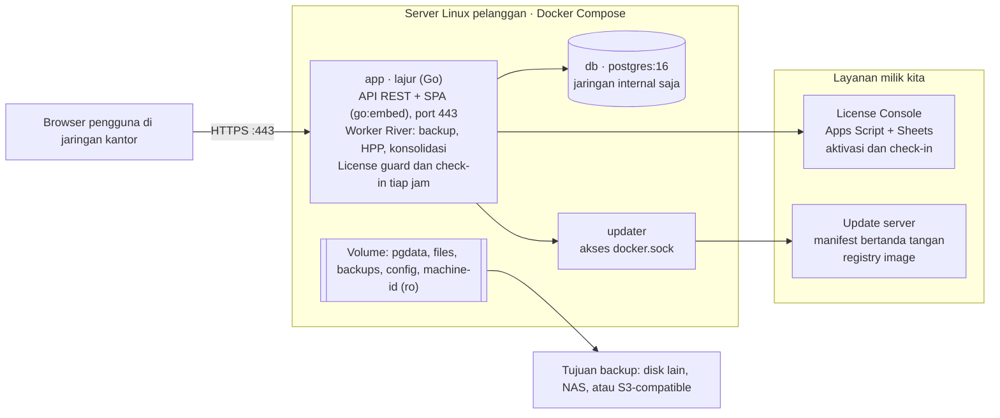
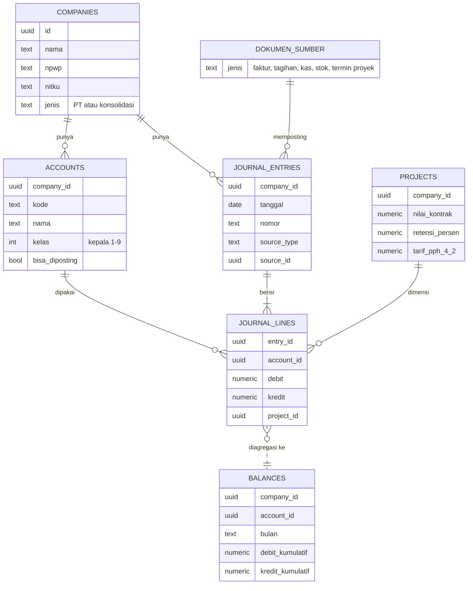
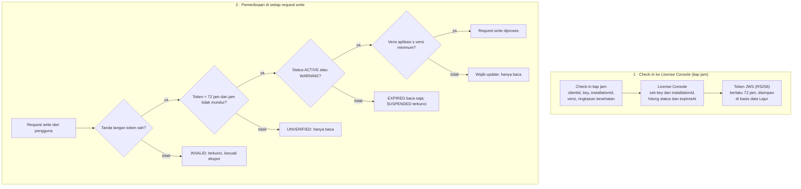
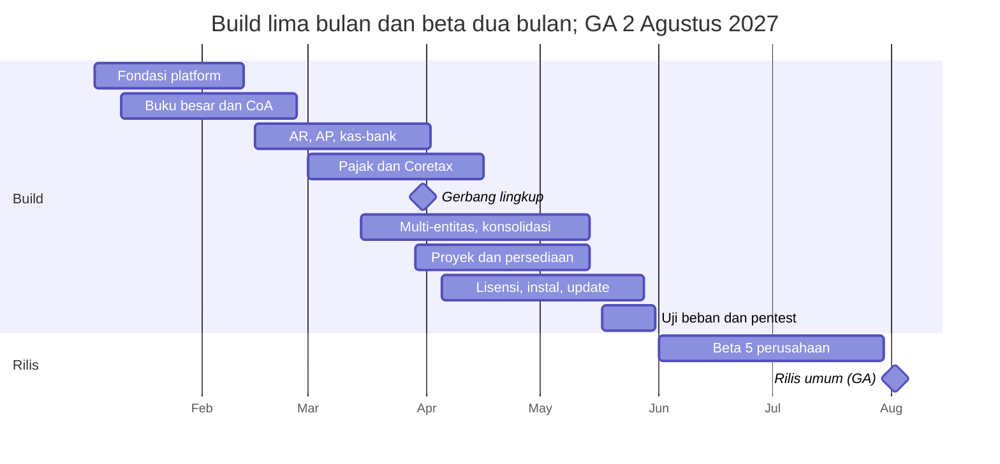

# TDD — Lajur: Desain Teknis Aplikasi Keuangan On-Premise

12 Oktober 2026 · Salinan dari [dokumen TDD di Claude Docs](https://claude.ai/code/artifact/7c231845-b8e7-479f-8f3d-1722cf7da513) · Kebutuhan produk: [PRD.md](PRD.md)

Lajur dibangun sebagai satu binary Go dengan PostgreSQL, dikemas Docker Compose untuk server Linux pelanggan. Desain ini mencakup seluruh kebutuhan P0 di PRD.

## Ringkasan

TDD ini menetapkan cara membangun MVP Lajur, yaitu semua kebutuhan P0 di PRD, oleh tim 5–7 orang dalam lima bulan (Januari–Mei 2027). ID kebutuhan PRD (GL-xx, AR-xx, LIC-xx, dan seterusnya) dirujuk langsung di bagian yang relevan.

**Lingkup teknis MVP**

- Satu instalasi Lajur per grup usaha: banyak PT dalam satu aplikasi, satu basis data, dan satu lisensi.
- Modul: akuntansi inti, penjualan, pembelian, kas-bank manual, pajak dengan ekspor XML Coretax, laporan, proyek, persediaan dasar, multi-entitas dan konsolidasi, platform, serta lisensi.
- Komponen di luar server pelanggan: perluasan License Console pos-app dan update server.

**Di luar lingkup dokumen ini**

- Rincian modul P1 dan P2; desain hanya memastikan modul itu bisa ditambahkan tanpa membongkar yang sudah ada.
- Konfigurasi ZeroTier, yang dibahas setelah aplikasi deploy.
- Desain UI per layar, yang dibuat sebagai prototipe di fase Discovery.

## Keputusan teknis utama

Semua pilihan di bawah mengejar dua hal: satu artefak yang mudah dipasang di server pelanggan, dan angka akuntansi yang tidak mungkin salah karena teknologi. Satu keputusan menyimpang dari PRD: frontend memakai Vite, bukan Next.js, karena aplikasi tidak butuh server-side rendering.

| Area | Keputusan | Alasan |
| --- | --- | --- |
| Backend | Go 1.23+, satu binary | Ringan, mudah didistribusikan, kode sumber tidak ikut terkirim |
| Arsitektur | Modular monolith; antar modul lewat interface Go, bukan HTTP | Tim kecil; faktur, jurnal, dan stok cukup diproses dalam satu transaksi basis data |
| Router HTTP | chi | Ringan dan kompatibel dengan net/http standar |
| Akses data | sqlc + pgx: SQL ditulis eksplisit, kode Go dihasilkan otomatis | Query akuntansi yang rumit lebih jelas sebagai SQL, tetap aman tipe |
| Migrasi | goose, file SQL berversi, dijalankan saat aplikasi start | Updater bisa memigrasi tanpa campur tangan manusia |
| Antrean job | River, antrean job di atas PostgreSQL | Tanpa Redis; job dibuat dalam transaksi yang sama dengan datanya |
| Angka uang | `NUMERIC(19,4)` di basis data, `shopspring/decimal` di Go | Tidak ada floating point di mana pun |
| ID | UUIDv7 yang dibuat di Go | Urut waktu, aman digabung antar PT, tidak membocorkan jumlah data |
| Frontend | React + TypeScript + Vite (SPA), disisipkan ke binary lewat `go:embed` | Satu artefak; server pelanggan tidak perlu Node.js |
| Komponen UI | shadcn/ui, TanStack Query dan Table, react-hook-form + zod, Motion untuk animasi | Tabel dan formulir akuntansi yang padat; animasi halus yang mudah dimatikan |
| Kontrak API | OpenAPI 3.1 sebagai sumber; klien TypeScript dihasilkan otomatis | Frontend dan backend tidak pernah berselisih bentuk data |
| Ekspor | XLSX dengan excelize, PDF dengan maroto | Pustaka Go murni, tanpa Chromium di server |
| Distribusi | Docker Compose berisi app, postgres:16, dan updater | Satu cara pasang di Ubuntu dan Debian |
| Lisensi | Token JWS (RS256) yang ditandatangani License Console | Bisa diverifikasi offline dengan kunci publik; Apps Script mendukung tanda tangan RSA-SHA256 |

## Arsitektur deployment



Container `app` memuat seluruh aplikasi: API, frontend, worker job, dan license guard. `db` hanya bisa dijangkau dari dalam jaringan Docker, sedangkan `updater` terpisah karena butuh hak atas Docker.

Koneksi keluar dari server pelanggan hanya ada empat: check-in lisensi tiap jam, unduhan pembaruan saat admin menekan tombol, email lewat SMTP pelanggan, dan tujuan backup. Coretax dan bank tidak terhubung, sesuai PRD.

## Struktur kode

Semua kode ada di satu monorepo, dan setiap modul bisnis memiliki skema PostgreSQL sendiri. Batas modul dijaga oleh compiler Go dan linter di CI, bukan sekadar kesepakatan tim.

```text
lajur/
├── cmd/lajur/            # perintah: serve, migrate, backup, restore, diag
├── internal/
│   ├── platform/         # db, http, auth, rbac, audit, jobs, license, config, tls
│   ├── ledger/           # mesin buku besar: posting, saldo, periode, penomoran
│   └── modules/
│       ├── core/         # perusahaan, cabang, pengguna, kontak, produk
│       ├── sales/        # AR: faktur, termin, pelunasan, nota kredit
│       ├── purchase/     # AP: tagihan, pembayaran, biaya
│       ├── cash/         # kas, bank, rekonsiliasi
│       ├── inventory/    # stok, HPP rata-rata, stock opname
│       ├── project/      # proyek, RAB, retensi
│       ├── tax/          # kode pajak, PPN, PPh, ekspor Coretax
│       ├── consol/       # intercompany dan konsolidasi
│       └── report/       # laporan keuangan dan dashboard
├── migrations/           # file SQL goose, dikelompokkan per modul
├── api/openapi.yaml      # kontrak API
├── web/                  # React + Vite
├── deploy/               # docker-compose.yml, install.sh, updater
└── test/                 # skenario akuntansi, E2E Playwright
```

**Aturan antar modul**

1. Setiap modul hanya mengekspos satu interface `Service`; isi lainnya ada di folder `internal/` milik modul itu, sehingga modul lain tidak bisa mengimpornya.
2. Hanya paket `ledger` yang boleh menulis ke tabel jurnal; modul lain memanggil `ledger.Post` di dalam transaksi yang sedang berjalan.
3. Modul tidak membaca tabel modul lain secara langsung. Pengecualian: modul `report` membaca tabel `ledger` dalam mode baca saja.
4. Arah dependensi selalu modul → `ledger` → `platform`, tidak pernah sebaliknya; dicek otomatis dengan go-arch-lint di CI.
5. Satu request HTTP = satu transaksi basis data. Transaksi dibuka di handler dan diteruskan lewat `context` ke semua service yang terlibat.

## Model data



Baris jurnal adalah satu-satunya sumber angka; saldo hanya agregat darinya. Tabel `consol.ic_links` (tidak digambar) menghubungkan dua jurnal cerminan antar-PT.

**Konvensi skema**

- Satu skema PostgreSQL per modul: `core`, `ledger`, `sales`, `purchase`, `cash`, `inventory`, `project`, `tax`, `consol`, `platform`.
- Setiap tabel bisnis punya `id` (UUIDv7), `company_id`, `created_at`, `created_by`, dan `version` untuk optimistic locking; dokumen juga punya `status` dan `posted_at`.
- Nominal `NUMERIC(19,4)`, kuantitas `NUMERIC(19,6)`, kurs `NUMERIC(19,8)`.
- Tanggal transaksi bertipe `DATE`; waktu sistem bertipe `TIMESTAMPTZ`.
- Foreign key komposit `(company_id, id)` mencegah data satu PT mengacu ke data PT lain.
- Data bisnis tidak pernah dihapus fisik; data master dinonaktifkan dengan `active = false`.

## Mesin buku besar

Semua angka di Lajur lewat satu fungsi, `ledger.Post`. Fungsi ini memvalidasi, memberi nomor, menulis jurnal, dan memperbarui saldo dalam satu transaksi, sehingga jurnal yang tidak seimbang tidak mungkin tersimpan (GL-02, GL-03).

**Alur posting**

1. Modul menyusun `EntryDraft`: PT, tanggal, dokumen sumber, serta baris debit dan kredit lengkap dengan dimensi (cabang, departemen, proyek).
2. `ledger.Post` memeriksa total debit = kredit, akun aktif dan bukan akun induk, periode masih terbuka untuk modul itu, dan dimensi wajib terisi (mis. proyek untuk akun biaya proyek).
3. Nomor dokumen diambil dari `ledger.sequences` dengan `SELECT … FOR UPDATE`, sehingga nomor tanpa celah per PT, jenis dokumen, cabang, dan tahun (GL-07).
4. `journal_entries` dan `journal_lines` disimpan; constraint trigger `DEFERRABLE` memastikan Σ debit = Σ kredit saat commit.
5. `ledger.balances` (saldo per PT × akun × bulan × jenis jurnal) diperbarui oleh trigger pada `journal_lines`, sehingga tidak mungkin terlupa. Dimensi (proyek, cabang) ditambahkan bersama modul yang memakainya.
6. Audit log dan job lanjutan (River) ditulis di transaksi yang sama.

**Invariant yang dijaga basis data, bukan hanya aplikasi**

- Σ debit = Σ kredit per jurnal, dicek trigger saat commit.
- Baris jurnal tidak bisa diubah atau dihapus: role basis data aplikasi tidak punya hak `UPDATE`/`DELETE` atas `journal_lines`, ditambah trigger penolak.
- Setiap baris jurnal ber-`company_id` sama dengan jurnalnya, dijaga foreign key komposit.
- Saldo di `balances` selalu sama dengan jumlah baris jurnal; job harian mencocokkannya dan memberi alert bila berbeda.

**Koreksi dan kunci periode**

- Dokumen yang sudah diposting tidak pernah diedit. Koreksi = void (jurnal pembalik bertanggal void, kolom `reversal_of`) lalu dokumen baru; hanya Manager dan Pemilik yang boleh void.
- `ledger.periods` menyimpan status buka/tutup per PT dan bulan (GL-05); kunci per modul ditambahkan bersama modul penjualan, pembelian, dan persediaan. Posting ke periode tertutup ditolak, kecuali Manager membukanya dengan alasan yang tercatat di audit log. Baris periode dikunci `FOR SHARE` saat posting, sehingga periode tidak bisa ditutup di tengah posting yang sedang berjalan.

**Kode akun dan jurnal penyesuaian (GL-01, GL-08, GL-11, GL-12)**

- Kode akun divalidasi saat dibuat: angka kepala 1–9 menentukan `class`, dan dari kelas itu diturunkan saldo normal, letak di laporan, serta apakah akun ditutup ke laba ditahan di akhir tahun.
- Kolom `journal_entries.kind` membedakan jurnal `umum`, `penyesuaian`, `pembalik`, dan `penutup`. Jurnal penyesuaian punya seri nomor sendiri, `JP/{tahun}/{bulan}/{nomor}`.
- Jurnal penyesuaian bertanda `auto_reverse` langsung membuat jurnal pembalik (seri JB) bertanggal hari pertama bulan berikutnya, di transaksi yang sama dan tertaut lewat `reversal_of`. Void jurnal penyesuaian ikut membatalkan pembaliknya, pada tanggal yang tidak lebih awal dari tanggal pembalik itu.
- Template penyesuaian berulang (mis. penyusutan, amortisasi sewa dibayar di muka) disimpan di `ledger.adjustment_templates`.
- Status periode di `ledger.periods`: `open` → `adjusting` (hanya jurnal penyesuaian yang boleh masuk) → `locked` (dikunci Manager).
- `ledger.balances` dipisah per `kind`, sehingga neraca lajur (`GET /ledger/worksheet`) langsung punya kolom sebelum penyesuaian, penyesuaian, dan sesudahnya tanpa menghitung ulang baris jurnal.
- Staf akuntansi memegang izin `ledger.adjustment.create` dan `ledger.adjustment.post`; void tetap hanya untuk Manager dan Pemilik.

**Contoh aturan posting**

| Dokumen | Debit | Kredit |
| --- | --- | --- |
| Faktur penjualan | Piutang usaha | Pendapatan; PPN keluaran |
| Faktur termin konstruksi (AR-08) | Piutang usaha; uang muka pelanggan (potongan DP); piutang retensi | Pendapatan proyek; PPN keluaran |
| Pelunasan dengan PPh 23 dipotong | Kas/bank; PPh 23 dibayar di muka | Piutang usaha |
| Pelunasan dengan PPh final 4(2) | Kas/bank; beban PPh final | Piutang usaha |
| Tagihan pemasok | Persediaan atau beban; PPN masukan | Utang usaha; utang PPh 23 atau 4(2) |
| Penjualan barang persediaan | HPP | Persediaan |
| Rekap penjualan harian retail (IND-07) | Kas/bank | Penjualan; PPN keluaran digunggung |

Aturan posting disimpan sebagai kode Go per jenis dokumen, dengan pemetaan akun yang dapat diatur per PT (akun default dari template CoA industri). Saat ini akun sistem (piutang usaha, PPN keluaran/masukan, PPh 23 dibayar di muka, utang PPh, beban PPh final) dicari dari kode defaultnya yang sama di semua template; layar pemetaan per PT menyusul. Jurnal dari dokumen modul memakai nomor dokumennya sendiri (mis. FJ/2026/10/0001), sehingga buku besar dan dokumen sumber mudah dicocokkan.

## Desain modul bisnis

Setiap dokumen bisnis mengikuti siklus status yang sama: draft → posted → (lunas sebagian atau lunas) → void. Jurnal hanya dibuat saat posted, lewat `ledger.Post`.

**Penjualan (AR)**

- `sales.invoices` dan `sales.invoice_lines`; pelunasan di `sales.receipts`, dialokasikan ke banyak faktur lewat `receipt_allocations`. Potongan PPh 23 atau PPh final 4(2) dicatat per alokasi (AR-04). Faktur dikunci `FOR UPDATE` saat dialokasikan, sehingga dua pelunasan bersamaan tidak bisa melebihi sisa faktur.
- PPN dihitung per baris: PPN = DPP × rasio DPP × tarif, dibulatkan ke bawah ke rupiah; qty × harga dan diskon dibulatkan ke rupiah terdekat. Perhitungan yang sama dipakai di server (Go) dan di formulir (TypeScript, BigInt).
- Faktur termin (AR-08) dihitung modul proyek: nilai termin = % progres × nilai kontrak − termin sebelumnya; potongan uang muka proporsional; retensi = % retensi × nilai termin.
- Umur piutang dihitung dari faktur yang belum lunas per tanggal laporan, bukan dari kolom saldo yang disimpan.

**Pembelian (AP)**

- Strukturnya mencerminkan AR: `purchase.bills`, `purchase.payments`, `payment_allocations`.
- PPh yang dipotong dicatat sebagai utang PPh saat tagihan diposting, sehingga yang dibayar ke pemasok adalah total dikurangi PPh; draf bukti potong di modul pajak menyusul (TAX-08). Tagihan dengan pemasok dan nomor faktur pemasok yang sama memunculkan peringatan, bukan ditolak.
- PT non-PKP tetap membayar PPN ke pemasok PKP, tetapi PPN itu tidak bisa dikreditkan: saat posting, PPN dibebankan ke akun baris tagihan, bukan ke PPN masukan.

**Kas dan bank (input manual)**

- Penerimaan, pengeluaran, dan transfer disimpan di `cash.transactions`.
- Rekonsiliasi: `cash.reconciliations` menyimpan saldo rekening koran per bulan; `cash.recon_items` menandai baris jurnal kas yang sudah dicentang. Rekonsiliasi hanya bisa ditutup bila selisihnya nol (CB-04).

**Persediaan dasar (HPP rata-rata tertimbang)**

Setiap penerimaan barang menghitung ulang biaya rata-rata per PT dan produk; setiap pengeluaran membukukan HPP dengan biaya rata-rata saat itu.

```latex
\bar{c}_{baru} = \frac{q_{lama}\,\bar{c}_{lama} + q_{masuk}\,c_{masuk}}{q_{lama} + q_{masuk}}
```

- Transaksi bertanggal mundur memicu job yang menghitung ulang HPP sejak tanggal itu dan membuat jurnal penyesuaian; tanggal sebelum periode persediaan yang ditutup ditolak.
- Stock opname menyimpan hitungan fisik; selisihnya menjadi jurnal penyesuaian persediaan (INV-04).

**Proyek**

- `project.projects` menyimpan pemberi kerja, nilai kontrak, persen uang muka, persen retensi, tarif PPh final 4(2), dan status (IND-01).
- `project.budget_lines` menyimpan RAB per pos biaya. Biaya aktual = baris jurnal ber-`project_id` pada akun biaya, sehingga laba per proyek dan biaya vs RAB (IND-03) dibaca dari `ledger.balances`.

**Pajak dan ekspor Coretax**

- `tax.tax_codes` bertanggal berlaku: tarif, rasio DPP (mis. 11/12), dan akun. Perhitungan ada di fungsi murni `tax.Calculate(lines, tanggal)` sehingga mudah diuji.
- Eksportir XML Coretax disimpan per versi template (saat ini `coretax-faktur-keluaran/v1`, struktur `TaxInvoiceBulk`) dengan struct `encoding/xml` dan tes golden. Versi v1 disusun dari struktur impor massal yang dipakai luas, belum dari TaxInvoice.xsd resmi; sebelum dipakai pelanggan, uji dengan file contoh resmi DJP dan satu unggahan percobaan di Coretax.
- Status faktur pajak keluaran disimpan modul pajak (`tax.output_invoices`): siap → diekspor → terbit (nomor faktur tercatat) → dibatalkan atau diganti. Data fakturnya dibaca lewat service penjualan. Kode transaksi default 04 bila DPP nilai lain dipakai, selain itu 01. Faktur penjualan yang faktur pajaknya terbit tidak bisa di-void sampai faktur pajaknya ditandai dibatalkan (pengunci dipasang lewat hook di service penjualan, tanpa dependensi melingkar).
- Rekap PPN per masa dihitung dari faktur dan tagihan yang diposting; lebih bayar otomatis dikompensasikan ke masa berikutnya. Restitusi, faktur pajak masukan (TAX-07), bukti potong (TAX-08), dan PPN digunggung retail (TAX-12) belum dibangun.
- Nomor faktur yang terbit dicatat kembali dengan mengimpor file unduhan Coretax, dicocokkan lewat nomor referensi faktur Lajur (TAX-03).
- Rekap PPN digunggung untuk retail (TAX-12) dihasilkan per masa dari rekap penjualan harian.

## Multi-entitas, transaksi antar-perusahaan, dan konsolidasi

Semua PT dalam grup berbagi satu basis data, tetapi setiap baris data bisnis terikat pada satu `company_id`. Konsolidasi MVP dibatasi untuk PT berkepemilikan 100% dengan mata uang rupiah; kepemilikan sebagian dan translasi valas menyusul.

**Multi-entitas (ME-02)**

- Hak akses disimpan per PT di `core.user_company_roles`, jadi seseorang bisa menjadi Manager di PT A dan Staf akuntansi di PT B.
- Sesi menyimpan PT aktif; berpindah PT tidak perlu login ulang. Setiap query wajib menyaring `company_id`, dan row-level security PostgreSQL menjadi lapisan pengaman kedua.
- Setiap PT punya bagan akun sendiri, dipetakan ke bagan akun grup lewat `consol.account_map`.

**Transaksi antar-perusahaan (ME-03)**

- Kontak yang mewakili PT lain dalam grup ditandai `linked_company_id`.
- Saat dokumen ke kontak itu diposting, Lajur membuat dokumen dan jurnal cerminan di PT lawan dalam transaksi yang sama. Contohnya, faktur PT A ke PT B menghasilkan tagihan di PT B; keduanya terhubung lewat `ic_link_id`.
- Void di satu sisi otomatis mem-void sisi lainnya, sehingga saldo antar-PT tidak pernah timpang.

**Konsolidasi (ME-04)**

1. Pengguna memilih grup, periode, dan PT yang dikonsolidasi.
2. Lajur mengambil neraca saldo tiap PT dari `ledger.balances`.
3. Saldo dipetakan ke bagan akun grup.
4. Saldo antar-PT (piutang–utang, pendapatan–beban) dieliminasi otomatis berdasarkan `ic_link_id`; selisih yang tidak bisa dieliminasi ditampilkan sebagai daftar yang harus dibereskan.
5. Jurnal eliminasi disimpan di entitas khusus “Konsolidasi”, sehingga buku setiap PT tetap bersih.
6. Laporan konsolidasi = jumlah semua PT + jurnal eliminasi, dan bisa ditelusuri sampai dokumen di tiap PT.

## API

Frontend hanya bicara dengan backend lewat REST JSON di `/api/v1`, dengan kontrak di `api/openapi.yaml`. Klien TypeScript dihasilkan dari kontrak itu, jadi perubahan API yang merusak frontend langsung gagal di CI.

**Konvensi**

- PT aktif dikirim lewat header `X-Company-Id` dan selalu dicek terhadap hak akses sesi.
- Angka uang dikirim sebagai string desimal (`"1250000.0000"`), tidak pernah sebagai angka JSON.
- Error memakai format problem+json (RFC 9457) dengan kode bisnis yang stabil, mis. `ledger.unbalanced`, `period.closed`, `license.expired`.
- POST untuk dokumen keuangan wajib membawa `Idempotency-Key`; kunci disimpan 24 jam, jadi klik ganda tidak membuat dua faktur.
- Draf yang diubah memakai `If-Match` berisi versi dokumen, sehingga dua orang yang mengedit bersamaan tidak saling menimpa.
- Daftar memakai pagination kursor (`cursor`, `limit`).

**Endpoint utama**

| Kelompok | Contoh endpoint |
| --- | --- |
| Autentikasi | `POST /auth/login`, `POST /auth/totp`, `POST /auth/logout` |
| PT dan sesi | `GET /companies`, `POST /session/company` |
| Buku besar | `POST /journals`, `POST /adjustments`, `POST /journals/{id}/void`, `GET /ledger/worksheet`, `GET /ledger/accounts/{id}/ledger`, `POST /ledger/periods/{bulan}/status` |
| Penjualan | `POST /sales/invoices`, `POST /sales/invoices/{id}/post`, `POST /sales/receipts` |
| Pembelian | `POST /purchase/bills`, `POST /purchase/payments` |
| Kas dan bank | `POST /cash/transactions`, `PUT /cash/reconciliations/{id}` |
| Persediaan | `POST /inventory/adjustments`, `POST /inventory/stock-counts` |
| Proyek | `POST /projects`, `POST /projects/{id}/progress-claims` |
| Pajak | `GET /tax/coretax/faktur-keluaran?period=2027-08`, `POST /tax/coretax/import-nomor` |
| Konsolidasi | `POST /consol/runs`, `GET /consol/runs/{id}/report` |
| Laporan | `GET /reports/balance-sheet`, `GET /reports/profit-loss?consolidated=true` |
| Sistem | `GET /system/license`, `POST /system/license/recheck`, `POST /system/updates/apply`, `GET /system/backups` |

## Autentikasi dan otorisasi

Izin dinyatakan sebagai `modul.objek.aksi` (mis. `sales.invoice.create`), dikelompokkan menjadi peran, lalu diberikan per PT. Setiap route wajib mendeklarasikan izin dan mode lisensinya; tes otomatis gagal bila ada route tanpa keduanya, seperti di pos-app.

**Autentikasi**

- Kata sandi di-hash dengan Argon2id. 2FA (TOTP) wajib untuk Pemilik, Manager, dan Admin pelanggan; opsional untuk peran lain.
- Sesi disimpan di server (`platform.sessions`), dengan cookie HttpOnly, Secure, dan SameSite=Strict. Sesi berakhir setelah 30 menit tidak aktif atau 12 jam sejak login.
- Lima kali salah kata sandi mengunci akun selama 15 menit. Menonaktifkan pengguna langsung mematikan semua sesinya.

**Matriks izin enam persona bawaan**

| Aksi | Pemilik | Manager | Staf akuntansi | Staf pajak | Auditor | Admin pelanggan |
| --- | --- | --- | --- | --- | --- | --- |
| Lihat transaksi dan laporan | Ya | Ya | Ya | Pajak saja | Ya | — |
| Buat transaksi | Ya | Ya | Ya | Dokumen pajak | — | — |
| Input dan posting jurnal penyesuaian | Ya | Ya | Ya | — | — | — |
| Ubah, hapus, atau void transaksi | Ya | Ya | — | — | — | — |
| Approval dan aturan approval | Ya | Ya | — | — | — | — |
| Kunci dan buka periode | Ya | Ya | — | — | — | — |
| Ekspor XML Coretax dan rekap SPT | Ya | Ya | — | Ya | — | — |
| Lihat audit trail | Ya | Ya | — | — | Ya | — |
| Ekspor data | Ya | Ya | Ya | Ya | Ya | — |
| Kelola pengguna dan persona kustom | Ya | Ya | — | — | — | Ya |
| Backup, pembaruan, status lisensi | Ya | Ya | — | — | — | Ya |

Persona kustom (PLT-12) dibuat Admin pelanggan dengan memilih izin dari katalog yang sama. Satu-satunya izin yang tidak pernah bisa diberikan adalah mengubah baris jurnal yang sudah diposting, karena tidak ada di katalog.

## Desain antarmuka dan animasi

Lajur harus terasa ringan dan hidup, tapi tetap serius untuk urusan uang. Caranya: animasi pendek yang menjelaskan perubahan, bukan hiasan. Animasi interaksi ≤ 250 ms, animasi dashboard ≤ 600 ms dan hanya saat halaman dibuka, dan tidak satu pun memperlambat entri data.

**Arah visual**

- Bersih dan lapang: latar netral, satu warna aksen merek, sudut membulat 8–12 px, bayangan halus hanya untuk elemen yang mengambang (dialog, menu, drawer).
- Tipografi Plus Jakarta Sans (karya foundry Indonesia, Tokotype) dengan angka tabular (`tabular-nums`), sehingga kolom nominal selalu rata kanan dengan rapi.
- Mode terang dan gelap sejak MVP.
- Tabel transaksi padat (baris 36–40 px) dengan opsi tampilan lega; formulir diberi ruang lebih.
- Warna status konsisten di seluruh aplikasi: hijau untuk lunas atau seimbang, kuning untuk mendekati jatuh tempo, merah untuk lewat jatuh tempo atau selisih.
- Ikon Lucide, ilustrasi halaman kosong yang sederhana, tanpa maskot.
- Font, ikon, dan ilustrasi dibundel di dalam binary; tidak ada yang dimuat dari CDN, karena server pelanggan bisa saja offline.

**Di mana animasi dipakai**

| Momen | Animasi | Durasi |
| --- | --- | --- |
| Pindah halaman | Fade dan geser 8 px | 200 ms |
| Buka dialog atau drawer detail | Skala 0,98 → 1 dengan fade; drawer meluncur dari kanan | 200–250 ms |
| Data sedang dimuat | Skeleton dengan kilau halus, bukan spinner | Sampai data tiba |
| Angka KPI di dashboard | Hitung naik dari nilai sebelumnya | 600 ms |
| Grafik di dashboard | Garis dan batang tumbuh dari sumbu | 400 ms |
| Simpan atau posting berhasil | Toast meluncur dengan ikon centang; baris baru disorot lalu memudar | 200 ms, sorotan 1,5 detik |
| Jurnal menjadi seimbang | Indikator selisih berubah ke hijau dengan transisi warna | 150 ms |
| Validasi gagal | Field bergetar halus dan pesan muncul di bawahnya | 200 ms |
| Hover dan fokus | Transisi warna dan sedikit elevasi | 120 ms |
| Berpindah PT aktif | Nama PT di header berganti dengan crossfade | 200 ms |

**Aturan animasi**

- Animasi tidak pernah menghalangi input: pengguna tetap bisa mengetik dan mengklik selama transisi, dan entri cepat dengan keyboard tidak menunggu animasi selesai.
- Angka di tabel dan laporan tidak pernah dianimasikan; hanya KPI dashboard yang boleh.
- Hanya `transform` dan `opacity` yang dianimasikan, supaya tetap mulus di PC kantor yang sudah tua.
- Kurva gerak: `cubic-bezier(0.2, 0, 0, 1)` untuk elemen masuk; elemen keluar dibuat lebih cepat.
- Sistem menghormati `prefers-reduced-motion`, dan setiap pengguna bisa memilih “Kurangi animasi” di profilnya.
- Pustaka: Motion untuk transisi komponen, transisi CSS untuk hover dan fokus, dan Recharts untuk grafik.

## Sistem lisensi



Request baca tetap dilayani dalam kondisi EXPIRED dan UNVERIFIED, dan ekspor data tidak pernah dikunci, sesuai aturan PRD.

**Protokol dengan License Console**

- `POST /activate` sekali saat setup wizard: console mencocokkan SHA-256 dari license key lalu mengikat `installationId` (LIC-02).
- `POST /checkin` tiap jam lewat job River; tombol “Cek Ulang Lisensi” memaksa check-in, maksimal sekali per 30 detik. Perpanjangan atau suspend di console berlaku paling lambat 1 jam.
- `installationId` = SHA-256 dari UUID instalasi dan `/etc/machine-id` host.
- Isi token: `clientId`, `product`, `status`, `expiresAt`, `timezone`, `minVersion`, `installationId`, `iat` (waktu server console), dan `exp` = `iat` + 72 jam.
- Kunci privat RSA disimpan di Script Properties console. Binary Lajur memuat dua kunci publik (aktif dan berikutnya), sehingga kunci bisa dirotasi tanpa memutus pelanggan.

**Deteksi jam mundur**

Lajur menyimpan waktu tertinggi yang pernah dilihat, dari `iat` token maupun waktu transaksi terakhir. Bila jam server lebih dari 10 menit di belakang nilai itu, status menjadi UNVERIFIED sampai check-in berikutnya berhasil.

**Perluasan License Console pos-app (LIC-11)**

- Kolom baru di sheet lisensi: `product`, `installationId`, `minVersion`, ringkasan kesehatan terakhir.
- Endpoint baru `activate` dan `checkin` untuk produk `lajur`; endpoint lama pos-app tidak diubah, sehingga client pos-app yang sudah berjalan tidak terdampak.
- Fungsi penanda tangan JWS memakai `Utilities.computeRsaSha256Signature` di Apps Script.

## Instalasi, pembaruan, dan backup

Satu skrip menyiapkan seluruh instalasi; setelah itu pembaruan dan backup dijalankan dari UI admin tanpa perlu SSH ke server.

```yaml
# /opt/lajur/docker-compose.yml (ringkas)
services:
  app:
    image: <registry>/lajur:1.0.0
    ports: ["443:8443"]
    volumes:
      - config:/etc/lajur
      - files:/var/lib/lajur/files
      - backups:/var/lib/lajur/backups
      - /etc/machine-id:/host/machine-id:ro
    depends_on: [db]
  db:
    image: postgres:16          # tidak membuka port ke host
    volumes: [pgdata:/var/lib/postgresql/data]
  updater:
    image: <registry>/lajur-updater:1.0.0
    volumes:
      - /var/run/docker.sock:/var/run/docker.sock
      - /opt/lajur:/opt/lajur
```

**Skrip instal (PLT-01)**

1. Memeriksa OS (Ubuntu 22.04+ atau Debian 12+), RAM, dan disk; memasang Docker bila belum ada.
2. Membuat CA lokal dan sertifikat HTTPS untuk hostname dan IP LAN server.
3. Membuat kata sandi PostgreSQL acak dan kunci enkripsi aplikasi, disimpan di `/opt/lajur/.env` dengan izin 600.
4. Menjalankan `docker compose up -d`; aplikasi memigrasi basis data lalu membuka setup wizard.
5. Menampilkan alamat aplikasi dan file sertifikat CA untuk dipasang di PC pengguna.

**Pembaruan (PLT-10)**

- Update server menyajikan manifest rilis bertanda tangan: versi, digest image, catatan rilis, dan versi minimum.
- Saat admin menekan “Perbarui”, updater memverifikasi tanda tangan image (cosign), membuat backup penuh, menarik image baru, menjalankan ulang container, lalu mengecek health. Bila gagal, updater kembali ke image lama dan memulihkan backup.
- Unduhan pembaruan hanya dilayani untuk token lisensi yang aktif.
- Migrasi ditulis dengan pola expand-then-contract, sehingga versi lama tetap bisa berjalan di atas skema versi baru selama satu rilis.

**Backup (PLT-09)**

- Job harian pukul 01.00: `pg_dump` format custom ditambah arsip lampiran, dienkripsi dengan age, lalu disalin ke folder lokal, NAS yang di-mount, atau penyimpanan S3-compatible. Disimpan 30 salinan terakhir.
- Kunci dekripsi backup diserahkan ke Pemilik saat instalasi; tanpa kunci itu, file backup tidak bisa dibaca siapa pun.
- Backup gagal atau tidak berjalan lebih dari 48 jam memunculkan banner di aplikasi dan email ke admin.
- Setiap minggu backup terbaru dipulihkan otomatis ke basis data sementara untuk membuktikan file itu bisa dipakai. Pemulihan manual lewat `lajur restore <file>`.

## Keamanan dan audit trail

Audit trail dibuat agar perubahan atau penghapusan baris lama bisa dibuktikan, bukan sekadar dicatat. Lapisan keamanan lain mengikuti satu prinsip: hanya port 443 yang terbuka, dan semua rahasia tinggal di server pelanggan.

**Audit trail (PLT-06)**

- `platform.audit_log` menyimpan waktu, pengguna, PT, aksi, objek, nilai sebelum dan sesudah (JSON), dan alamat IP. Penulisan terjadi di transaksi yang sama dengan perubahan datanya.
- Setiap baris menyimpan hash SHA-256 dari baris sebelumnya (hash chain). Job harian dan halaman audit trail memverifikasi rantai ini, sehingga penghapusan atau pengubahan diam-diam langsung ketahuan.
- Role basis data aplikasi tidak punya hak `UPDATE`/`DELETE` atas tabel ini. Tabel dipartisi per tahun dan disimpan minimal 10 tahun.

**Kontrol keamanan lain**

- Kolom sensitif (rekening bank, NIK) dan license key dienkripsi AES-256-GCM dengan kunci aplikasi di `/opt/lajur/.env` (izin 600).
- PostgreSQL tidak membuka port ke host. Container berjalan sebagai non-root dengan filesystem read-only, kecuali volume data.
- Updater memegang akses `docker.sock`, jadi ia hanya menerima perintah dari container app lewat jaringan internal bertoken, dan hanya menjalankan image yang ditandatangani kunci kita.
- Semua total dan saldo dihitung ulang di server. Nilai ekspor CSV/XLSX yang diawali `= + - @` disimpan sebagai teks untuk mencegah formula injection.
- CI menjalankan govulncheck dan audit dependensi npm, dan setiap rilis disertai SBOM. Pentest eksternal dilakukan sebelum GA.

## Kinerja dan observabilitas

Target PRD (API p95 < 300 ms, laporan ≤ 5 detik untuk 1 juta baris jurnal, 50 pengguna bersamaan) dicapai dengan membaca saldo agregat, bukan menjumlah jutaan baris setiap kali laporan dibuka.

**Kinerja**

- Neraca, laba rugi, dan laba per proyek membaca `ledger.balances` yang sudah teragregasi per bulan; baris jurnal hanya dibaca saat drill-down.
- Indeks utama: `journal_lines (company_id, account_id, entry_date)`, `journal_lines (company_id, project_id)`, dan `(company_id, status, due_date)` di tabel dokumen.
- Pekerjaan berat (konsolidasi, hitung ulang HPP, ekspor besar) berjalan sebagai job River; pengguna mendapat notifikasi saat selesai.
- Konfigurasi PostgreSQL bawaan disetel untuk server 8 GB RAM, misalnya `shared_buffers` 2 GB.
- Sebelum beta, uji beban dengan data sintetis 10 PT × 1 juta baris jurnal pada server spesifikasi minimum.

**Observabilitas dan dukungan**

- Log terstruktur JSON (slog) disimpan di volume dengan rotasi 14 hari.
- `/healthz` memeriksa aplikasi, basis data, ruang disk, status lisensi, dan umur backup; dipakai updater dan halaman status admin.
- Tombol “Unduh paket diagnosis” di UI admin mengumpulkan log 7 hari, versi, status lisensi, ruang disk, dan hasil cek integritas, tanpa data transaksi, untuk dikirim ke owner.
- Check-in lisensi tiap jam ikut membawa ringkasan teknis (versi, umur backup, sisa disk) tanpa data keuangan, sehingga License Console bisa menandai server yang bermasalah sebelum pelanggan menelepon.

## Strategi pengujian

Logika akuntansi dan pajak dibangun test-first: skenario dan hasil jurnal yang diharapkan ditulis bersama QA berlatar akuntansi sebelum kodenya, karena kesalahan angka adalah risiko terbesar di PRD. Paket `ledger`, `tax`, `inventory`, dan `consol` wajib cakupan tes ≥ 85%.

| Lapisan | Yang diuji | Alat | Kapan |
| --- | --- | --- | --- |
| Unit | Perhitungan pajak, HPP rata-rata, termin dan retensi, aturan posting | `go test`, table-driven | Setiap commit |
| Properti | Invariant buku besar: debit = kredit, saldo = jumlah baris, void mengembalikan saldo | rapid (property-based) | Setiap commit |
| Skenario akuntansi | Rangkaian dokumen nyata per industri dan grup → jurnal dan laporan yang diharapkan | Golden file YAML | Setiap commit |
| Integrasi | Query sqlc, trigger, row-level security, migrasi | testcontainers-go dengan PostgreSQL 16 | Setiap commit |
| Ekspor Coretax | XML hasil ekspor vs file contoh DJP per versi template | Golden file | Setiap commit dan setiap ada template baru |
| Route dan izin | Semua route punya izin dan mode lisensi; Staf akuntansi tidak bisa mengubah atau menghapus | Tes enumerasi router | Setiap commit |
| Lisensi | Expired, suspended, offline 72 jam, jam dimundurkan, token palsu | Jam tiruan + License Console tiruan | Setiap commit |
| Pembaruan | Upgrade dari rilis sebelumnya dengan data contoh, termasuk rollback | Docker Compose di CI | Setiap rilis |
| End-to-end | Setup wizard, faktur → pelunasan → laporan, konsolidasi grup | Playwright | Setiap malam |
| Beban | 10 PT × 1 juta baris jurnal pada spesifikasi minimum | k6 | Sebelum beta dan GA |

## CI/CD dan lingkungan pengembangan

Setiap rilis lahir dari tag git, dibangun dan ditandatangani di CI, lalu diterbitkan ke kanal `beta` atau `stable` di update server. Tidak ada image yang dibangun di laptop.

**Lingkungan**

| Lingkungan | Isi | Dipakai untuk |
| --- | --- | --- |
| Lokal | `make dev`: PostgreSQL di Docker, backend dengan hot reload, Vite dev server, data contoh grup 3 PT (jasa, konstruksi, retail) | Pengembangan harian |
| Staging | VM Ubuntu yang dipasang persis seperti server pelanggan, data sintetis | Uji pembaruan, uji beban, demo |
| Beta | Server 5 pelanggan beta, kanal `beta` | Juni–Juli 2027 |
| Produksi | Server pelanggan, kanal `stable` | Sejak GA |

Seperti pos-app, lisensi memakai provider `LOCAL` untuk pengembangan dan `REMOTE` untuk produksi. Build rilis menolak provider `LOCAL` lewat build tag.

**Pipeline**

- Setiap pull request: golangci-lint, go-arch-lint, semua tes Go (unit, properti, skenario, integrasi), tsc + eslint + vitest, cek klien OpenAPI tidak berubah tanpa disengaja, dan govulncheck. Merge butuh CI hijau dan satu reviewer.
- Setiap tag rilis: build image `linux/amd64`, tanda tangan cosign, push ke registry privat, SBOM, lalu manifest rilis bertanda tangan diterbitkan ke kanal yang dipilih.
- Setiap malam: Playwright end-to-end dan uji pembaruan dari rilis sebelumnya di staging.

## Rencana implementasi



Urutan mengikuti dependensi: fondasi dan buku besar lebih dulu karena semua modul memposting lewat `ledger.Post`. Lisensi, installer, dan updater dikerjakan paralel mulai April supaya siap sebelum beta.

Di gerbang 31 Maret, bila buku besar, AR/AP, dan pajak belum selesai, persediaan dasar dan perbandingan biaya vs RAB digeser ke Fase 2, sesuai mitigasi di PRD.

## Risiko teknis dan pertanyaan terbuka

Risiko teknis terbesar adalah dua komponen yang tidak sepenuhnya kita kendalikan: License Console di Apps Script dan server milik pelanggan.

| Risiko | Dampak | Mitigasi |
| --- | --- | --- |
| Kuota atau gangguan Apps Script untuk License Console | Check-in lambat atau gagal | Token berlaku 72 jam sehingga gangguan singkat tidak terasa; uji beban; jalur pindah ke license service Go sendiri |
| Updater memegang akses `docker.sock` | Bila dibobol, server pelanggan bisa diambil alih | Hanya menerima perintah internal bertoken, hanya menjalankan image bertanda tangan, tidak membuka port |
| Hitung ulang HPP saat ada transaksi mundur tanggal | Lambat pada data besar; jurnal penyesuaian membingungkan | Dibatasi kunci periode persediaan, dijalankan sebagai job, disertai laporan perubahan HPP |
| PT dalam grup memakai bagan akun berbeda | Pemetaan salah membuat laporan grup salah | Pemetaan wajib lengkap sebelum konsolidasi dijalankan; daftar selisih eliminasi |
| Template Coretax berubah | Ekspor ditolak DJP | Eksportir berversi dengan golden test; rilis cepat lewat kanal `stable` |
| Sertifikat CA lokal belum dipercaya browser | Pengguna melihat peringatan keamanan | Pemasangan CA di PC pengguna jadi bagian instalasi, dengan panduan Windows dan macOS |
| Sebelas modul P0 untuk tim 5–7 orang | GA mundur | Urutan kerja mengikuti rencana implementasi; lingkup dipangkas di gerbang akhir Maret bila tertinggal |

**Pertanyaan terbuka**

- [ ] Di mana registry container dan update server di-hosting (mis. GitHub Container Registry dan object storage)?
- [ ] Apakah konsolidasi perlu mendukung kepemilikan sebagian (kepentingan nonpengendali) sejak MVP?
- [ ] Siapa yang menyimpan cadangan kunci dekripsi backup bila Pemilik kehilangan kuncinya?
- [ ] Apakah Staf akuntansi boleh mengubah draf miliknya sendiri yang belum diposting? Keputusan sementara: faktur dan tagihan draf boleh diubah dan dihapus oleh pembuatnya, serta oleh Manager dan Pemilik; jurnal manual tetap langsung diposting saat disimpan.
- [ ] Apakah PRD diperbarui agar frontend memakai Vite, bukan Next.js?
